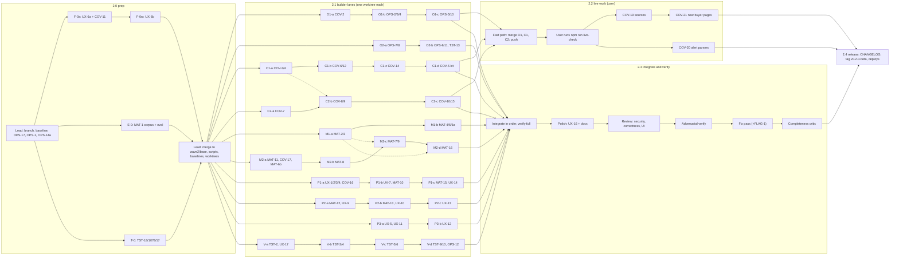

# Wave 2 — v2: more bids, fewer misses, beta-ready

**Goal.** Wave 2 delivers the v2 release in docs/ROADMAP.md and closes every open item from v1, docs/PLAN.md (Phases 4, 5 and 6) and docs/NOTES-2026-11-21.md. It has four parts:
- **More bids.** Lgbids reads more buyers. Each page reader is checked against the live site and gets a regression fixture. Alert e-mails are read reliably, including CanadaBuys and bids&tenders. Nothing that arrives is lost silently.
- **Fewer misses.** Scoring is measured on a labelled corpus before and after every rule change. Duplicates, addenda, extensions and awards are tracked across a bid's whole life. Beta users can say "Not relevant" or "Missed this one", and a tuning report turns that into evidence.
- **Beta-ready.** Security holes found by the scouts are closed: DNS rebinding, robots.txt being skipped on redirects, SSRF, the proxy-trust lockout bypass, and mail credentials sent without TLS. The Docker image starts and is checked in CI. The UI is verified by committed browser tests. The release is tagged `v0.2.0-beta` and deployed.
- **Budget.** All of this runs as a lean multi-agent workflow with strict file ownership and budget guards. v1 used about 858k subagent tokens against a 150k cap, so this wave must stay inside its budget.

Everything below traces to the five scout reports (Coverage `COV`, Matching `MAT`, Product/UX `UX`, Ops `OPS`, Tests `TST`), CLAUDE.md, docs/ROADMAP.md and docs/PLAN.md. Scout task ids are kept wherever a task survived. Merged, split and deferred tasks are listed in §6.0 and §11.

---

## 1. Contents
1. Contents · 2. Exit criteria · 3. Starting point · 4. Coverage matrix · 5. Decisions and user inputs · 6. Workstreams and tasks · 7. Wave structure and sequencing · 8. Workflow design · 9. Verification pyramid · 10. Risks · 11. Deferred to v3/v4 · 12. Tracking checklist

---

## 2. Exit criteria (all must hold to tag `v0.2.0-beta`)

| # | Criterion | How it is measured |
|---|---|---|
| E1 | Every row of the coverage matrix (§4) has reached its v2 target status, or its row shows a named reason (registry note or `buyers.ts` setup hint). | `GET /api/coverage` on the user's install after 2.2, compared row by row with §4. The final statuses are copied into CLAUDE.md. |
| E2 | Each of the seven unverified page sources (Sooke, Langford, Colwood, View Royal, Sidney, Oak Bay, CRD) is either turned on with a fixture test or turned off with a reason. No source ships turned on while unverified. | `tests/liveSources.test.ts` has one table row per page that was turned on. The `DEFAULT_SOURCES` test asserts that every unverified source starts `off`. |
| E3 | Alert e-mails: each service the user receives (BC Bid and Bonfire, plus CanadaBuys and bids&tenders if subscribed) has at least 2 scrubbed real `.eml` fixtures. Each fixture gives the right title, buyer, reference, closing date and kind. The CanadaBuys, bids&tenders, MERX and Biddingo senders are recognised. An unrecognised alert is never lost. | `tests/alerts.test.ts` fixture cases. `tests/alerts-import.test.ts` checks that an unrecognised `.eml` lands in `alert-inbox/unrecognised/`. |
| E4 | Relevance corpus: at least 150 labelled rows, each tagged with its origin. 100 % of pinned rows pass. Suitable recall is at least 0.95 and suitable precision at least 0.70 (D32). Area and notice-type accuracy are at least the 2.0 baseline. Every probe case in the MAT scout is pinned and passes. | `npm run eval -- --check` and `tests/eval.test.ts` (part of `npm test`). |
| E5 | Lifecycle behaviour is covered by tests that pass: the MAT duplicate probes `dup.ts` and `dup2.ts`; a same-day date-to-time refinement never alerts; the 72 h and 24 h reminders fire once each; a change push goes out once per change. | `tests/changes.test.ts`, `tests/store.test.ts`, `tests/reminders.test.ts`, `tests/watch.test.ts`. |
| E6 | Tests: `npm test` count above 288, and every test named in §6 exists. A shuffled run passes for seeds 1, 42, 1337, 9001 and 777. Coverage stays at or above the ratchet threshold. `npm run test:e2e` passes three times in a row. axe finds 0 serious or critical issues on every route, light and dark, at 1280 and 390 px, in both demo and prototype. Typecheck shows 0 errors. | `npm run verify:full`, plus the seed loop in §9. |
| E7 | Security review (OPS-16) done. Every high or medium finding is either fixed with a regression test or listed in `docs/SECURITY.md` under known limits. Probes: a foreign `Host` gets 403; rotating `X-Forwarded-For` gets 429; a redirect to a host that disallows robots is blocked before it is fetched; `169.254.169.254` is refused. `npm audit --omit=dev --audit-level=high` is clean. | `tests/security.test.ts`, `tests/http.test.ts`, and the CI audit job. |
| E8 | CI is green on the release commit and on the tag: jobs `check`, `e2e`, `node-floor`, `prod-smoke`, `docker` and `audit`. The docker job proves the container is healthy, runs as a non-root user, has a writable `/data`, and refuses to start without `APP_PASSWORD`. | GitHub Actions runs (OPS-12). |
| E9 | Release: version `0.2.0-beta`. `CHANGELOG.md` has entries for 0.1.0-beta and 0.2.0-beta, with upgrade notes. Tag `v0.2.0-beta` is pushed. `main` is the protected default branch (D27). | `git ls-remote --symref origin HEAD`, GitHub tag list. |
| E10 | Deploy targets: Netlify auto-deploys from `main`. The `beta-feedback` and `notice-feedback` forms are both registered and one test submission has arrived. The live prototype smoke passes. The beta install on the owner's computer starts from the launcher, and backup and restore have been tried once there (D25). | Netlify MCP `get-forms-for-project`; `PROTOTYPE_URL=… npx playwright test e2e/prototype.spec.ts`; the user's confirmation. |
| E11 | Docs: README, `docs/DEPLOY.md`, `docs/SECURITY.md` and the Help page are updated. CLAUDE.md "Decisions" records every answer to §5 and "Done" is updated. docs/ROADMAP.md shows the moved items. | Read by the docs agent and checked by the completeness critic. |
| E12 | Budget: each sub-wave stays inside its budget directive, and the wave total stays inside the approved budget. Any overrun is logged in the wave summary. | `budget.spent()` per run, as reported by each workflow. |

---

## 3. Starting point

### 3.1 v1 state (2026-11-21, branch `ccr-707adaf0-joblwh`, commit `baaf3c5`)
- 288 tests pass in about 3 s; typecheck takes 1.8 s. CI has been green on the last 3 pushes, about 20 s each. `npm audit` finds 0 issues.
- Demo mode runs headless. The first run reads 33 notices and finds 12 suitable, all 12 drafted. The send, second-send refusal and mark-submitted flows work.
- The prototype is live at lgbids.netlify.app. axe shows 0 violations on 10 routes, at both widths and in both themes.
- Direct reading is verified for only two buyers: Saanich (RSS) and Esquimalt. Oak Bay is switched on but has never been checked. Sooke, Langford, Colwood, View Royal and Sidney are off and unchecked. CRD points at a dead URL. Bonfire, CanadaBuys and CivicInfo are forced off.
- Version is 0.1.0 and there are no tags. The GitHub default branch is an old session branch (`ccr-d5d1aeaf-xi4ohg`), so v1 is not on it. Netlify Forms is "not enabled", so beta feedback is probably being lost.

### 3.2 Open items carried over

| Open item | Source | Task |
|---|---|---|
| Check www.crd.ca and www.oakbay.ca from a machine that can reach them | PLAN Phase 4 "Remaining" | COV-12, COV-5, COV-19 |
| Live-check the new sources (Sooke … Sidney) | NOTES item 9, ROADMAP v2 | COV-5, COV-19 |
| Tag the beta, open a PR to the default branch, deploy for the beta company | PLAN Phase 5.1–5.2 | OPS-14b (CHANGELOG records 0.1.0-beta), OPS-19, OPS-15 |
| Record missed and false-positive notices during the beta | PLAN Phase 5.4 | MAT-12, UX-9 (in the app instead of a list kept by hand) |
| Decide on `auto` mode after the beta | PLAN Phase 5.5 | Deferred; auto stays hidden in the UI (§11) |
| Parsers checked only against invented alerts | PLAN Phase 6 open item 1, NOTES 9 | COV-7, COV-20 |
| IMAP path never run against a real Gmail account | PLAN Phase 6 open item 2 | COV-9 (the user presses Test connection) |
| CanadaBuys alert parser planned but never built | PLAN Phase 6 "Pieces" | COV-8 |
| Full `/security-review` never run | PLAN Progress, Phase 3 | OPS-16 |
| Docker image never run | PLAN Phase 3.4 | OPS-11, OPS-12 (CI) |
| `remindedAt` missing from the Application DTO; the closing-date-changed event has no test | PLAN Phase 2.6 | UX-6 (DTO), MAT-8 (test) |
| No database backup procedure | PLAN Phase 3.2 | OPS-8 |
| PWA "Add to Home Screen" hint; money and date formatting sweep | PLAN UI pass 2, Phase 5 "Not done" | Deferred (§11) |

### 3.3 Scout findings rated high or medium → task (nothing dropped silently)

**Coverage scout.**

| Finding | Impact | Task |
|---|---|---|
| Coverage gaps across the 13 municipalities | high | §4, COV-3/5/6/12/19/21 |
| Public bodies and federal buyers not covered | high | §4, COV-3/8/12/21, MAT-6 |
| Aggregators not parsed; no way to add a bid by hand | medium | COV-8, COV-15, COV-5 |
| Docker image crashes: mailparser is a devDependency | high | OPS-1 (COV-1 merged into it) |
| Redirects skip the robots.txt check | high | COV-2 |
| A robots.txt that fails to load counts as allow-all | medium | COV-2 |
| Nested-table and single-notice e-mails lose notices | high | COV-7 |
| Table rows with several links produce bogus notices | high | COV-7 |
| Plain-text links keep a trailing `>` | medium | COV-7 |
| Account and marketing e-mails become notices | medium | COV-7 |
| Unlabelled alert cards take the wrong title | medium | COV-7 |
| Only BC Bid and Bonfire senders recognised; every alert treated as BC and Pacific time | high | COV-8 |
| An empty first IMAP run makes the next run fetch the 200 oldest alerts | medium | COV-9 |
| IMAP search terms may miss real senders | medium | COV-9, COV-5 (per-term counts), user Test (§5.3) |
| Unrecognised alerts are lost | medium | COV-10 |
| Generic page reader finds 0 notices on common layouts | high | COV-6 |
| Portal links stored as notices and re-fetched every run | medium | COV-6, COV-17 |
| Built-in source settings never update on upgrade | high | COV-11 |
| No live-check kit | high | COV-5 |
| Users can turn off robots.txt and change the user agent | medium | COV-2 (server side), UX-3 (UI), D2 |
| Alert setup steps cover only BC Bid and Bonfire | medium | COV-16 |
| *Low:* Oak Bay on though unverified; region list lacks abbreviations; no mock-sync test | low | COV-12, MAT-5, MAT-6, COV-12 |

**Matching scout.**

| Finding | Impact | Task |
|---|---|---|
| An extension on a duplicate never reaches the canonical row | high | MAT-8 |
| A new-year notice without a closing date merges into last year's closed row | high | MAT-7 |
| Description wording turns open bids into AWARD or NOI | high | MAT-3 |
| Organization keys have no aliases | high | MAT-6 |
| Closing changes are not surfaced | high | MAT-8, MAT-10, MAT-15 |
| Notice pages are fetched only once | high | MAT-9 |
| Relevance false positives (turf, basket brackets, pump stations) | medium | MAT-4 |
| Relevance false negatives (trimming, planters, bioretention …) | medium | MAT-4 |
| Bundled-trade contracts land in Review with a generic reason | medium | MAT-4, D11 |
| A street name containing a place beats a non-local buyer | medium | MAT-5 |
| Juan de Fuca, boat-access islands and mixed titles | medium | MAT-5, D10 |
| A re-issued tender hides under the cancelled original | medium | MAT-7 |
| Addendum, result and cancelled notices treated as open bids | medium | MAT-3, MAT-7, COV-7 |
| Undated alert notices auto-close after 21 days | medium | MAT-11 |
| No feedback storage or rule trace | medium | MAT-2, MAT-12 |
| No labelled corpus, eval script or CI gate | medium | MAT-1 |
| No award data model | medium | MAT-16, UX-11 |
| *Low:* a date-to-time refinement reported as a change; misleading supply-only wording | low | MAT-8 (`closing_refined`), MAT-4 |

**Product/UX scout.**

| Finding | Impact | Task |
|---|---|---|
| Phone alerts missing from the first-run setup | medium | UX-1 |
| Today and the nav ignore "layout may have changed" | high | UX-2 |
| Layout-warning copy and controls are weak | medium | UX-2 |
| `notifyOnNew` turns off every digest e-mail | medium | UX-3 |
| Reminders: one per bid, tied to runs, wrong deadline | high | UX-7 |
| Closing change only logged in Activity, and re-listed as "new" | high | MAT-8, MAT-10 |
| Notice-page date changes ignored; addenda never detected | high | MAT-8, MAT-9 |
| A precision upgrade is reported as a closing change | medium | MAT-8 |
| "Not for us" has no reason, and its wording differs between pages | medium | MAT-12, UX-9 |
| After Won, the other result buttons get a 409 | medium | UX-5 |
| No award data; award notices are dead ends | medium | MAT-16, UX-11, UX-12 |
| No contract-value field | medium | Deferred to v3 (D23) |
| Single-password auth with no user identity | high | UX-14 (recipients), UX-15 (accounts in v3), D15 |
| Prototype snapshot has no version for new fields | medium | UX-16 |
| Demo fixtures cannot show changes | medium | UX-17 |
| Parallel lanes will collide on shared files | high | UX-6, §8.2 |
| *Low:* mock setup drift; `remindedAt`; alerts cannot link back to the app; Help omits v1 features; keyboard not re-checked | low | UX-1, UX-6, UX-3 (`appUrl`), UX-4, UX-18 and TST-5 |

**Ops scout.**

| Finding | Impact | Task |
|---|---|---|
| Server imports the devDependency mailparser | high | OPS-1 |
| No Host-header check (DNS rebinding) | high | OPS-2 |
| Docker `/data` likely not writable by the `node` user | high | OPS-11 (confirmed in the OPS-12 CI job) |
| `TRUST_PROXY=1` bypasses the login lockout; README exposes port 3000 | medium | OPS-3, OPS-15 |
| SMTP and IMAP credentials may travel without TLS | medium | OPS-5, COV-9 |
| No SSRF guard | medium | COV-2 (OPS-6 merged into it) |
| Secrets and sessions at rest | medium | OPS-4, OPS-5, OPS-7, D24 |
| No safe backup or restore | medium | OPS-8 |
| Migrations have no pre-backup, schema-ahead guard or upgrade test | medium | OPS-8, UX-6 (`tests/migration.test.ts`) |
| No single-instance lock | medium | OPS-7 |
| Shutdown does not wait for a running check | medium | OPS-9 |
| Thin observability | medium | OPS-10, OPS-15 |
| CI only typechecks, tests and builds | medium | OPS-12 |
| Netlify deployed by hand; the feedback form is not registered | medium | OPS-18 |
| Settings switch for robots.txt | medium | COV-2, UX-3 |
| *Low:* scheduler sleep drift; no release hygiene; no environment setup script; missing headers; patch updates | low | OPS-9, OPS-14 and OPS-19, OPS-17, OPS-3 OPS-11 OPS-15, OPS-14a |

**Tests scout.**

| Finding | Impact | Task |
|---|---|---|
| No automated browser e2e | high | TST-1, TST-3 |
| The demo golden path can be driven headless today | medium | TST-3 |
| The demo mail sink cannot prove the PDF was attached | medium | TST-2 |
| The axe step depends on cdnjs, which is blocked | high | TST-5 |
| The prototype is built in CI but never loaded | medium | TST-4, OPS-12 |
| "Prototype code stays out of dist/web" is not enforced | medium | TST-7 |
| Mock sources have drifted from `DEFAULT_SOURCES` | medium | COV-12 |
| Pipeline tests depend on run order | medium | TST-18 |
| Reminders untested and ignore `closingDeadline` | medium | UX-7 (TST-11 merged into it) |
| IMAP adapter has no test | medium | COV-9 (TST-12 merged into it) |
| Winter and old-tz-data runtimes barely covered | medium | TST-10, TST-13, OPS-12 |
| Untested modules | medium | TST-13, TST-9 |
| `check-sources` skips exactly the sources v2 must check | high | COV-5 (TST-14 merged into it) |
| Fixture realism is thin | high | COV-5, COV-19, COV-20 |
| No labelled relevance corpus | high | MAT-1 (TST-16 merged into it) |
| Pixel baselines would not be portable | medium | TST-6, D30 |
| *Low:* prototype dates depend on the browser time zone; alert runs not checked for zero HTTP; no coverage measure; MaxListeners noise; skill route list and CSP parity | low | UX-16 and TST-9, COV-10, TST-17, TST-18, TST-7 and TST-20b |

---

## 4. Coverage matrix

**Status key.**
- **V**: read directly and verified.
- **U**: direct page reader exists but is unverified.
- **A**: alert path built, tested only on invented samples.
- **A+**: alert path tested on real samples.
- **B**: blocked by robots.txt or a bot check, so alerts only.
- **X**: not covered.

Certainty about how a buyer posts comes from the Coverage scout and is often recalled from memory, not checked. Do not rely on a "low" row until the kit (COV-5) confirms it.

| Buyer | How they post (certainty) | Lgbids path | Status now | v2 target | Tasks |
|---|---|---|---|---|---|
| Sooke | Own page + BC Bid (medium) | `html_list` page (off) + BC Bid alerts | U, off (registry.ts:216) | V-on, or off with a reason; A+ | COV-6, COV-5, COV-19 |
| Metchosin | Own site or CivicInfo + BC Bid (low) | BC Bid alerts only; no source | X | A+ (alerts); page only if the kit confirms it | COV-3, COV-5, COV-21 |
| Langford | Own RFP page + BC Bid (medium) | Page (off) + alerts | U, off (registry.ts:222) | V-on, or off with a reason | COV-6, COV-5, COV-19 |
| Colwood | Own page + BC Bid, maybe Bonfire (low) | Page (off) + alerts | U, off (registry.ts:228) | V-on, or off with a reason | COV-6, COV-5, COV-19 |
| Highlands | Rarely posts; BC Bid or CivicInfo (low) | Alerts | X | A+ (alerts expected) | COV-3, COV-21 |
| View Royal | Own page + BC Bid (medium) | Page (off) + alerts | U, off (registry.ts:234) | V-on, or off with a reason | COV-6, COV-5, COV-19 |
| Esquimalt | Own page (verified 2026-11-17) | Page (on) | V, no fixture saved | V + fixture test | COV-19 |
| Victoria | Bonfire (code) | Bonfire alerts | B + A | B + A+ | COV-7, COV-20, COV-16 |
| Oak Bay | Own page + BC Bid (medium) | Page (**on**) | U but on (registry.ts:206) | Off until Test passes (D3), then V-on | COV-12, COV-19 |
| Saanich | RSS (verified, fixture) + Bonfire | RSS + Bonfire alerts | V + A | V + A+ | COV-20 |
| Central Saanich | Bonfire (code) | Alerts | B + A | B + A+ | COV-7, COV-20 |
| North Saanich | Bonfire (code) | Alerts | B + A | B + A+ | COV-7, COV-20 |
| Sidney | bids&tenders (code note) | Page (off) + bids&tenders alerts | U, off; alerts not recognised (parse.ts:36-40) | A+ for bids&tenders; page per the kit | COV-6, COV-8, COV-19 |
| CRD, CRHC, CRHD | bid.crd.ca is dead; new crd.ca page unknown, possibly Bonfire or BC Bid (low) | Forced off with a dead URL (registry.ts:185-198) | X | URL from the user (D4) → V-on, or off with a reason; aliases | COV-3, COV-12, COV-19, MAT-6 |
| SD61, SD62, SD63 | BC Bid, maybe own sites (medium) | BC Bid alerts; no "SD61" aliases (geo.ts:259-268) | A, area check misses the short forms | A+ with aliases | MAT-6, MAT-5, COV-21 |
| UVic | Bonfire (code) | Alerts; forced off (registry.ts:171-184) | B + A | B + A+, alias | COV-7, COV-20, MAT-6 |
| Camosun, Royal Roads | BC Bid (medium) | Alerts only | A | A+ | COV-20 |
| Island Health, BC Housing | BC Bid (medium) | Alerts; area comes from place names | A | A+, hospital names known | MAT-5, COV-20 |
| Victoria Airport Authority | Own site, maybe BC Bid (low) | None (only in the org list, geo.ts:270) | X | Kit probe → page or alerts hint | COV-3, COV-21 |
| BC Ferries | Own supplier portal and/or BC Bid (low) | None | X | Setup hint in `buyers.ts`; kit probe | COV-3, COV-21 |
| DND/DCC (CFB Esquimalt), Parks Canada, PSPC | CanadaBuys (high) | CSV and search forced off by robots; saved-search alerts neither fetched nor parsed | B + X | B + A (A+ if the user subscribes, D5) | COV-8, COV-9, COV-16 |
| Provincial ministries | BC Bid (high) | BC Bid alerts | A | A+ | COV-7, COV-20 |
| CivicInfo BC | Cloudflare check, forced off; whether it sends alerts is unknown (low) | None | B | B; kit reads robots.txt only | COV-5 |
| MERX | Paid; sends alert e-mails | Not parsed | X | Sender recognised (D5); tuned only if subscribed | COV-8 |
| Biddingo | Paid; few local buyers (low) | Not parsed | X | Sender recognised (D5) | COV-8 |
| bids&tenders (portal) | Free vendor-account alerts; robots.txt unknown | Not parsed | X | A (+ robots verdict from the kit) | COV-5, COV-8 |
| Any bid seen with no alert | — | No manual route | X | "Add a bid" / "Paste an alert" (D6) | COV-15 |

---

## 5. Decisions and user inputs

### 5.1 Decisions needed
**Rule.** If the user has not answered by the start of 2.1, the recommended default is used. The docs agent records it in CLAUDE.md "Decisions" in 2.3. None of these blocks 2.0.

| ID | Question | Recommended default | Blocks | Scout |
|---|---|---|---|---|
| D1 | How is the live check of sites and the mailbox done? | Run `npm run live-check` on your own computer (it covers Gmail too). A cloud environment with the bid hosts allowed would reverse your earlier "no" to www.crd.ca and www.oakbay.ca, so it is only an option if you offer it. | COV-19, COV-20, COV-21 | COV, TST |
| D2 | Remove the "Respect robots.txt" switch and the free user-agent field? | Remove both. The server always respects robots.txt and the user agent is fixed as `Lgbids/<version>`. | COV-2, UX-3 | COV, OPS |
| D3 | Oak Bay is unverified but on. What should new installs do? | Ship it off until Test passes. | COV-12 | COV |
| D4 | What is the CRD's current bids page URL? | Until you tell us, CRD stays off with its dead-URL note. | COV-12, COV-19 | COV |
| D5 | Which other alert services do you receive or will set up? | Build CanadaBuys and bids&tenders in full (both free). For MERX and Biddingo, build sender recognition and generic parsing only, and tune them when you subscribe. | COV-8, COV-16, COV-20 | COV |
| D6 | Should the beta show "Add a bid by hand" and "Paste an alert"? | Yes, on Opportunities. This is recorded as an addition to the beta-scope decision; Sources still has no "Add a source". | COV-15 | COV |
| D7 | Where does the "Who you hear from" table go? | A collapsed, read-only section on Sources. | COV-14 | COV |
| D8 | When are extra buyer pages (Metchosin, Highlands, the airport, school districts, Camosun, Royal Roads, BC Housing, BC Ferries) added? | Only after the kit confirms them. | COV-21 | COV |
| D9 | What time zone applies to MERX times that have no zone? | Eastern, the same cautious reading as CanadaBuys (recorded as a new Decision). | COV-8 | COV |
| D10 | Which Juan de Fuca and island places are in the service area? | Strict Sooke to Sidney: Jordan River, Shirley and Port Renfrew are out; Willis Point, Otter Point and East Sooke are in; boat-access islands (James, Sidney, Piers) are "unknown". | MAT-5 | MAT |
| D11 | How are bundled-trade notices (janitorial, multi-trade, civil works with sod) treated? | Review with an explicit reason and a lower score; never suitable. | MAT-4 | MAT |
| D12 | Which bids count as "watched" for page re-reads and change pushes? | Pursued bids, plus any bid with an application in needs input, ready or submitted. | MAT-9, MAT-10 | MAT |
| D13 | Are awards recorded for all in-area relevant notices, or only pursued ones? | All in-area relevant notices (market data for v3 pricing). | MAT-16 | MAT |
| D14 | Should a change on a drafted bid (addendum, moved closing) add a required "I have read the addendum" item and hold automatic sending? | Yes. **This changes the CLAUDE.md auto-mode Decisions**, so it is flagged as FLAG-1 (§5.2), not planned. | FLAG-1 | MAT, UX |
| D15 | Multi-user: how much goes into v2? | Per-person alert recipients without logins in v2; user accounts and roles in v3. This moves part of a roadmap item. | UX-14, UX-15 | UX, OPS |
| D16 | Are closing reminders sent when automation is Off? | Yes. They have their own switch (recorded as a Decision). | UX-7, OPS-9 | UX |
| D17 | Which bids get the 72 h and 24 h reminders? | Pursued bids and unsent applications (needs input, ready or failed). Submitted bids get none. | UX-7 | UX |
| D18 | Does "Not relevant" also dismiss? How is the reason asked? | Yes: one tap with Undo, plus an optional "Tell us why" in the toast and a reason dialog on the detail page. | MAT-12, UX-9 | MAT, UX |
| D19 | Allow "Report a bid Lgbids missed"? | Yes, as feedback only, not as a source. | MAT-12, UX-9 | MAT |
| D20 | Where does Insights live? | A nav item "Insights" under "Your company" (lazy-loaded), with Scoring and Results tabs. | UX-6, UX-10, UX-12 | UX |
| D21 | May Insights offer a one-click "Add to excluded words"? | Yes, with a confirm dialog and Undo (recorded as a beta-scope addition). | UX-10 | UX |
| D22 | Should the prototype send per-notice feedback to a Netlify form (`notice-feedback`)? | Yes. | UX-9, UX-16 | UX |
| D23 | Is "bids over a value" filtering needed in v2? | No; deferred to v3. v2 filters by score, service and place. | UX-13 | UX |
| D24 | How are secrets protected at rest? | Plain text in SQLite, with files set to 0600 and folders to 0700, plus optional environment-variable overlays. Backups contain secrets, and the docs say so. | OPS-5, OPS-7 | OPS |
| D25 | Where does the v2 beta run? | The owner's computer first. Docker is checked in CI, and the VPS docs are ready for later. | OPS-11, OPS-12, OPS-15 | OPS |
| D26 | How does the Netlify prototype deploy? | Link the GitHub repo in the Netlify UI and turn on form detection. | OPS-18 | OPS |
| D27 | Set up a release branch and tag? | Create and protect `main`, make it the default branch, and tag `v0.2.0-beta` after the fix pass. | OPS-19 | OPS |
| D28 | Add a cloud environment setup script (`npm ci`)? | Yes; it needs no new hosts. | OPS-17 | OPS |
| D29 | Tag without the 2.2 live results? | If 2.2 is not back when 2.3 is green, tag `v0.2.0-beta` with honest statuses (unverified pages stay off) and ship 2.2 as `v0.2.1-beta`. | OPS-19 | Planner, from the COV risk "Wave 2b is blocked on the user" |
| D30 | Pixel visual regression policy? | Accessibility-tree (aria) snapshots block merges; pixel diffs run in CI only and do not block. | TST-6 | TST |
| D31 | Node.js support floor? | Keep `>=22.13` and add a CI floor job with tests guarded for time-zone data. | TST-10, OPS-12 | TST |
| D32 | How strict is the corpus gate? | Pinned rows must pass and metrics may not drop (ratchet). The v2 exit also requires suitable recall ≥ 0.95 and precision ≥ 0.70. | MAT-1 | TST, MAT |
| D33 | When does the live prototype smoke run? | On demand (`workflow_dispatch`) after each deploy. | TST-4, OPS-12 | TST |

### 5.2 Flagged: these would change a CLAUDE.md Decision, so they are not planned until you say yes

| Flag | What | Why flagged | Ready spec if approved |
|---|---|---|---|
| FLAG-1 (D14) | An addendum on a bid with an application adds a required checklist item `addenda`, and auto-send waits while a change is unseen. | It adds a new auto-send condition, and auto mode must not waive the new item. The Decisions list exactly when auto-send may happen and which single item auto mode waives. | Files: `src/server/applications/draft.ts`, `src/server/pipeline/run.ts`, `tests/addenda.test.ts` (new). Acceptance: a `documents_added` change with the addendum flag adds the required item "I have read addendum N"; auto-send also requires no unseen change; acknowledging clears the hold. Runs in the 2.3 fix pass (one agent, after the merge). |
| — (D1, option b) | A cloud live check with bid hosts allowed | You declined adding www.crd.ca and www.oakbay.ca before. | Not planned. The kit runs on your computer instead. |
| — (D6, D21) | "Add a bid" on Opportunities; "Add to excluded words" in Insights | Both add UI that the beta-scope decision did not list. Neither undoes anything that decision hid. | Planned with the default "yes". The beta-scope decision text is updated in 2.3. |

### 5.3 What you must do or provide (checklist with exact commands)
- [ ] **Answer §5.1 in one message** (or say "use the defaults"). At minimum answer D3, D4 (the CRD URL as your browser shows it) and D5.
- [ ] **Approve the cloud environment setup script** when prompted (OPS-17). The script is `if [ -d Lgbids ]; then (cd Lgbids && npm ci --no-audit --no-fund); fi`. It adds no new hosts.
- [ ] **Turn on the alerts you want to hear from** so samples start arriving: BC Bid notifications for the grounds and landscaping commodities; "follow" Victoria, Saanich, Central Saanich, North Saanich and UVic on Bonfire; a CanadaBuys saved search (Greater Victoria, landscaping/grounds); a bids&tenders vendor account following Sidney. All of these go to the Gmail inbox Lgbids reads.
- [ ] **Allow pushing the integration branch**, so you can fetch the kit and CI runs (the "fast path" in §7).
- [ ] **Run the live-check kit on your computer** (2.2, after the fast-path push):
  ```bash
  git fetch origin && git checkout wave2/integration
  npm ci
  npm run live-check                              # bid sites only
  npm run live-check -- --alerts                  # plus your saved Gmail alert inbox (read-only)
  npm run live-check -- --eml ~/lgbids-alerts     # instead of --alerts: a folder of saved .eml files
  ```
  Paste `live-check-YYYY-MM-DD/report.md` (at most 20 KB, privacy note at the top) into the session and upload `bundle.json`. Never upload raw `.eml` files; the kit scrubs them first.
- [ ] **Save 2–3 alert e-mails per service** (BC Bid, Bonfire, CanadaBuys, bids&tenders, plus any addendum, cancellation or award alert). In Gmail: open the message → ⋮ → "Download message" (or "Show original" → "Download original"). Put them in `~/lgbids-alerts` and run the `--eml` line above.
- [ ] **Gmail test**: Settings → Bid alert inbox → "Test connection". Send us the per-sender counts it shows (COV-9; PLAN Phase 6 open item 2).
- [ ] **Phone test**: Settings → Phone alerts → "Send test alert" (Telegram or ntfy). After 2.3, mark one real bid "Pursue" and confirm the 72 h and 24 h reminders arrive (UX-7, UX-14).
- [ ] **Mail TLS test** after updating: Settings → E-mail → "Send test e-mail" (OPS-5).
- [ ] **Backup and restore once** on your install (OPS-8): stop Lgbids, run `npm run backup`, then `npm run restore -- <DATA_DIR>/backups/<stamp>`, start it again, and check that your bids and documents are still there.
- [ ] **Netlify** (OPS-18): Netlify UI → the site → link the GitHub repository (install the Netlify app), set the production branch to `main`, turn on Forms → form detection, redeploy, then send one test feedback form.
- [ ] **GitHub** (OPS-19): approve creating `main`, making it the default branch, protecting it with the CI checks, and pushing tag `v0.2.0-beta`.
- [ ] **Hosts**: none are needed on the recommended path.

---

## 6. Workstreams and tasks

### 6.0 How to read this, and where each scout task went
Each task block gives its size (S, M or L), its **lane** and work package (WP, §8.1), its dependencies and what it needs from you. **Files** lists only the files that task may edit. "(new)" marks a file the task creates. "(stub)" marks a file that sub-wave 2.0 creates for the task to fill in. Test files named here replace the shared `tests/api.test.ts` and `tests/pipeline.test.ts`, which are frozen during 2.1 (§8.2).

| Scout task | Outcome |
|---|---|
| COV-1 | Merged into **OPS-1** |
| COV-13 | Split: places → **MAT-5**, organization aliases → **MAT-6** |
| COV-18 | Server part → **COV-2**, UI part → **UX-3** |
| OPS-6, OPS-20 | Merged into **COV-2** (client.ts, one owner); the OPS-20 UI part → **UX-3** |
| OPS-13 | Split: config → **TST-1**, golden path → **TST-3**, prototype spec → **TST-4** |
| OPS-14 | Split: **OPS-14a** (2.0 dependencies) and **OPS-14b** (2.4 version and CHANGELOG) |
| MAT-14 | Feedback UI → **UX-9**, tuning UI → **UX-10** |
| MAT-17 | Parsing part → **COV-7**, store and row update → **MAT-8** |
| MAT-10 reminder part | → **UX-7** (MAT-10 keeps the change pushes) |
| MAT-13 weekly digest line, UX-10 Monday digest | Deferred to v3 (low value; the Insights page covers it) |
| UX-6 | Expanded into the 2.0 foundation: **UX-6a** (server), **UX-6b** (web) |
| UX-8 | Split: diff and model → **MAT-8**, page re-read → **MAT-9**, alerts → **MAT-10**, UI → **MAT-15**; the `addenda` checklist item → **FLAG-1** |
| UX-11 | Parser and linking → **MAT-16**; route and UI stay in **UX-11** |
| UX-17 | Kept, in lane V (it owns `src/server/demo/*`) |
| TST-8 | The drift test → **COV-12**; the tsconfig part stays in **TST-8** |
| TST-11 | Merged into **UX-7** |
| TST-12 | Adapter tests → **COV-9**; the zero-HTTP check → **COV-10** |
| TST-14 | Merged into **COV-5** (`--save-html`) |
| TST-15 | Anonymiser → **COV-4**; fixtures → **COV-20** |
| TST-16 | Merged into **MAT-1** |
| TST-19 | Merged into **OPS-12** |
| TST-20 | Split: **TST-20a** (2.0 package scripts) and **TST-20b** (2.3 docs) |
| TST-21 | Dissolved: each task carries its own acceptance tests |
| UX-8 "bids over a value" | Deferred to v3 (D23) |

### 6.1 Workstream A — Coverage (lanes C1, C2; plus P1, M2 and F-0 where they own the file)

**COV-11 — Built-in source settings reach existing installs**
- Size M · Lane F-0 (2.0, WP F-0s) · Depends: — · Needs user: —
- Why: `seedSources` updates only `notes` and the forced-off state (store.ts:643-646). Fixes from the live check, and CRD's new URL, would never reach existing installs.
- Files: `src/server/db/database.ts` (the migration 3 column only), `src/server/db/store.ts` (`seedSources`), `tests/migration.test.ts` (new).
- Acceptance: migration 3 adds `sources.default_config`. `seedSources` replaces `config` and `name` only when the stored config equals the stored `default_config`, then saves the new default. User-added sources are never touched. The enabled state still follows the start modes `on`, `off` and `blocked`.
- Tests: an untouched built-in source gets the new URL; a built-in edited through PATCH keeps the user's config; the forced-off rules are unchanged.

**COV-3 — Buyer registry: who posts where**
- Size M · Lane C1 (C1-a) · Depends: — · Needs user: —
- Why: there is no single list of Greater Victoria buyers. The coverage view, the kit and the alert buyer names all need one.
- Files: `src/shared/buyers.ts` (new), `tests/buyers.test.ts` (new).
- Acceptance: pure data, no I/O. It covers the 13 municipalities, CRD/CRHC, SD61/62/63, UVic, Camosun, Royal Roads, Island Health, BC Housing, Victoria Airport Authority, BC Ferries, DND/DCC, Parks Canada and the BC ministries. Each entry has `id`, `name`, `aliases`, `channels` (`page:<sourceId>`, `bcbid`, `bonfire:<sub>`, `bidsandtenders:<sub>`, `canadabuys`, `civicinfo`), `certainty` (`verified`, `code` or `unconfirmed`), a one-sentence setup hint, and `candidateUrls` (unconfirmed; used only by the kit).
- Tests: every municipality is present; every `page:` id exists in `DEFAULT_SOURCES`; every `bonfire:` sub matches a key of `BONFIRE_BUYERS` in parse.ts (read-only import); aliases are unique after `normalize()`.

**COV-4 — Scrubber for fixtures and e-mail samples (absorbs TST-15's anonymiser)**
- Size S · Lane C1 (C1-a) · Depends: — · Needs user: —
- Why: real pages and alerts carry names, addresses, phone numbers and tracking tokens. Fixtures must use `.example` addresses.
- Files: `src/server/util/scrub.ts` (new), `tests/scrub.test.ts` (new).
- Acceptance: `scrubHtml` removes scripts, styles, inline SVG and `data:` images; caps output at 300 KB; turns e-mails into `name@<host>.example` and phone numbers into `250-555-01xx`; keeps tags and labels. `scrubEml` drops the To, Cc, Bcc, Delivered-To, Received, DKIM, ARC, Message-ID and Return-Path headers; replaces the recipient; removes query strings from click-tracking URLs; keeps From, Subject, Date and both MIME parts. Pure.
- Tests: golden files, where no `@` address survives without `.example`; the From domain is kept; `parseAlertEmail` on the scrubbed sample gives the same titles and closing dates as on the original.

**COV-6 — Generic page reader: document lists, heading titles, portal links, diagnostics**
- Size M · Lane C1 (C1-b) · Depends: — · Needs user: —
- Why: probes found 0 notices on common layouts and found portal links stored as notices. Sooke, Langford, Colwood, View Royal, Sidney and Oak Bay all depend on this reader (extract.ts:339-340, 326-349).
- Files: `src/server/sources/extract.ts`, `src/server/sources/connectors/web.ts`, `tests/extract.test.ts` (new).
- Acceptance:
  - (a) On a local buyer's page, a pdf, doc or docx link counts as a notice when its text is at least 12 characters or its row holds a date.
  - (b) Generic link text ("Download", "View") takes the nearest preceding heading as the title.
  - (c) Links to known portal hosts (bcbid.gov.bc.ca, *.bonfirehub.ca, *.bidsandtenders.ca, civicinfo.bc.ca, canadabuys.canada.ca, merx.com, biddingo.com) are never notices. Instead they give a note such as "This page points to bids&tenders (sidney.bidsandtenders.ca); follow that buyer's alerts."
  - (d) `extractListing({explain:true})` returns the rejected links with a reason.
  - Probe layouts a and c each give 2 notices with closing dates; layout b gives 0 notices plus the note.
- Tests: the three probe layouts and an off-site link case. `tests/connectors.test.ts` stays green.

**COV-12 — Registry corrections and a mock-sync test (absorbs TST-8's drift test)**
- Size S · Lane C1 (C1-b) · Depends: COV-11 · Needs user: D3, D4
- Why: Oak Bay runs unverified, CRD points at a dead URL, and five mock source notes have drifted from the registry.
- Files: `src/server/sources/registry.ts`, `src/web/mock/sources.ts` (stub), `tests/connectors.test.ts`, `tests/web/mock-sources.test.ts` (new).
- Acceptance: Oak Bay ships `off` with the `unchecked()` note (D3). CRD stays `off` and gets the URL the user gives (D4); without one it keeps its note. The "unchecked" test includes `oakbay`. The notes for `email-alerts`, `canadabuys-federal` and `sidney` name the new senders from COV-8. The 5 drifted mock notes are fixed (`canadabuys-bcbid`, `canadabuys-federal`, `crd`, `oakbay`, `civicinfo-bc`). The drift test stubs `location`, `sessionStorage` and `localStorage`, imports the mock, and compares `GET /api/sources` with `DEFAULT_SOURCES` on id, name, kind, start state and notes. A written allowlist covers `email-alerts`, which is enabled in the prototype.
- Tests: the default-sources block in connectors.test.ts; `npx vitest run tests/web`.

**COV-14 — Coverage view "Who you hear from"**
- Size L · Lane C1 (C1-c) · Depends: COV-3, UX-6 · Needs user: D7
- Why: shows, for each buyer, whether Lgbids reads its site, expects its alerts, has seen a notice lately, or misses it, with the setup step that closes the gap.
- Files: `src/server/sources/coverage.ts` (new), `src/server/routes/coverage.ts` (stub), `src/web/components/sources/CoverageSection.tsx` (stub, mounted on Sources), `src/web/mock/sources.ts`, `tests/coverage.test.ts` (new).
- Acceptance: a pure `coverage(buyers, sources, opportunities, now)` gives each buyer one status: reading, alerts seen (with the last notice date), alerts expected, or not covered. Opportunities are matched to buyers with `organizationKey` and the aliases. `GET /api/coverage` returns the rows. Sources shows a collapsed, read-only table with an action hint per row (no Add or Edit, per the beta scope). The mock returns sample rows. Follow the web-feature, ux-patterns and ui-quality-pass skills.
- Tests: fixtures for each status; an API inject test in the same file; the UI is checked in 2.3 at 390 and 1280 px, light and dark.

**COV-5 — Live-check kit: `npm run live-check` (absorbs TST-14)**
- Size L · Lane C1 (C1-d) · Depends: COV-2 (behaviour only), COV-3, COV-4, COV-6 · Needs user: run it (§5.3)
- Why: the sandbox cannot reach any bid site or mailbox, and every reader fix needs real evidence.
- Files: `src/server/cli/liveCheck.ts` (new), `src/server/sources/liveCheck.ts` (new), `scripts/import-live-check.mjs` (new), `tests/liveCheck.test.ts` (new). The `live-check` package script is added by the lead in 2.0c.
- Acceptance:
  - **Safety.** Uses an in-memory store and never writes the user's database; reads only the saved alert-inbox settings. Every request goes through `HttpClient`, so robots.txt and the SSRF rules apply.
  - **What it tests.** Every built-in source, on or off. Blocked sources only with `--include-blocked`: one robots.txt request each, still obeying robots. It also probes the COV-3 candidate URLs and the portal robots.txt files (bidsandtenders, merx, biddingo, civicinfo): robots first, then one GET only when allowed.
  - **Per-source report.** Status, final URL and any host change, robots verdict, bytes, bot check, notice count, 5 samples, % with a closing date and % with a reference. Up to 2 notice pages are read per source (closing date found, document count). It also lists link-rejection reasons (COV-6 `explain`) and the portal links seen.
  - **`--save-html`.** Keeps the scrubbed listing and up to 2 scrubbed notice pages per source.
  - **Alerts.** `--alerts` reads the IMAP inbox read-only and adds per-search-term counts, the parse result per e-mail and up to 3 scrubbed `.eml` per sender. `--eml <dir>` does the same for saved files.
  - **Output.** `live-check-YYYY-MM-DD/report.md` (at most 20 KB, privacy note at the top) and `bundle.json` (at most 5 MB, scrubbed). `scripts/import-live-check.mjs` unpacks the bundle into `tests/fixtures/live/<id>/` and `tests/fixtures/alerts/`.
- Tests: run against the demo fixture server with `allowPrivate` and a fake mailbox. Assert the report sections (not counts, because lane V changes the demo fixtures in parallel); no `@` outside `.example` in the bundle; blocked sources skipped without the flag.

**COV-7 — Alert parser robustness and e-mail classification (absorbs MAT-17's parsing)**
- Size M · Lane C2 (C2-a) · Depends: UX-6 (the `RawOpportunity.event` type) · Needs user: —
- Why: probes confirmed five failure modes (parse.ts:84, 97-111, 197-199, 48-52, 212).
- Files: `src/server/sources/alerts/parse.ts`, `tests/alerts.test.ts`.
- Acceptance:
  - Trim `>`, `)`, `.` and `,` from plain-text URLs.
  - For links with the same href, keep the best title: not ID-like, and the longest.
  - In a table row with headers, use the whole row as the block whatever its link count, and skip ID-only and organization-cell links.
  - Fall back to `<body>` when the e-mail holds one notice. Walk up through nested tables (about 12 levels, or stop at the first block holding a heading or labelled fields).
  - Title lines skip "has posted", "posted a new", "matching your" and "you are receiving".
  - A gate returns 0 notices for account, password, newsletter and webinar mail.
  - New `readAlertEmail()` returns `{kind: new|addendum|closing_change|award|cancelled|other, items}`. Its items carry `event` and, for cancellations, `status`. `parseAlertEmail` keeps its signature. Addendum e-mails carry the new closing date. Unknown wording behaves as today.
- Tests: the seven probe cases (nested-table button, 3-link row, `<url>` text, unlabelled card, Euna newsletter, BC Bid password e-mail, addendum with an extended closing date) plus invented cancel and award cues. The existing 5 tests stay green.

**COV-8 — New alert senders: CanadaBuys, bids&tenders, MERX, Biddingo**
- Size M · Lane C2 (C2-b; first merges `wave2/C1` for `buyers.ts`) · Depends: COV-7, COV-3 · Needs user: D5, D9; the real From addresses (from the kit report)
- Why: federal work (CFB Esquimalt, DCC, Parks Canada) and Sidney reach Lgbids only through these e-mails, and today they are neither fetched nor parsed (parse.ts:34-40, 213; emailAlerts.ts:74).
- Files: `src/server/sources/alerts/parse.ts`, `tests/alerts.test.ts`. Registry notes are handled in COV-12.
- Acceptance: `AlertSender` adds canadabuys, bidsandtenders, merx and biddingo, each with its site hosts. `ALERT_FROM_SEARCHES` adds `bc bid`, `gobonfire`, `bonfirehub`, `canadabuys`, `bidsandtenders`, `merx` and `biddingo`. The time zone is set per sender: CanadaBuys and MERX are Eastern when no zone is written (Decision, plus D9). `bcSource` is true only for bcbid and bonfire, or when the text has a BC cue. The buyer comes from the bids&tenders subdomain (`sidney` → Town of Sidney). `BONFIRE_BUYERS` comes from `src/shared/buyers.ts`. English and French duplicates collapse to one notice.
- Tests: invented samples per sender, marked invented and using `.example` addresses: sender detection, buyer, Eastern zone, and `bcSource` false for a national CanadaBuys row outside BC.

**COV-9 — IMAP mailbox: start position, Gmail-aware search, adapter tests (absorbs TST-12 and the IMAP part of OPS-5)**
- Size M · Lane C2 (C2-b) · Depends: COV-8 · Needs user: "Test connection" against the real Gmail
- Why: an empty first run later pulls the 200 oldest alerts (mailbox.ts:76-88). A substring FROM search may miss senders. The adapter that protects privacy is untested. IMAP may run without STARTTLS.
- Files: `src/server/sources/alerts/mailbox.ts`, `tests/mailbox.test.ts` (new).
- Acceptance:
  - Pure `planFetch(found, resume, max, uidNext)`: with nothing found and no saved position, the position becomes `uidNext-1`.
  - When the server offers `X-GM-EXT-1`, search with `X-GM-RAW 'from:(bcbid.gov.bc.ca OR gobonfire.com OR bonfirehub.com OR …)'`; otherwise use OR-of-FROM. Headers are re-checked on the client with `alertSender`.
  - `test()` returns per-sender counts.
  - ImapFlow gets `doSTARTTLS:true` when `secure` is false and the host is not loopback.
- Tests: `planFetch` cases (empty lookback, resume, UIDVALIDITY change, the `N:*` quirk, the cap). With `vi.mock('imapflow')`, check that `mailboxOpen` is called with `readOnly:true`, every search carries the FROM terms, fetch asks only for the searched UIDs, nothing flags, moves or deletes, and logout happens on error.

**COV-10 — Keep unrecognised alerts; preview an import (absorbs TST-12's zero-HTTP check)**
- Size M · Lane C2 (C2-c) · Depends: COV-7 · Needs user: —
- Why: an alert that fails to parse is lost for good (emailAlerts.ts:54, 65-84).
- Files: `src/server/sources/connectors/emailAlerts.ts`, `src/server/routes/sources.ts`, `tests/alerts-import.test.ts` (new).
- Acceptance: imported files that yield 0 notices move to `alert-inbox/unrecognised/`, not `read/`. Skipped IMAP mail (uid, from, subject, date; the last 20) is kept in source state, and the health line says "N not recognised — kept for a bug report". `POST /api/alerts/import` parses at once and answers either "Found 2 notices: …" or "Not recognised; kept so it can be checked". Test still consumes nothing. An alert-only run makes 0 HTTP requests.
- Tests: a newsletter `.eml` lands in `unrecognised/`; importing a recognised `.eml` returns the notice titles; a counting `httpFactory` sees 0 calls.

**COV-15 — Add a bid by hand, and paste an alert**
- Size L · Lane C2 (C2-c) · Depends: COV-7, UX-6 (source kind `manual` and its connector) · Needs user: D6
- Why: bids seen on a portal that sent no alert have no way into Lgbids, and neither do bids for Outlook users who cannot save `.eml` files (routes/opportunities.ts:42-69, routes/sources.ts:48).
- Files: `src/server/routes/manual.ts` (stub), `src/web/components/ManualAddDialog.tsx` (stub, mounted on Opportunities), `src/web/mock/manual.ts` (stub), `tests/manual.test.ts` (new).
- Acceptance: `POST /api/opportunities/manual {title, buyer, closing?, link?, submissionMethod, text?}` fills blanks with `findClosingDate`, `extractReference` and `extractFacts`. The bid is scored like any other and drafted when suitable and the mode is prepare or higher. `POST /api/opportunities/paste-alert {html|text, sender}` goes through `readAlertEmail`. Lgbids never fetches the pasted link. Errors are full sentences (400).
- Tests: a manual bid with pasted text gets its closing date and reference parsed and is drafted; a pasted alert gives notices; a counting `httpFactory` sees 0 calls.

**COV-16 — Alert setup steps for every buyer and service**
- Size S · Lane P1 (P1-a) · Depends: COV-3, COV-8 (content from their specs above) · Needs user: —
- Why: users hear only from the buyers they follow, and today's steps name only BC Bid and Bonfire (Settings.tsx:435-441, Help.tsx:52).
- Files: `src/web/pages/Settings.tsx`, `src/web/pages/Help.tsx`.
- Acceptance: the steps cover BC Bid notifications for grounds and landscaping commodities; following each Bonfire buyer (Victoria, Saanich, Central Saanich, North Saanich, UVic, plus any COV-3 confirms); a CanadaBuys saved search; bids&tenders for Sidney; and a Gmail filter string using the full sender domains (the same list as COV-9). Plain sentences, per ux-patterns.
- Tests: ui-quality-pass in 2.3; axe 0 violations.

**COV-17 — Stop retrying notice pages that refuse automated reading**
- Size S · Lane M2 (M2-a) · Depends: COV-2 (the test uses a fake blocked `HttpError`) · Needs user: —
- Why: blocked notice pages count as failed and are requested again on every run (run.ts:430-433).
- Files: `src/server/pipeline/run.ts`, `tests/lifecycle.test.ts` (new).
- Acceptance: in `fetchDetails`, an `HttpError` with `blocked` set calls `applyDetail(id, null)` and writes one info event saying to open the notice in a browser. Network errors are still retried.
- Tests: a notice page that robots.txt disallows is requested once across two runs.

**COV-19 — Fix and switch on sources from live-check fixtures (2.2)**
- Size L · Lane LIVE · Depends: COV-5, COV-6, COV-11, COV-12 · Needs user: the kit report and bundle
- Why: closes the ROADMAP v2 item "Live-check the new sources" with real evidence.
- Files: `tests/fixtures/live/` (new), `tests/liveSources.test.ts` (new), `src/server/sources/registry.ts`, `src/web/mock/sources.ts`, `src/shared/buyers.ts`.
- Acceptance: run `node scripts/import-live-check.mjs bundle.json`. Each of Sooke, Langford, Colwood, View Royal, Sidney, Oak Bay and CRD gets a fixture test (count, closing %, a sample title). `linkPattern` or `itemSelector` is set where needed. Verified sources move to `on` (reaching installs through COV-11). The rest keep a note naming the reason. The matrix statuses are handed to the docs agent for CLAUDE.md.
- Tests: table-driven `tests/liveSources.test.ts`; full `npm test`.

**COV-20 — Tune the alert parsers on real samples (2.2; absorbs TST-15's fixtures and MAT-16/MAT-17 sample tuning)**
- Size M · Lane LIVE · Depends: COV-5, COV-7, COV-8 · Needs user: 2–3 real alerts per service
- Files: `tests/fixtures/alerts/` (new), `tests/alerts.test.ts`, `src/server/sources/alerts/parse.ts`, `src/server/matching/award.ts` (only if award alerts arrive).
- Acceptance: 2–3 scrubbed real `.eml` files each for BC Bid, Bonfire, CanadaBuys and bids&tenders (where received). Each gives the right titles, buyer, reference, closing date and kind (new, addendum, cancelled or award).
- Tests: fixture tests in `tests/alerts.test.ts` (and `tests/award.test.ts` if award samples arrive).

**COV-21 — Add confirmed new buyer pages (2.2)**
- Size M · Lane LIVE · Depends: COV-5, COV-19 · Needs user: the kit report with the candidate URLs; D8
- Files: `src/server/sources/registry.ts`, `src/shared/buyers.ts`, `src/web/mock/sources.ts`, `tests/connectors.test.ts`, `tests/liveSources.test.ts`.
- Acceptance: only candidates that the kit found reachable, allowed by robots.txt and listing notices become built-ins. They start `on` when verified, otherwise `off` with the unchecked note. The others keep their alerts-only channel in `buyers.ts`.
- Tests: the default-sources tests, the mock-sync test, and a fixture test per added page.

### 6.2 Workstream B — Matching quality (lanes E-0, M1, M2)

**MAT-1 — Labelled corpus, eval script and CI gate (absorbs TST-16)**
- Size M · Lane E-0 (2.0) · Depends: — · Needs user: label beta notices later (MAT-12 export)
- Why: every rule change needs measured precision and recall. Today there is no evidence base (tests/fixtures has one HTML file).
- Files: `tests/fixtures/corpus/notices.jsonl` (new), `tests/fixtures/corpus/baseline.json` (new), `src/server/matching/evaluate.ts` (new), `scripts/eval-matching.ts` (new), `tests/eval.test.ts` (new), `.github/workflows/ci.yml` (the eval step). The `eval` script is added by the lead.
- Acceptance:
  - `npm run eval` prints relevance precision and recall, area accuracy, notice-type accuracy, the decision confusion matrix, and the mismatches with their matched terms and area reason (the rule id once MAT-2 lands). `--json` gives machine output; `--check` exits 1 on any drop.
  - Each row holds the AnalyseInput fields (analyse.ts:31-48), the expected `{relevant, decision, area, type}`, `origin` (`invented`, `test` or `beta`), `pinned`, and optionally `todo:"<task id>"`. A `todo` row is a known failure; the named task fixes it and flips it to pinned.
  - At least 150 rows: the 32 titles in matching.test.ts, the demo fixtures, every probe case in the MAT report, and invented rows to fill the rest. Probe cases include: artificial turf, hanging-basket brackets, irrigation pump station, line trimming, weed whacking, weed eating, planter maintenance, green infrastructure, stormwater pond, pollinator meadow, sprinkler blow-out, pond weed harvesting, exterior upkeep, janitorial, playground, watermain with sod, Victoria Road (Nanaimo), Jordan River, Shirley, Highway 14, Malahat, James Island, Sidney Island, Deep Cove, Tod Inlet, "will be awarded to", "not a sole-source", addendum, results, CANCELLED, zero-turn mower.
  - The eval uses a fixed profile, region and clock. vitest fails if a pinned row fails or a metric drops below `baseline.json`. `todo` rows are reported, not gated. The baseline is written from the 2.0 run.
- Tests: `tests/eval.test.ts` (the gate) and unit tests for the metric maths on a tiny corpus.

**MAT-2 — Rule trace: reason codes, area rule ids, mask hits, lexicon version**
- Size S · Lane M1 (M1-a) · Depends: UX-6 (optional schema fields) · Needs user: —
- Files: `src/server/matching/relevance.ts`, `geo.ts`, `notice.ts`, `analyse.ts`, `tests/matching.test.ts`.
- Acceptance: `AnalysisReason.code` (for example `relevance.none`, `area.nonlocal_government`, `type.award`, `service.not_offered`, `keyword.excluded`, `closed`). `AreaResult.rule` gives one id per branch of geo.ts:393-446. `RelevanceResult` adds `maskHits[]` and the full match list. `LEXICON_VERSION` is a stable hash of the terms and masks. Existing reason text is unchanged.
- Tests: each area branch returns its rule id; codes are present on analyse reasons; the version is stable across calls.

**MAT-3 — Notice-type fixes and a notice-event classifier**
- Size M · Lane M1 (M1-a) · Depends: MAT-1 · Needs user: —
- Why: description wording blocks open bids (notice.ts:18, 21, 59), and addenda, results and cancellations show up as open bids.
- Files: `src/server/matching/notice.ts`, `analyse.ts`, `tests/matching.test.ts`, the corpus rows (flip `todo:MAT-3` to pinned). `extract.ts` is not touched; applying the status is MAT-7.
- Acceptance: in the description, AWARD needs a past-tense award phrase ("has been awarded", "notice of award"), not "will be awarded to". NOI ignores a negated "not a sole-source". New `classifyNoticeEvent(title, text)` returns notice, addendum, award, result or cancellation. A title with CANCELLED is a cancellation; a "Bid Results" or "Results:" title is a result, not biddable. The `NoticeType` enum is unchanged.
- Tests: the probe cases from fn.ts as unit tests and corpus rows; the eval gate passes.

**MAT-4 — Lexicon tuning: false-positive vetoes, missing terms, bundled-trade warning**
- Size M · Lane M1 (M1-b) · Depends: MAT-1, MAT-2 · Needs user: D11
- Files: `src/server/matching/relevance.ts`, `analyse.ts`, `tests/matching.test.ts`, the corpus.
- Acceptance:
  - Synthetic or artificial turf anywhere in the title vetoes lawn terms.
  - Hanging-basket brackets and hangers are masked.
  - "Irrigation pump station", "irrigation district" and "irrigation main" become weak terms.
  - Added terms: line or string trimming, weed whacking and weed eating, planter maintenance and watering, bioretention and green-infrastructure maintenance, pollinator and meadow establishment, sprinkler blow-out, start-up and winterization, aquatic weed harvesting.
  - A non-landscape trade in the title (janitorial, custodial, HVAC, paving, watermain, sewer, roofing, playground equipment) with landscaping only in the body gets code `relevance.bundled_trade` and a score penalty, and is never suitable (D11).
  - The supply-only reason for equipment reads "equipment or materials purchase".
  - After the gate passes, raise `baseline.json`.
- Tests: the probe cases from rel.ts, fn.ts and an.ts; corpus precision and recall at or above the baseline.

**MAT-5 — Area fixes: street guard, non-local buyer precedence, Juan de Fuca and islands (absorbs COV-13's places)**
- Size M · Lane M1 (M1-b) · Depends: MAT-1, MAT-2 · Needs user: D10
- Files: `src/server/matching/geo.ts`, `tests/matching.test.ts`, the corpus.
- Acceptance:
  - The `STREET_SUFFIX` guard applies to ambiguous place names (those not in `UNAMBIGUOUS`).
  - A non-local municipal or regional-district buyer beats an ambiguous place.
  - A title naming both a core place and an excluded place gives "unknown".
  - New places: SEAPARC, Panorama Recreation, Juan de Fuca Recreation Centre, Saanich Commonwealth Place, Crystal Pool, Royal Athletic Park, Heals Range, HMC Dockyard, Willis Point, Durrance, Tod Inlet, Deep Cove, Dean Park, Ardmore, Matheson Lake, Mount Wells, Gorge Road Hospital, Aberdeen Hospital. Jordan River and Shirley are excluded; boat-access islands are unknown (D10). The unambiguous ones go into `UNAMBIGUOUS`; local hospitals and campuses count as unambiguous.
  - No false positives for Port Renfrew or the Juan de Fuca Electoral Area.
- Tests: the geo.ts probe cases; "Juan de Fuca Electoral Area - Port Renfrew" stays outside; corpus area accuracy at or above the baseline.

**MAT-6 — Organization aliases for dedupe keys, and recompute stored keys (absorbs COV-13's aliases)**
- Size S · Lane M1 (M1-b, part a) + M2 (M2-a, part b) · Depends: — · Needs user: —
- Files: (a) `src/server/matching/geo.ts`, `tests/matching.test.ts`; (b) `src/server/db/store.ts`, `tests/store.test.ts`.
- Acceptance: (a) `organizationKey` maps aliases to one key: CRD, a "(CRD)" suffix, UVic, SD61/SD 61/SD62/SD63 and "Sooke School District No 62" (also added to `DEFAULT_ORGANIZATIONS`), and "Corporation of the …". Capital Region Housing Corporation and the Capital Regional Hospital District stay distinct from CRD. (b) When the `keys_version` meta value from migration 3 differs, `ref_key` and `title_key` are recomputed once at startup.
- Tests: an alias table with negative cases (CRHC and CRHD are not CRD); CRD and Capital Regional District rows link; the recompute runs once.

**MAT-7 — Safe dedupe, and status from notice events**
- Size M · Lane M2 (M2-c; first merges `wave2/M1` for MAT-3) · Depends: MAT-3 · Needs user: —
- Why: new-year notices and re-issued tenders vanish under old closed rows (store.ts:863-873).
- Files: `src/server/db/store.ts`, `src/server/pipeline/run.ts`, `tests/store.test.ts`.
- Acceptance: a missing closing date is not a wildcard; a title match with a closing missing needs `first_seen` or `published` within 45 days. An open row never links to a closed, cancelled or awarded canonical unless both closings are known and within 36 h. A reference match whose new closing is more than 7 days after a non-open canonical's closing is a re-issue: not linked, with `reissueOf` noted. Same-source rows that `classifyNoticeEvent` marks as addenda link to their parent by `ref_key`. A cancellation sets status `cancelled`; a result or award is not biddable.
- Tests: the dup2 probe stays visible; the re-issue case; a same-source addendum links; the existing `linkDuplicate` tests are unchanged.

**MAT-8 — Change log, diff and propagation from duplicates (absorbs UX-8's diff and model, MAT-17's row update, and PLAN 2.6's missing test)**
- Size L · Lane M2 (M2-b) · Depends: UX-6 (`opportunity_changes` table and its CRUD) · Needs user: —
- Why: an extension on a duplicate never reaches the canonical row, so the bid closes and its draft expires on the old date (store.ts:782, 911, 1004; run.ts:620-626). Changes are logged only when an application exists (run.ts:439-444). A closing change resets `notified_at`, so the bid is re-listed as "new" (store.ts:531). Notice-page dates are ignored once one is set (store.ts:806-813).
- Files: `src/server/matching/changes.ts` (new), `src/server/db/store.ts`, `src/server/pipeline/run.ts`, `tests/changes.test.ts` (new), `tests/store.test.ts`.
- Acceptance:
  - A pure `diffNotice(before, after)` returns these kinds: `closing_moved` (compared by `closingDeadline`), `closing_refined` (a same-day date upgraded to a time; never alerted), `closing_added`, `documents_added` (with an addendum flag when a file name matches `/addend|amend|revis|clarif/i`), `status_changed` and `description_changed`.
  - `upsert`, `applyDetail` and `linkDuplicate` return `changes[]` and insert `opportunity_changes` rows.
  - A duplicate's closing, status or document change is applied to the canonical row (the latest observation wins) and resets its `analysed_at`.
  - `notified_at` is no longer reset on a closing change.
  - `applyDetail` accepts a new closing date from the notice page.
  - Alert `event`s (addendum, closing change, cancelled, award) for the same notice URL update the existing row and record a change.
  - The Opportunity DTO is filled with `changes[]` and `lastChangedAt`.
- Tests: the dup.ts probe (the canonical stays open until 07-16 and the draft stays alive); a refinement is classified as `closing_refined`; `closing_changed` is recorded with no application; an alert addendum updates the existing row.

**MAT-9 — Re-read notice pages for watched bids (absorbs UX-8's re-read)**
- Size M · Lane M2 (M2-c) · Depends: MAT-8 · Needs user: D12
- Why: addenda are posted on notice pages, which are read only once (run.ts:413).
- Files: `src/server/pipeline/run.ts`, `src/server/db/store.ts` (the watched query), `tests/refetch.test.ts` (new).
- Acceptance: watched means the D12 set. Detail pages are re-read at most every 12 h and at most 10 per source per run, only through connectors that have `detail()` and through `HttpClient` (robots, per-host delay), and never for forced-off sources. A new document or a moved closing is recorded through MAT-8. A failed re-read never fails a run.
- Tests: a local fixture server (`allowPrivate`) serving a changed page records change rows; the interval and cap hold; forced-off sources are skipped.

**MAT-11 — Undated alert rows: no auto-close for incremental or pursued notices**
- Size S · Lane M2 (M2-a) · Depends: — · Needs user: —
- Files: `src/server/db/store.ts`, `tests/store.test.ts`.
- Acceptance: `closeExpired` skips the undated-stale rule for rows from incremental sources and for pursued rows. Those rows keep the "closing date not found" warning.
- Tests: an undated `email-alerts` row stays open after 22 days; a listing-source row still closes.

**MAT-16 — Award tracking, server side (absorbs UX-11's `extractAward` and linking)**
- Size L · Lane M2 (M2-d; after merging `wave2/M1`) · Depends: MAT-3, MAT-7, UX-6 (`awards` table) · Needs user: D13; real award notices (2.2, optional)
- Files: `src/server/matching/award.ts` (new), `src/server/db/store.ts`, `src/server/pipeline/run.ts`, `tests/award.test.ts` (new).
- Acceptance: `extractAward()` reads the winner, amount and date ("awarded to X", "successful proponent", "$"). An award or result notice links to its original by `ref_key` or `title_key` (the same source is allowed). The original becomes `awarded` and is never drafted. The extracted values are stored as an `awards` row with `status 'suggested'`; they are confirmed only by the UX-11 PUT and never presented as fact. The application gets a won or lost *suggestion* from a match on the profile company name. Awards are kept for all in-area relevant notices (D13).
- Tests: parser cases on invented samples; linking by reference key; the original's status set to awarded; a suggestion is not confirmed.

### 6.3 Workstream C — Product features (lanes F-0, P1, P2, P3; UX-16 and UX-18 in 2.3)

**UX-6 — v2 foundation: contracts, migration 3, store CRUD, stubs, mount points, mock split**
- Size L (two agents) · Lane F-0 (2.0: F-0s, then F-0w) · Depends: — · Needs user: —
- Why: without it the parallel lanes collide on schemas, api, database, store, mock and the detail pages.
- **UX-6a (F-0s, server). Files:** `src/shared/schemas.ts`, `src/shared/api.ts`, `src/server/contracts.ts`, `src/server/db/database.ts`, `src/server/db/store.ts` (CRUD only), `src/server/sources/types.ts`, `src/server/sources/registry.ts` (the `manual` entry only), `src/server/sources/connectors/manual.ts` (new), `src/server/settings.ts` (defaults and validation only), `src/server/app.ts` (route registration only), `src/server/http/client.ts` (the option type only), `src/server/bootstrap.ts` (one line), `tests/migration.test.ts` (new). Stubs it creates (new):
  - Routes answering 501 "Not built yet.": `src/server/routes/feedback.ts`, `awards.ts`, `searches.ts`, `watch.ts`, `manual.ts`, `coverage.ts`, `recipients.ts`, `status.ts`.
  - `src/server/routes/insights.ts`, which is final: it validates `days` and delegates to `scoringInsights()` in `src/server/matching/tuning.ts` (stub) and `resultsInsights()` in `src/server/insights.ts` (stub).
  - `src/server/pipeline/reminders.ts` (`runReminders(deps, now)` stub), `src/server/pipeline/watch.ts` (`notifyChanges(deps, now)` stub), `src/server/logging.ts` (`loggerOptions(config)` stub).
- **UX-6a acceptance:**
  - **Migration 3** is appended after migrations 1–2 and never edits them. It adds:
    - `sources.default_config` (COV-11) and `opportunities.alerts_muted INT DEFAULT 0`;
    - `opportunity_changes` (id, opportunity_id, kind, summary, before_value, after_value, addendum, detected_at, run_id, notified_at, seen_at);
    - `reminders_sent` (opportunity_id, threshold_hours, closes_at, sent_at, channels; primary key on the first three);
    - `feedback` (id, opportunity_id NULL, verdict, reasons JSON, note, title, url, organization, source_id, notice_type, score, decision, matched_terms, services, area, area_match, trace JSON, lexicon_version, created_at);
    - `awards` (id, opportunity_id NULL UNIQUE, notice_opportunity_id, org_key, ref_key, title, winner, amount, amount_text, awarded_on, url, excerpt, origin parsed or manual, status suggested or confirmed, notes, updated_at);
    - `saved_searches` (id, name UNIQUE, filter JSON, position, created_at);
    - `recipients` (id, name, email, channel, chat_id_or_topic, kinds JSON, saved_search_id NULL, verified_at, created_at);
    - the meta value `keys_version`.
  - **DTOs:** NoticeChange, Award, FeedbackRecord, SavedSearch, Recipient, CoverageRow, ManualOpportunityInput, ScoringInsights, ResultsInsights, StatusInfo.
  - **New fields:**
    - Opportunity: `alertsMuted`, `unseenChanges`, `lastChangedAt`, `changes?`, `award?`, `myFeedback?`.
    - Optional `AnalysisReason.code` and trace fields (MAT-2).
    - `SetupItem.optional`.
    - `Dashboard.counts`: `sourcesWarning`, `unseenChanges`, `awaitingResult`.
    - `Application.remindedAt` (PLAN 2.6).
    - Automation: `notifyReminders` (true), `notifyChanges` (true), `reminderHours` ([72,24]; a `deadlineReminderDays` of 0 maps to []), `appUrl` ('').
    - `SourceKind 'manual'`.
    - `RawOpportunity.event?` and `status?`.
    - AppConfig: `allowedHosts`, `trustProxy` forms, `logFile`.
  - **Wiring:** HttpClient options gain `allowPrivate?: boolean` (type only), and bootstrap passes `allowPrivate: config.demo`.
  - **Store:** CRUD for every new table; `listOpportunities` filters `minScore`, `service` and `place`; `deleteAllSessions()`.
  - **Settings:** `appUrl` must be https, or http on localhost or the LAN, else a 400 with a sentence.
  - **Docs and registration:** `src/shared/api.ts` documents every v2 route in §8.3. `app.ts` registers every stub.
- **UX-6b (F-0w, web). Files:** `src/web/api.ts`, `src/web/mock.ts`, `src/web/mock/sources.ts`, `manual.ts`, `alerts.ts`, `feedback.ts`, `searches.ts`, `awards.ts` (all new), `src/web/App.tsx`, `src/web/components/Layout.tsx`, `src/web/pages/OpportunityDetail.tsx`, `ApplicationDetail.tsx`, `Opportunities.tsx`, `Dashboard.tsx`, `Sources.tsx` (mount lines only), `src/web/pages/Insights.tsx` (new shell with Scoring and Results tabs), `src/web/pages/insights/Scoring.tsx`, `Results.tsx` (new stubs). Stub components (new): `src/web/components/opportunity/{AlertsToggle,ChangesSection,ChangeBanner,ChangedChip,FeedbackButtons,AwardSection,ReportMissedLink}.tsx`, `src/web/components/sources/CoverageSection.tsx`, `src/web/components/ManualAddDialog.tsx`, `src/web/components/FeedbackDialog.tsx`, `src/web/components/dashboard/AwaitingResult.tsx`.
- **UX-6b acceptance:**
  - `src/web/api.ts` has a client function for every v2 route.
  - `mock.ts` routes the v2 paths to the `mock/*.ts` modules, which share state and `save()`. The sources and application-result handlers move into `mock/sources.ts` and `mock/awards.ts`. `STORAGE_KEY` is unchanged; UX-16 bumps it.
  - Each stub renders nothing or an empty state.
  - App adds the `/insights` route (lazy) and Layout adds the "Insights" nav item under "Your company" (D20).
- Tests: `tests/migration.test.ts`: upgrading a schema-2 database keeps its data and the new tables start empty; CRUD per table; the COV-11 cases. Both typechecks, `npm run build` and `npm run build:prototype` pass.

**UX-1 — Optional phone-alert step in setup; mock setup list aligned**
- Size S · Lane P1 (P1-a) · Depends: UX-6 · Needs user: —
- Files: `src/server/dashboard.ts`, `src/web/pages/Dashboard.tsx`, `src/web/mock.ts`, `tests/dashboard.test.ts` (new).
- Acceptance: `setup[]` gains `{key:'push', label:'Get alerts on your phone (optional)', optional:true, done: push.verifiedAt!==null, href:'/settings#push'}`. Progress counts required steps only, and the card hides when they are done. The welcome screen gets a small "Optional: alerts on your phone" link. The mock returns the same keys, order and hrefs as the server (`/settings#email` in both).
- Tests: the push item is present and optional, and becomes done after a push test with a fake `pushFetch`.

**UX-2 — Show layout warnings on Today, in the nav and on the chip; rewrite the copy (plus the v2 dashboard counts)**
- Size S · Lane P1 (P1-a) · Depends: UX-6 · Needs user: —
- Files: `src/server/sources/health.ts`, `src/server/dashboard.ts`, `src/web/pages/Dashboard.tsx`, `src/web/components/Layout.tsx`, `src/web/components/status.tsx`, `src/web/pages/Sources.tsx`, `src/web/mock.ts`, `tests/dashboard.test.ts`.
- Acceptance:
  - `counts.sourcesWarning` is added. `counts.unseenChanges` and `counts.awaitingResult` (submitted, 14 or more days after closing, no result) are also computed here, for MAT-15 and UX-12.
  - Today shows a warning callout naming each warned site, linked to /sources, and never shows the "All N worked" line while a warning exists.
  - The Sources badge is failing plus warned: bad tone if any are failing, else warn. The chip reads "Check needed".
  - The callout title is "{name} listed no bids this time". The body is "Last time it listed {n}. The site may have changed how it shows bids, so Lgbids could be missing some. Open the site and look for open bids, then press Test." The footnote is "If the site has nothing open right now, this goes away when bids are listed again." The callout has "Open the site" and "Test again" buttons.
  - The mock shows a warning sample.
- Tests: dashboard counts; a unit test for the health text; ui-quality-pass in 2.3.

**UX-3 — Notifications card: separate e-mail kinds, app address, honest delivery note (plus the OPS-20/COV-18 UI part)**
- Size M · Lane P1 (P1-a) · Depends: UX-6 · Needs user: D2
- Why: `notifyOnNew` silently turns off all e-mails (notify.ts:47). The UI lets users switch off robots.txt checks (Settings.tsx:221-232).
- Files: `src/server/pipeline/notify.ts`, `src/web/pages/Settings.tsx`, `src/web/mock.ts`, `tests/notify.test.ts` (new).
- Acceptance:
  - `notifyOnNew` controls only the new-bids section.
  - A new "Notifications" card (in the section nav, before Phone alerts) has the e-mail address and three switches: New suitable bids, Closing reminders, Changes to bids you pursue. Reminder times show as "72 h and 24 h before closing". There is an "Address of this app (optional)" field.
  - The Phone alerts intro adds "Alerts are sent by Lgbids itself, so they arrive only while it is running and the computer is awake."
  - "Open in Lgbids" links appear only when `appUrl` is set.
  - The robots.txt switch and the user-agent field are removed, replaced by a read-only sentence (D2).
- Tests: a digest with `notifyOnNew=false` still e-mails a reminder; links appear only when `appUrl` is set.

**UX-4 — Help and tester tasks for v1 features**
- Size S · Lane P1 (P1-a) · Depends: — · Needs user: —
- Files: `src/web/pages/Help.tsx`, `src/web/components/PrototypeBar.tsx`. The README part goes to the docs agent in 2.3.
- Acceptance: Help adds "Alerts on your phone and by e-mail" (#phone), "Download to a spreadsheet" and "When a site may have changed". The tester tasks add "Phone alerts" (Settings → Phone alerts → choose ntfy → Send test alert) and "Spreadsheet" (filter, then Download CSV).
- Tests: typecheck and `build:prototype`; ui-quality-pass on /help in 2.3.

**UX-7 — Closing reminders 72 h and 24 h (push and e-mail) with a per-bid mute (absorbs TST-11 and MAT-10's reminder part)**
- Size M · Lane P1 (P1-b) · Depends: UX-6, UX-3 · Needs user: D16, D17; a real phone check
- Why: today it is one reminder per bid, tied to runs, using `closesAt` instead of `closingDeadline`, and untested (notify.ts:71-81).
- Files: `src/server/pipeline/reminders.ts` (stub), `src/server/pipeline/notify.ts`, `src/server/routes/watch.ts` (stub; the mute endpoint), `src/web/components/opportunity/AlertsToggle.tsx` (stub), `src/web/mock/alerts.ts`, `tests/reminders.test.ts` (new). The 15-minute tick is wired by OPS-9.
- Acceptance:
  - **Eligible:** the D17 set, open, not muted, with a known closing.
  - **Timing:** the deadline is `closingDeadline()`. Each threshold is sent once, when now ≥ deadline − h and now < deadline. Reminders are keyed on (opportunity, h, closes_at), so a moved date re-arms them. If several thresholds have passed, only the nearest is sent. Nothing is sent for submitted, won, lost or withdrawn bids.
  - **Channels:** push if configured; e-mail if `notifyReminders` is on and an address and SMTP are set. A reminder is marked sent only if one channel succeeded. Failures become a warn event and never throw.
  - **Text:** "Closes in 24 hours: {title} — {buyer}, {local time}. {Still needs: a price. / Ready to send. / Upload it on Bonfire, then mark it submitted.}". Event `reminder_sent`. The old digest "Closing soon" section is removed.
  - **Mute toggle:** "Remind me before it closes and tell me about changes", with a toast and Undo.
- Tests: a fake clock in June and in December: 72 h then 24 h, once each; a bid pursued 20 h before closing gets only the 24 h one; date-only closings count from the start of the day; muted gives none; a moved date re-arms; submitted gives none; a push failure still lets the e-mail go out; mute API answers 200 and 404.

**MAT-10 — Push on changes to watched bids; "Changed" digest section (absorbs UX-8's alert part)**
- Size M · Lane P1 (P1-b) · Depends: UX-6 (change rows), MAT-8 (real rows after the merge) · Needs user: D12
- Files: `src/server/pipeline/watch.ts` (stub), `src/server/pipeline/notify.ts`, `tests/watch.test.ts` (new).
- Acceptance: each unnotified change on a watched, unmuted bid (closing moved, addendum, cancelled, awarded) sends one push, plus an e-mail when `notifyChanges` is on, and sets `notified_at`. `closing_refined` is silent. The digest lists "Changes to bids you are pursuing" first, instead of re-listing them as new. A push failure is logged and never fails a run.
- Tests: with a fake `pushFetch`: one push per change, no repeat, a refinement stays silent, a muted change is recorded but not alerted.

**MAT-15 — Change UI: Changed chip, "What changed" timeline, application banner (absorbs UX-8's UI)**
- Size M · Lane P1 (P1-c) · Depends: UX-6, MAT-10 · Needs user: —
- Files: `src/web/components/opportunity/ChangesSection.tsx`, `ChangeBanner.tsx`, `ChangedChip.tsx` (stubs), `src/server/routes/watch.ts` (`POST /api/opportunities/:id/changes/seen`), `src/web/pages/Dashboard.tsx`, `src/web/components/Layout.tsx`, `src/web/mock/alerts.ts`, `tests/watch.test.ts`.
- Acceptance: lists show a "Changed" chip when `lastChangedAt` is after the user's last visit. The detail page shows the changes newest first, before and after, in plain sentences. The application header shows the banner "The closing date moved from {a} to {b} (noticed {date})." with a "Got it" button. Today's "Needs you" and the Applications badge include unseen changes. The mock has one change.
- Tests: the changes/seen API; ui-quality-pass in 2.3.

**UX-14 — Per-person alert recipients without user accounts**
- Size M · Lane P1 (P1-c) · Depends: UX-6, UX-7, MAT-10 · Needs user: D15; tests on real phones
- Files: `src/server/routes/recipients.ts` (stub), `src/server/pipeline/notify.ts`, `reminders.ts`, `push.ts`, `watch.ts`, `src/web/pages/Settings.tsx`, `src/web/mock/alerts.ts`, `tests/recipients.test.ts` (new), `tests/push.test.ts`.
- Acceptance: one company bot token or ntfy server. Each recipient has a name, an optional e-mail, a Telegram chat id or ntfy topic, alert kinds (new bids, reminders, changes) and an optional saved search as its new-bid filter (applied through the store's `listOpportunities` filters). Each recipient has its own "Send test alert". Existing push settings become recipient 1 on first start (idempotent). One recipient's failure never blocks the others. Tokens stay write-only.
- Tests: filtering per recipient; one failure and the others are still sent; the upgrade from v1 push settings.

**MAT-12 — Feedback data model and API (absorbs UX-9's server part)**
- Size M · Lane P2 (P2-a) · Depends: UX-6, MAT-2 (trace fields; stored as given until the merge) · Needs user: D18, D19
- Files: `src/server/routes/feedback.ts` (stub), `tests/feedback.test.ts` (new).
- Acceptance:
  - **Per notice:** `PUT` and `DELETE /api/opportunities/:id/feedback {verdict: not_relevant|missed, reasons[], note?}`. Reason codes: `not_our_work`, `supply_only`, `outside_area`, `too_big_small`, `duplicate`, `our_work`, `in_area`, `other`. One record per opportunity; PUT replaces it. It stores a snapshot: score, decision, matched terms, services, area, areaMatch, sourceId, noticeType, the MAT-2 trace and the lexicon version. `not_relevant` also dismisses the bid (D18).
  - **Missed bids:** `POST /api/feedback/missed {title, url?, organization?, foundVia?, note?, text?}` runs `analyse` and stores the trace (D19).
  - **Reading and export:** `GET /api/feedback`; `GET /api/feedback.csv` (BOM and formula guard via `src/shared/csv.ts`); `GET /api/feedback/corpus.jsonl` in the MAT-1 format, with public notice fields only (no profile, no secrets).
  - **Errors:** 400 and 404 answers are full sentences.
- Tests: create, replace, undo, list, export; validation; the export has no profile fields.

**UX-9 — Per-notice feedback UI and "Report a bid Lgbids missed" (absorbs MAT-14's feedback UI)**
- Size M · Lane P2 (P2-a) · Depends: MAT-12 · Needs user: D18, D22
- Files: `src/web/components/opportunity/FeedbackButtons.tsx`, `ReportMissedLink.tsx`, `src/web/components/FeedbackDialog.tsx` (stubs), `src/web/pages/OpportunityDetail.tsx`, `src/web/pages/Opportunities.tsx`, `src/web/hooks.ts`, `src/web/mock/feedback.ts`.
- Acceptance: the detail page asks "Is this score right?" with [Not relevant] and [Missed this one], which open a dialog with reason radios and an optional note (focus trap, Esc). "Not for us" on the list stays one tap with Undo, and its toast adds "Tell us why". The detail page's "Dismiss" is renamed "Not for us". After feedback the page says "Thanks — this helps tune the scoring." Scores are not changed directly. There is a "Report a bid Lgbids missed" link on Opportunities. The prototype also posts to the Netlify form `notice-feedback` behind an **inline** `import.meta.env.VITE_PROTOTYPE` check (D22).
- Tests: mock parity; ui-quality-pass and `check:bundles` in 2.3.

**MAT-13 — Rule-based tuning report (absorbs UX-10's server part; the weekly digest line is deferred)**
- Size M · Lane P2 (P2-b) · Depends: MAT-12, MAT-2 · Needs user: —
- Files: `src/server/matching/tuning.ts` (stub), `src/server/cli/tuningReport.ts` (new), `tests/tuning.test.ts` (new).
- Acceptance: a pure function turns feedback into a report. It gives the false-positive count per term (decisive or supporting, title or body), errors per area rule and type rule, and uncovered n-grams in missed titles (stopwords removed, not matched by any term), each with notice ids and titles. It re-scores every feedback item under the current rules (fixed or still wrong). It suggests exclude keywords, terms and places only with at least 3 not-relevant items and at least a 60 % share. It is served by `GET /api/insights/scoring?days=7|30|all` and by `npm run tuning-report`. Nothing is applied automatically.
- Tests: synthetic feedback: correct attribution, n-grams, re-score, thresholds.

**UX-10 — Insights page, Scoring tab, and feedback CSV (absorbs MAT-14's tuning UI)**
- Size M · Lane P2 (P2-b) · Depends: MAT-13 · Needs user: D20, D21
- Files: `src/web/pages/Insights.tsx`, `src/web/pages/insights/Scoring.tsx`, `src/web/mock/feedback.ts`.
- Acceptance: verdict counts, false-positive terms, by area, by source and by notice type, and the missed list. Suggestions ("Add 'X' to excluded words") open a confirm dialog, then set `excludeKeywords` with Undo, with a note that bids are re-scored (D21). The empty state reads "No feedback yet. Mark a bid 'Not relevant' to start." A "Download feedback (CSV)" button. Tables use `th scope`. Works at 390 px.
- Tests: ui-quality-pass in 2.3; a mock smoke in the prototype build.

**UX-13 — Saved searches, plus score, service and place filters**
- Size M · Lane P2 (P2-c) · Depends: UX-6 · Needs user: D23 (no value filter)
- Files: `src/server/routes/searches.ts` (stub), `src/server/routes/opportunities.ts`, `src/shared/csv.ts`, `src/web/components/OpportunityToolbar.tsx` (new), `src/web/pages/Opportunities.tsx`, `src/web/mock/searches.ts`, `tests/searches.test.ts` (new).
- Acceptance: the list and CSV accept `minScore` (0–100), `service` (ServiceKey) and `place` (analysis.areaMatch or location, case-insensitive), all kept in the URL. "Save this search" is enabled when a filter differs from the default; it asks for a name (unique, at most 60 characters, errors as sentences). "Your searches" links sit above the tabs, with the current one highlighted. Searches can be renamed and deleted (delete confirms with the name). At most 20. The CSV gains the award columns (winner, amount, awarded on) from MAT-16. The prototype keeps the searches.
- Tests: CRUD; a duplicate name gives 409; each new filter; the CSV honours the filters and has the award columns.

**UX-5 — Fix result correction (won, not awarded, submitted) and mock parity**
- Size S · Lane P3 (P3-a) · Depends: — · Needs user: —
- Files: `src/server/routes/applications.ts`, `src/web/pages/ApplicationDetail.tsx`, `src/web/mock/awards.ts`, `tests/results.test.ts` (new).
- Acceptance: won and lost are allowed from submitted, won or lost. "Undo result" goes back to submitted from won or lost. Withdrawn is hidden for won and lost bids. The mock enforces the same transitions with the same 409 sentences.
- Tests: won → lost is ok; lost → submitted is ok; needs_input → won is 409; withdrawn from won is 409.

**UX-11 — Award entry and display (the parser is MAT-16)**
- Size M · Lane P3 (P3-a) · Depends: UX-6, UX-5 · Needs user: —
- Files: `src/server/routes/awards.ts` (stub), `src/web/components/opportunity/AwardSection.tsx` (stub), `src/web/components/ResultDialog.tsx` (new), `src/web/pages/ApplicationDetail.tsx`, `src/web/mock/awards.ts`, `tests/awards-api.test.ts` (new).
- Acceptance: `PUT` and `DELETE /api/opportunities/:id/award {winner ≤200 chars, amount ≥0 or null, awardedOn or null, notes}` work for any opportunity. Won or Not awarded opens ResultDialog with "Who won?" (prefilled with the company name on Won) and "Winning price" (`inputmode=decimal`), showing your own price. A suggestion shows "Suggested from the award notice: {winner}, {amount}" with Confirm, Edit and Ignore; nothing is confirmed until the PUT. The Result section shows the winner, the winning price, your price and the difference in %.
- Tests: validation; a suggestion is not confirmed without the PUT.

**UX-12 — Win/loss record: Results tab and the "Did you win?" prompt**
- Size M · Lane P3 (P3-b) · Depends: UX-11 · Needs user: —
- Files: `src/server/insights.ts` (stub), `src/web/pages/insights/Results.tsx` (stub), `src/web/components/dashboard/AwaitingResult.tsx` (stub), `src/web/mock/awards.ts`, `tests/results.test.ts`.
- Acceptance: `GET /api/insights/results` returns submitted, won, lost, awaiting, winRate (null with fewer than 3 decided), valueWon, byBuyer, byType, and recent rows comparing your price with the winning price. Today lists "Did you win?" for bids submitted 14 or more days after closing with no result (from `counts.awaitingResult`, UX-2); Won and Not awarded open ResultDialog. Copy: "Based on N decided bids". A results CSV.
- Tests: aggregation, including the zero states.

**UX-16 — Prototype parity for v2 (2.3; absorbs TST-9's mock date fix)**
- Size M · Lane I (2.3, polish) · Depends: all P lanes merged · Needs user: —
- Files: `src/web/mock.ts`, `src/web/mock/*.ts`, `src/web/components/PrototypeBar.tsx`, `scripts/prototype.mjs`, `scripts/check-bundles.mjs`.
- Acceptance:
  - `STORAGE_KEY` becomes `lgbids-prototype-v2`, with a one-time migration from v1 that fills defaults.
  - Sample data includes a pursued bid closing in about 30 h with a reminder sent, a moved closing date, an award suggestion, feedback rows, one won and one lost application, and two saved searches. "Run now" can change a pursued bid.
  - The tester tasks cover mute, feedback, recording a result, saved searches and Insights.
  - `prototype.mjs` writes a static `notice-feedback` form.
  - `endOfDay` and `ymd` in the mock compute in America/Vancouver through `Intl`.
  - Every prototype-only line uses an inline `import.meta.env.VITE_PROTOTYPE` check.
- Tests: `build:prototype`; `check:bundles` (no `notice-feedback`, `PrototypeBar` or `lgbids-prototype-` in `dist/web`); the prototype spec, including `timezoneId` Pacific/Honolulu showing the same "Closes in N days" as Vancouver.

**UX-15 — Decision record: user accounts and roles planned for v3 (2.3 docs)**
- Size S · Lane D (2.3) · Depends: — · Needs user: D15
- Files: `docs/ROADMAP.md`, `CLAUDE.md`.
- Acceptance: records the v3 design: `users(id, name, email unique, role owner|estimator, scrypt hash, disabled_at)`; `sessions.user_id`; `APP_PASSWORD` creates the first owner; role rules per route (an estimator cannot change Settings, Sources, SMTP, the inbox, push or automation; Send is a decision); `events.actor_user_id`; last visit and alert settings per user (reusing recipients); a user page for the owner; a role switcher in the prototype. The CLAUDE.md decision is updated.
- Tests: none (docs).

**UX-18 — Verify and document the v2 UI (2.3)**
- Size M · Lane I (2.3 review, then fix and docs) · Depends: UX-1 to UX-5, UX-7, MAT-10, MAT-15, UX-9 to UX-14, UX-16, UX-17 · Needs user: —
- Files: `e2e/golden-v2.spec.ts` (new), `src/web/pages/Help.tsx`, `README.md`, `CLAUDE.md`.
- Acceptance: ui-quality-pass on every route including /insights and the Feedback, Result and Save-search dialogs, at 1280 and 390 px, light and dark: 0 console errors, 0 overflow, one h1, axe 0 serious or critical, keyboard Tab, Esc and focus return per dialog, and the mute toast's Undo. The v2 golden path (pursue → 72 h reminder → change alert → result → Insights) is an e2e spec. Help adds sections on reminders and changes, "Telling Lgbids a score is wrong", and recording results. CLAUDE.md "Decisions" and "Done" are updated.
- Tests: `npm run verify:full`.

### 6.4 Workstream D — Ops, security and release (lanes Lead, O1, O2, V, D, 2.4)

**OPS-17 — Cloud environment setup script**
- Size S · Lane Lead (2.0a) · Depends: — · Needs user: approve the prompt
- Files: none in the repository; changed through `update_environment`.
- Acceptance: first run `if [ -d Lgbids ]; then (cd Lgbids && npm ci --no-audit --no-fund); fi` from `/home/user` and see it work, then save it as the setup script. No new hosts.
- Tests: `npm test` in a fresh session.

**OPS-1 — Move mailparser to dependencies (absorbs COV-1)**
- Size S · Lane Lead (2.0a) · Depends: — · Needs user: —
- Files: `package.json`, `package-lock.json`.
- Acceptance: `npm ls mailparser --omit=dev` lists it. In a scratch copy, `npm ci --omit=dev` followed by `node dist/server/index.js` prints "Lgbids is running", and `GET /api/health` answers 200.
- Tests: the scratch copy check above; later the CI `prod-smoke` job.

**OPS-14 — Dependencies, version 0.2.0-beta and CHANGELOG**
- Size S · Lane Lead (2.0a, part a) and Lead (2.4, part b) · Depends: (b) OPS-8, TST-1 · Needs user: —
- Files: `package.json`, `package-lock.json`, `CHANGELOG.md` (new).
- Acceptance: (a) `npm update` applies the patch bumps (nodemailer, @fastify/multipart, @fastify/static, imapflow, smtp-server, vitest). Then `npm install --save-dev --save-exact @playwright/test@1.63.0 @axe-core/playwright@4.14.0 @vitest/coverage-v8@5.1.0`. (b) The version becomes `0.2.0-beta`. The CHANGELOG (Keep a Changelog) has 0.1.0-beta (v1, 2026-11-21) and 0.2.0-beta, with upgrade notes: a one-time sign-out (OPS-4), the backups folder (OPS-8), region defaults not reaching custom region settings (MAT-5), and re-scored drafts (MAT-4).
- Tests: `npm test`, `npm run typecheck`, `npm run build`, and `npm audit --omit=dev` with 0 high or critical.

**COV-2 — HttpClient hardening: robots.txt on every hop, unreadable robots.txt means disallow, SSRF guard, robots always on (absorbs OPS-6, and the server parts of OPS-20 and COV-18)**
- Size M (large) · Lane O1 (O1-a) · Depends: UX-6 (the `allowPrivate` option type) · Needs user: D2
- Why: redirects skip the robots check (client.ts:120, 158, 174-182). A failed robots.txt load means "allow all" (robots.ts:84-92). There is no guard against internal addresses. The user can switch robots.txt off.
- Files: `src/server/http/client.ts`, `src/server/http/robots.ts`, `tests/http.test.ts` (new).
- Acceptance:
  - **Redirects:** `redirect:'manual'`, at most 5 hops. Robots is checked for each new URL, and a disallowed hop throws `HttpError(blocked)` before the target is requested. Each hop is logged.
  - **Unreadable robots.txt:** a 5xx or network failure means disallow for that origin, with the message "robots.txt could not be read". A 4xx still means allow.
  - **SSRF:** the resolved IP must not be loopback, RFC1918, link-local, CGNAT, ULA, multicast or 0.0.0.0 unless `allowPrivate` is set. The DNS lookup can be injected for tests. Robots fetches follow the same rule. A refusal is an `HttpError` that never throws out of `listSource`.
  - **`stream()`** follows the same rules.
  - **Fixed settings:** a stored `respectRobots:false` is ignored. The user agent is fixed as `Lgbids/<version>` (D2; the alternative is "must contain `Lgbids`").
- Tests: a 301 to a host that disallows is blocked and the final page is never fetched; robots 5xx is blocked; robots 404 is allowed; a redirect loop errors; a redirect to 169.254.169.254 or a direct `http://127.0.0.1` is refused, and allowed with `allowPrivate`; `respectRobots:false` still refuses a disallowed path. The existing source tests stay green through the helpers' `allowPrivate:true`.

**OPS-2 — Host allowlist against DNS rebinding**
- Size M · Lane O1 (O1-b) · Depends: UX-6 (`AppConfig.allowedHosts`) · Needs user: —
- Files: `src/server/app.ts`, `src/server/config.ts`, `tests/security.test.ts` (new).
- Acceptance: when HOST is loopback, a request whose Host hostname is not localhost, 127.x, [::1] or in `ALLOWED_HOSTS` gets a 403 with a sentence. This applies to API and static routes alike. `ALLOWED_HOSTS` (a comma list) is honoured in every mode; without it, a non-loopback host logs a warning. The same-origin UI still works on localhost:3000 and 127.0.0.1:3000.
- Tests: Host `attacker.example:3000` gets 403 on GET and PUT of `/api/settings/automation`; localhost and 127.0.0.1 get 200; `ALLOWED_HOSTS=bids.example.com` is accepted; the default inject host still works.

**OPS-3 — Proxy trust, login throttling and security headers**
- Size M · Lane O1 (O1-b) · Depends: OPS-2 · Needs user: —
- Files: `src/server/app.ts`, `src/server/routes/auth.ts`, `src/server/routes/util.ts`, `tests/security.test.ts`.
- Acceptance: `TRUST_PROXY=1` trusts loopback proxies only (`'127.0.0.1,::1'`); an IP list or hop count is also accepted. A global cap applies (30 failures per 10 minutes across all IPs gives 429), and the failures map is bounded. A warning is logged when `APP_PASSWORD` is shorter than 12 characters on a non-loopback host. HSTS is sent only over https. Permissions-Policy and COOP are added. File downloads get `content-security-policy: sandbox; default-src 'none'`.
- Tests: rotating XFF with `TRUST_PROXY=1` gives 429 after the limit; headers over http and over `x-forwarded-proto: https`; the download CSP header is present.

**OPS-4 — Session hardening**
- Size S · Lane O1 (O1-b) · Depends: OPS-3, UX-6 (`deleteAllSessions`) · Needs user: —
- Files: `src/server/routes/auth.ts`, `tests/security.test.ts`.
- Acceptance: `auth.ts` stores `sha256(token)` through the existing store calls; the cookie still carries the raw token. A scrypt fingerprint of `APP_PASSWORD` with a random salt is kept in settings, and all sessions are deleted at start when it changes. Logout deletes the session.
- Tests: the stored row is not the cookie value; a restart with a new password makes the old cookie get 401; the same password keeps it valid.

**OPS-5 — TLS required for mail; no credential carried over to a new host (the IMAP part is in COV-9)**
- Size M · Lane O1 (O1-c) · Depends: — · Needs user: a real Gmail SMTP and IMAP test; D24
- Files: `src/server/submission/email.ts`, `src/server/settings.ts`, `tests/email.test.ts`, `tests/settings-secrets.test.ts` (new).
- Acceptance: nodemailer gets `requireTLS:true` when auth is set, `secure` is false and the host is not loopback, so the demo sink still works. A blank password is kept only if host and user are unchanged, for both SMTP and IMAP. Optional environment overlays `ALERT_IMAP_PASS`, `TELEGRAM_TOKEN` and `NTFY_TOKEN` work like `SMTP_PASS`.
- Tests: transport options checked through a `mailerFactory` spy; an smtp-server without STARTTLS plus auth gives a clear error; changing the host drops the saved password; the `npm run demo` send is still captured.

**OPS-10 — Health, status and log file**
- Size M · Lane O1 (O1-c) · Depends: OPS-3, UX-6 (stubs) · Needs user: —
- Files: `src/server/routes/status.ts` (stub), `src/server/logging.ts` (stub), `src/server/routes/auth.ts` (`/api/health`), `src/server/app.ts`, `tests/status.test.ts` (new).
- Acceptance: the public `/api/health` runs `SELECT 1` and answers 503 on failure, revealing nothing more. `/api/status` (signed-in only) returns version, schemaVersion, Node and tz versions plus the tz warning, uptime, last run status and time, nextRunAt, the failing-source count, the latest backup (by listing `DATA_DIR/backups`) and the data-dir size. `LOG_FILE` is supported (default `DATA_DIR/logs/lgbids.log` when stdout is not a TTY); it rotates at 5 MB and keeps 3 files. No secret appears in the logs.
- Tests: 401 when signed out under `APP_PASSWORD`; the response shape; health 503 with a closed DB; captured logs show an SMTP failure without the password.

**OPS-7 — Data-dir permissions and a single-instance lock**
- Size M · Lane O2 (O2-a) · Depends: — · Needs user: D24
- Files: `src/server/bootstrap.ts`, `src/server/files.ts`, `src/server/util/lock.ts` (new), `scripts/launch.mjs`, `tests/launch.test.ts`, `tests/lock.test.ts` (new).
- Acceptance: on POSIX, `DATA_DIR` is 0700 and `lgbids.sqlite` and uploads are 0600 (no change on Windows). `DATA_DIR/lgbids.lock` is created exclusively with `{pid, port, startedAt}` and removed on stop; a stale lock (dead pid) is replaced. A second start on a live lock exits 1 with a sentence naming the running address. The launcher reads the lock to open the running instance's URL.
- Tests: acquire; a second acquire fails; a stale pid is taken over; the launcher takes its URL from the lock; the file-mode check is skipped on win32.

**OPS-8 — Backup and restore CLI, pre-migration snapshot, schema-ahead guard**
- Size M · Lane O2 (O2-a) · Depends: OPS-7 · Needs user: one backup and restore on the real install
- Files: `src/server/db/database.ts` (no new migrations), `src/server/db/backup.ts` (new), `src/server/cli/backup.ts` (new), `src/server/cli/restore.ts` (new), `tests/backup.test.ts` (new).
- Acceptance: `backupDatabase()` uses `VACUUM INTO`. Before any pending migration, a snapshot goes to `DATA_DIR/backups/lgbids-schema<N>-<stamp>.sqlite`. A daily start-up snapshot keeps the last 7. `npm run backup` writes `backups/<stamp>/` with the database plus copies of `files/` and `alert-inbox/`. `npm run restore -- <dir>` refuses while the lock is held. If `schema_version` is greater than `MIGRATIONS.length`, the app refuses to start with an update-or-restore message.
- Tests: open a schema-1 database in a temp dir and a snapshot exists with the new columns present; a schema-99 database throws; backup, wipe and restore keeps an opportunity and an uploaded file.

**OPS-9 — Graceful shutdown, scheduler watchdog and the reminder tick (absorbs UX-7's tick wiring)**
- Size M · Lane O2 (O2-b) · Depends: UX-6 (`runReminders` stub) · Needs user: D16
- Files: `src/server/index.ts`, `src/server/pipeline/scheduler.ts`, `tests/scheduler.test.ts` (new).
- Acceptance: on SIGINT or SIGTERM the server stops the scheduler, waits up to 25 s while `pipeline.isRunning()`, then calls `server.stop()`; a second signal exits at once. `unhandledRejection` is logged and exits 1. The scheduler adds an unref'd 5-minute wall-clock check that fires a run when `nextAt` has passed. It also adds an unref'd 15-minute tick that calls `runReminders`, independent of the automation mode (D16). The startup line prints the version. The sleep-drift diagnosis was never reproduced, so it is not claimed as a fixed field bug.
- Tests: a fake clock: `deps.now()` jumping past `nextAt` makes the watchdog fire one run; no double run while one is running; the reminder tick fires even when mode is Off; shutdown waits for a fake pipeline.

**OPS-11 — Dockerfile and .dockerignore fixes**
- Size S · Lane O2 (O2-b) · Depends: OPS-1 · Needs user: —
- Files: `Dockerfile`, `.dockerignore`.
- Acceptance: `RUN mkdir -p /data && chown node:node /data` comes before `VOLUME`. `NODE_VERSION` is an ARG (default 22). `.dockerignore` adds `.env`, `.env.*`, `.netlify`, `.claude`, `coverage`, `*.log` and `lgbids-prototype-*.zip`. The image runs as non-root.
- Tests: the OPS-12 docker job (there is no Docker daemon in the sandbox).

**OPS-12 — CI: prod smoke, Docker, audit, e2e, node floor, visual, prototype guard, dependabot (absorbs TST-19 and TST-10's floor job)**
- Size M · Lane V (V-d) · Depends: OPS-1, OPS-11, TST-1, TST-7, TST-17 · Needs user: allow pushing so CI runs
- Files: `.github/workflows/ci.yml`, `.github/dependabot.yml` (new).
- Acceptance: jobs:
  - `check`: typecheck, test, shuffled test, `test:coverage`, build, `build:prototype`, `check:bundles`, `eval -- --check`.
  - `e2e` (needs `check`): Playwright 1.63.0, `npx playwright install --with-deps chromium` with a cache, `npm run test:e2e`, report uploaded on failure.
  - `node-floor`: Node 22.13.0 runs `npm test`.
  - `prod-smoke`: a copy with `npm ci --omit=dev`, start, curl health.
  - `docker`: build; run with `APP_PASSWORD` and a named volume until `docker inspect` shows healthy; `id -u` is not 0; `/data/lgbids.sqlite` exists; without `APP_PASSWORD` on 0.0.0.0 it exits 1 with the message.
  - `audit`: `npm audit --omit=dev --audit-level=high`.
  - `visual`: the Playwright container, `continue-on-error`.
  - A `prototype-live` workflow, on demand, with a URL input, read-only.
  - Triggers: push to `main`, tags and `wave2/**`; `pull_request`; `workflow_dispatch`. Actions are pinned to commit SHAs. Dependabot covers npm and actions weekly.
- Tests: push the branch and see every job green (GitHub actions tools); a deliberate a11y break fails `e2e`.

**OPS-15 — Deploy, upgrade and security docs**
- Size M · Lane D (2.3) · Depends: OPS-2, OPS-3, OPS-7, OPS-8, OPS-10, OPS-11 · Needs user: —
- Files: `README.md`, `docs/DEPLOY.md` (new), `docs/SECURITY.md` (new).
- Acceptance:
  - **Docker:** `-p 127.0.0.1:3000:3000 --restart unless-stopped --stop-timeout 30`.
  - **Hosting:** a full Caddyfile with HSTS, plus `TRUST_PROXY` and `ALLOWED_HOSTS`; a VPS systemd unit (dedicated user, `ProtectSystem`, `ReadWritePaths`); a macOS launchd plist with `KeepAlive`; a Windows task with restart on failure.
  - **Upgrade:** backup → stop → update (git pull, or a new zip with `data/` and `.env` copied over) → `npm ci` → build → start; roll back by restoring.
  - **Reference:** the full environment table (`LOG_LEVEL`, `LOG_FILE`, `ALLOW_NO_PASSWORD`, `ALLOWED_HOSTS`, `WEB_DIR`, `LGBIDS_NO_BROWSER`, the `TRUST_PROXY` forms); a note on secrets at rest (D24); a threat model; known limits.
- Tests: the Docker steps are checked line by line against the OPS-12 job output; a fresh-eyes reviewer follows the non-Docker steps in the sandbox.

**OPS-16 — Full security review**
- Size S · Lane I (2.3 review) · Depends: COV-2, OPS-2 to OPS-5 · Needs user: —
- Files: none (findings go to the fix agent and to `docs/SECURITY.md`).
- Acceptance: the `security-review` skill runs on `wave2/base..HEAD`, plus a manual whole-tree pass of auth, uploads, outbound fetches, mail and settings. Each finding is fixed or listed under known limits. The report table goes in the wave summary.
- Tests: a regression test for every fixed finding.

**OPS-18 — Netlify auto-deploy from GitHub, and the feedback forms**
- Size S · Lane 2.4 · Depends: OPS-19 · Needs user: the Netlify UI steps (§5.3)
- Files: `netlify.toml`.
- Acceptance: the repo is linked with `main` as production. Form detection is on, and `beta-feedback` and `notice-feedback` appear in `get-forms-for-project`. One test submission is received. `netlify.toml` gets an `ignore` rule so it builds only when `src/web`, `src/shared`, `scripts/prototype.mjs`, `package-lock.json` or `netlify.toml` change.
- Tests: Netlify MCP `get-project` and `get-forms-for-project`; the live smoke (TST-4).

**OPS-19 — Release branch, protection and tag `v0.2.0-beta`**
- Size S · Lane 2.4 · Depends: OPS-12, OPS-14b, OPS-16 · Needs user: D27, D29; approval to push
- Files: none.
- Acceptance: `main` is created from `wave2/integration` and made the default branch, with the CI checks required. Tag `v0.2.0-beta` is pushed after the fix pass is green, with release notes from the CHANGELOG.
- Tests: `git ls-remote --symref origin HEAD` shows `main`; the tag list shows `v0.2.0-beta`; CI is green on the tag.

### 6.5 Workstream E — Verification (lanes T-0, V, O2, Lead, D)

**TST-18 — Test isolation and shared helpers**
- Size S · Lane T-0 (2.0) · Depends: — · Needs user: —
- Files: `tests/pipeline.test.ts`, `tests/api.test.ts`, `tests/helpers/apiHarness.ts` (new), `tests/helpers/pipelineEnv.ts` (new).
- Acceptance: the helpers move to `tests/helpers/` with behaviour unchanged: `harness`, `fakePipeline`, `fakeScheduler`, `seedOpportunity`, `createApp` and `multipart` (from api.test.ts) and `makeEnv`, `sources`, `find`, `appFor` and `tick` (from pipeline.test.ts). Tests that move the clock (pipeline.test.ts:293-299) get their own env or a commented `describe.sequential`. The MaxListeners warning is fixed.
- Tests: `for s in 1 42 1337 9001 777; do npx vitest run --sequence.shuffle --sequence.seed=$s; done`.

**TST-1 — Playwright harness for the demo and prototype (absorbs OPS-13's config)**
- Size M · Lane T-0 (2.0) · Depends: OPS-14a · Needs user: —
- Files: `playwright.config.ts` (new), `e2e/tsconfig.json`, `e2e/support/serve-prototype.mjs`, `e2e/support/demo.ts`, `e2e/smoke.spec.ts` (all new), `.gitignore`.
- Acceptance: two projects. `demo`: webServer runs `npm run demo` with `PORT=$E2E_DEMO_PORT` (default 4317) and `DEMO_DATA_DIR=.e2e/data-demo`, 1 worker. `prototype`: `serve-prototype.mjs` serves `dist/prototype` on `$E2E_PROTO_PORT` (default 4318) and applies the `_headers` CSP and `_redirects`. Ports come from the environment so parallel lanes never clash (§8.4). It runs in the sandbox with no `playwright install`, using `/opt/pw-browsers`. Specs live outside `tests/`.
- Tests: `npx playwright test --list` shows both projects; `e2e/smoke.spec.ts` passes on each.

**TST-7 — Bundle guard and CSP parity**
- Size S · Lane T-0 (2.0) · Depends: — · Needs user: —
- Files: `scripts/check-bundles.mjs` (new).
- Acceptance: fails if any `dist/web/**/*.js` contains `lgbids-prototype-` (any version), `beta-feedback`, `notice-feedback`, `handleMock`, `PrototypeBar` or `prototypePdf`. Also fails if those markers are missing from `dist/prototype`, so the guard cannot pass by accident. Also fails if the prototype `_headers` CSP is not the server CSP (app.ts) plus `blob:` in img-src.
- Tests: `npm run build && npm run build:prototype && npm run check:bundles`; temporarily importing the mock in main.tsx makes it fail.

**TST-8 — Web test tsconfig (the drift test is COV-12)**
- Size S · Lane T-0 (2.0) · Depends: — · Needs user: —
- Files: `tests/web/tsconfig.json` (new), `tsconfig.json` (exclude `tests/web`).
- Acceptance: lib DOM, types node and vite/client, Bundler resolution. The typecheck script includes it (the lead, TST-20a).
- Tests: `npm run typecheck`.

**TST-17 — Coverage ratchet**
- Size S · Lane T-0 (2.0) · Depends: OPS-14a · Needs user: —
- Files: `vitest.config.ts`.
- Acceptance: coverage covers `src/server`, `src/shared` and `src/web/format.ts`, and excludes `e2e/`. Thresholds sit at the measured baseline minus 1 %; the lead sets them in 2.0c. CI uploads `coverage/`.
- Tests: `npm run test:coverage`.

**TST-20 — Verify scripts and lane gates**
- Size S · Lane Lead (2.0c, part a) and D (2.3, part b) · Depends: TST-1, TST-7 · Needs user: —
- Files: (a) `package.json`; (b) `CLAUDE.md`, `.claude/skills/lean-build/SKILL.md`, `.claude/skills/ui-quality-pass/SKILL.md`.
- Acceptance: (a) The scripts:
  - `verify` = typecheck + vitest + shuffled vitest + build + `build:prototype` + `check:bundles`.
  - `verify:full` = verify + `test:coverage` + `test:e2e`.
  - Also `test:e2e`, `test:e2e:demo`, `test:e2e:prototype`, `test:coverage`, `check:bundles`, `eval`, `live-check`, `backup`, `restore` and `tuning-report`.
  - `typecheck` adds `e2e/tsconfig.json` and `tests/web/tsconfig.json`.

  (b) The gates L0–L4 (§9) are written into CLAUDE.md "Conventions". The ui-quality-pass skill uses npm axe and lists /help (from TST-5).
- Tests: `npm run verify` and `npm run verify:full` pass on a clean checkout.

**TST-2 — Demo mail log for tests**
- Size S · Lane V (V-a) · Depends: — · Needs user: —
- Files: `src/server/cli/demo.ts`.
- Acceptance: with `DEMO_MAIL_LOG=<path>`, the sink appends one JSON line per message: `{subject, to, attachments:[{filename, contentType, size}]}`, parsed with mailparser. It never stores bodies. The default behaviour is unchanged.
- Tests: TST-3 asserts a `.pdf` attachment.

**UX-17 — Demo fixtures that exercise v2**
- Size M · Lane V (V-a) · Depends: — (end-to-end assertion in 2.3) · Needs user: —
- Files: `src/server/demo/fixtures.ts`, `src/server/demo/server.ts`, `src/server/cli/demo.ts`, `tests/demo-fixtures.test.ts` (new).
- Acceptance: the demo seeds a pursued bid closing within 72 h. After the first run the fixture server serves a second version: a moved closing date and an addendum PDF link on the pursued bid. An award notice matches a sample bid. The demo SMTP sink receives reminder and change e-mails. Demo push goes to the activity log, never to real services.
- Tests: in 2.1, the server serves v1 and then v2. In 2.3 the integrator adds `tests/demo-v2.test.ts`: one change row and one award link after the switch.

**TST-3 — Golden-path e2e in demo mode (absorbs OPS-13's golden spec)**
- Size L · Lane V (V-b) · Depends: TST-1, TST-2 · Needs user: —
- Files: `e2e/golden-path.spec.ts`, `e2e/login.spec.ts` (new).
- Acceptance:
  - Waits for the first run through `/api/runs`.
  - **Find:** the Suitable view shows at least 1 item with score reasons.
  - **Qualify:** "Not for us" then Undo; Pursue opens a draft.
  - **Prepare:** tick the documents item; type a price and tick a box within 1.5 s; reload, and the price is kept (the v1 regression).
  - **Send:** confirm; the status becomes Submitted and the `DEMO_MAIL_LOG` line has a `.pdf`; a second send is refused.
  - **Portal:** Download package gives a file starting with `%PDF`; then Mark as submitted, then Won.
  - **Track:** the states show in the list; `calendar.ics` has a VEVENT; the CSV starts with a BOM.
  - **Guardrail:** fully automatic mode is not offered.
  - **Login spec** with `APP_PASSWORD`: a wrong password shows a sentence; the right one signs in.
  - Uses role and label locators only and never asserts absolute dates.
- Tests: `npm run test:e2e:demo` passes 3 times in a row.

**TST-4 — Prototype smoke, local and live (absorbs OPS-13's prototype spec)**
- Size M · Lane V (V-b) · Depends: TST-1 · Needs user: —
- Files: `e2e/prototype.spec.ts` (new).
- Acceptance: 10 routes plus an unknown path, at 1280 and 390 px, light and dark: no console or page errors (including CSP), exactly one h1, no horizontal overflow. "Run now" adds exactly one sample bid, and a reload keeps the state. The package download is a PDF; the ICS and CSV are valid. `/feedback.html` has `form name=beta-feedback data-netlify`. With `PROTOTYPE_URL` it runs the read-only checks against the live site and never submits the form.
- Tests: `npm run test:e2e:prototype`; `PROTOTYPE_URL=https://lgbids.netlify.app npx playwright test e2e/prototype.spec.ts`.

**TST-5 — Accessibility with axe and keyboard checks**
- Size M · Lane V (V-c) · Depends: TST-1 · Needs user: —
- Files: `e2e/a11y.spec.ts` (new). The skill text goes to TST-20b.
- Acceptance: AxeBuilder with tags wcag2a, wcag2aa and wcag21aa on every route (plus /help, /insights, an open dialog and the phone menu), light and dark, 1280 and 390 px, in both projects. Fails on serious or critical issues; the baseline is 0. Keyboard: focus is visible after Tab; Esc closes a dialog and returns focus.
- Tests: `npx playwright test e2e/a11y.spec.ts`.

**TST-6 — Structure snapshots (blocking) and pixel diffs (CI only)**
- Size M · Lane V (V-c) · Depends: TST-1, TST-4 · Needs user: D30
- Files: `e2e/visual.spec.ts`, `e2e/__snapshots__/` (new), `playwright.config.ts`.
- Acceptance: `toMatchAriaSnapshot` on Today, Opportunities, Opportunity detail, Application detail, Sources and Settings in the prototype, with `page.clock.setFixedTime` and `timezoneId` America/Vancouver (blocking). A `visual` project runs `toHaveScreenshot` with animations off and dates masked, only in the `mcr.microsoft.com/playwright:v1.63.0-noble` container. Its baselines are updated by an on-demand run. **The aria baselines are regenerated in 2.3 after the merge**, because the P lanes change these pages in parallel.
- Tests: `npx playwright test e2e/visual.spec.ts --grep @aria`.

**TST-9 — Unit tests for `src/web/format.ts` (the mock fix is UX-16)**
- Size S · Lane V (V-d) · Depends: TST-8 · Needs user: —
- Files: `tests/web/format.test.ts` (new).
- Acceptance: covers `formatDateTime`, `formatDate`, `relative`, `closingText`, `daysUntilPlainDate`, `formatMoney` and `emailProblem` at summer, winter and late-evening (UTC next day) clocks.
- Tests: `npx vitest run tests/web`.

**TST-10 — Clock and time-zone matrix**
- Size M · Lane V (V-d) · Depends: — (the CI job is OPS-12; `timeZoneWarning` is TST-13) · Needs user: D31
- Files: `tests/clock-matrix.test.ts` (new).
- Acceptance: `describe.each` over these clocks: 2026-06-15T20:00Z, 2026-06-16T05:30Z, 2026-12-15T20:00Z, 2026-11-02T15:00Z (the week Eastern DST ends) and 2027-01-15T20:00Z. Each checks: a pipeline run on the fixtures (CanadaBuys Eastern, Bonfire UTC and Saanich Pacific closings each equal 14:00 Pacific); `closingDeadline`; readiness for date-only closings; the CSV file day; the ICS DTSTART; the dashboard closingSoon. Assertions that need 2026-or-later tz data are guarded by a Vancouver January offset of -420.
- Tests: `npx vitest run tests/clock-matrix.test.ts`.

**TST-13 — Startup and CLI tests (plus `timeZoneWarning` injection)**
- Size S · Lane O2 (O2-b) · Depends: — · Needs user: —
- Files: `tests/startup.test.ts` (new), `src/server/cli/checkSources.ts`, `src/server/cli/runOnce.ts`, `src/server/bootstrap.ts`.
- Acceptance: spawning `node --import tsx src/server/index.ts` with `HOST=0.0.0.0` and no `APP_PASSWORD` exits 1 with the explanation. `isLoopback` and `displayUrl` get unit tests. `timeZoneWarning` takes an injectable offset, and both branches are tested. `checkSources` and `runOnce` move their logic into exported functions that take deps and output, and exit 1 when a source errors or is blocked.
- Tests: `npx vitest run tests/startup.test.ts`.

---

## 7. Wave structure and sequencing

### 7.1 Sub-waves
| Sub-wave | Entry | Work | Exit |
|---|---|---|---|
| **2.0 Prep** | v1 green; §5.1 asked | **2.0a (lead, inline):** branch `wave2/base`; baseline; OPS-17, OPS-1, OPS-14a; make the worktrees F0, E0 and T0. **2.0b (workflow):** F-0s (UX-6a + COV-11), then F-0w (UX-6b), alongside E-0 (MAT-1) and T-0 (TST-18, TST-1, TST-7, TST-8, TST-17). **2.0c (lead, inline):** merge the three branches into `wave2/base`; add the package scripts (TST-20a) and `allowPrivate:true` in the test helpers; set the coverage thresholds; commit `baseline.json`; make the 10 lane worktrees and the integration worktree. | `npm run verify` green on `wave2/base`; eval baseline recorded; every stub and contract from UX-6 present |
| **2.1 Build** | 2.0 exit | 10 lanes in parallel, each a serial chain of work packages in its own worktree (§8.1). Cross-lane waits only for C2-b (after C1-a) and M2-c and M2-d (after M1-a). | Each lane's last package ran `npm run verify` green, or the lane reported `blocked` |
| **2.2 Live (user)** | Fast path pushed (O1 + C1 + C2 merged) | You run the kit (§5.3); then COV-19, COV-20 and COV-21 on branch `wave2/live` (one agent, or Claude Code on your machine) | Fixtures imported; matrix updated; merged into `wave2/integration` |
| **2.3 Integrate + verify** | 2.1 exit | Integrator merges in a fixed order → polish (UX-16 + docs) → reviewers (security OPS-16, correctness, UI / UX-18) → adversarial verify → one fix pass (plus FLAG-1 if approved) → completeness critic | `npm run verify:full` green; E4–E7, E11 met |
| **2.4 Release** | 2.3 exit (+ 2.2, or D29) | OPS-14b, OPS-19, OPS-18, live smoke (TST-4), CI on the tag (OPS-12) | E8–E10, E12 met; tag pushed |

2.2 can start as soon as the fast path is pushed: the integrator merges O1, C1 and C2 first, runs L1 and pushes. You can run the kit while the rest of 2.3 continues. While a `wave2/live` branch is open, the 2.3 fix pass does not edit the files it owns: `registry.ts`, `buyers.ts`, `parse.ts`, `award.ts`, `mock/sources.ts` and `tests/fixtures/live|alerts`.

### 7.2 Dependency graph



### 7.3 Critical path
**In the sandbox:** Lead 2.0a → F-0s (L) → F-0w (L) → 2.0c merge → **M2: M2-a → M2-b (MAT-8, L) → M2-c (waits for M1-a) → M2-d (MAT-16, L)** → integrate → reviews → verify → fix → critic → 2.4.

Lanes C1 (two L packages) and V (TST-3 L) are close behind. If M2 runs late, M2-d (awards) can be cut to 2.3 without blocking any other lane: only P3's suggestion display waits on it. P3 builds against the stub and still passes.

**With the user:** C1-d (kit) → fast path push → your live-check run → COV-19 → COV-21 → 2.4. This path has no fixed length. D29 lets the tag go ahead without it.

---

## 8. Workflow design

### 8.1 Lanes, work packages and file ownership (2.1)
One agent per work package (WP). Packages run **in order** inside a lane and lanes run **in parallel**. The last WP of each lane runs L1. A lane may edit only its own files; anything else goes to `contractRequests` in its result.

| Lane | WPs (tasks) | Owns in 2.1 (only these files) | Lane gate (after L0) | E2E ports |
|---|---|---|---|---|
| **O1** security | O1-a (COV-2) · O1-b (OPS-2, OPS-3, OPS-4) · O1-c (OPS-5, OPS-10) | `src/server/http/client.ts`, `http/robots.ts`, `app.ts`, `config.ts`, `routes/auth.ts`, `routes/util.ts`, `routes/status.ts`, `logging.ts`, `submission/email.ts`, `settings.ts`; `tests/http.test.ts`, `security.test.ts`, `status.test.ts`, `email.test.ts`, `settings-secrets.test.ts` | `npx vitest run tests/http.test.ts tests/security.test.ts tests/email.test.ts tests/status.test.ts` | — |
| **O2** reliability | O2-a (OPS-7, OPS-8) · O2-b (OPS-9, OPS-11, TST-13) | `src/server/bootstrap.ts`, `files.ts`, `util/lock.ts`, `db/database.ts` (no migrations), `db/backup.ts`, `cli/backup.ts`, `cli/restore.ts`, `index.ts`, `pipeline/scheduler.ts`, `cli/checkSources.ts`, `cli/runOnce.ts`, `scripts/launch.mjs`, `Dockerfile`, `.dockerignore`; `tests/launch.test.ts`, `lock.test.ts`, `backup.test.ts`, `scheduler.test.ts`, `startup.test.ts` | `npx vitest run tests/lock.test.ts tests/backup.test.ts tests/scheduler.test.ts tests/startup.test.ts tests/launch.test.ts` | — |
| **C1** sites | C1-a (COV-3, COV-4) · C1-b (COV-6, COV-12) · C1-c (COV-14) · C1-d (COV-5) | `src/shared/buyers.ts`, `src/server/util/scrub.ts`, `sources/extract.ts`, `sources/connectors/web.ts`, `sources/registry.ts`, `sources/coverage.ts`, `routes/coverage.ts`, `sources/liveCheck.ts`, `cli/liveCheck.ts`, `scripts/import-live-check.mjs`, `src/web/mock/sources.ts`, `src/web/components/sources/CoverageSection.tsx`; `tests/buyers.test.ts`, `scrub.test.ts`, `extract.test.ts`, `connectors.test.ts`, `coverage.test.ts`, `liveCheck.test.ts`, `tests/web/mock-sources.test.ts` | `npx vitest run tests/buyers.test.ts tests/scrub.test.ts tests/extract.test.ts tests/connectors.test.ts tests/coverage.test.ts tests/liveCheck.test.ts tests/web` | — |
| **C2** alerts | C2-a (COV-7) · C2-b (COV-8, COV-9; merges `wave2/C1` first) · C2-c (COV-10, COV-15) | `src/server/sources/alerts/parse.ts`, `alerts/mailbox.ts`, `connectors/emailAlerts.ts`, `routes/sources.ts`, `routes/manual.ts`, `src/web/components/ManualAddDialog.tsx`, `src/web/mock/manual.ts`; `tests/alerts.test.ts`, `mailbox.test.ts`, `alerts-import.test.ts`, `manual.test.ts` | `npx vitest run tests/alerts.test.ts tests/mailbox.test.ts tests/alerts-import.test.ts tests/manual.test.ts` | — |
| **M1** rules | M1-a (MAT-2, MAT-3) · M1-b (MAT-4, MAT-5, MAT-6a) | `src/server/matching/relevance.ts`, `geo.ts`, `notice.ts`, `analyse.ts`; `tests/matching.test.ts`, `tests/fixtures/corpus/notices.jsonl`, `baseline.json` | `npx vitest run tests/matching.test.ts tests/eval.test.ts && npm run eval` | — |
| **M2** lifecycle | M2-a (MAT-11, COV-17, MAT-6b) · M2-b (MAT-8) · M2-c (MAT-7, MAT-9; merges `wave2/M1` first) · M2-d (MAT-16) | `src/server/db/store.ts`, `pipeline/run.ts`, `matching/changes.ts`, `matching/award.ts`; `tests/store.test.ts`, `changes.test.ts`, `refetch.test.ts`, `lifecycle.test.ts`, `award.test.ts` | `npx vitest run tests/store.test.ts tests/changes.test.ts tests/refetch.test.ts tests/lifecycle.test.ts tests/award.test.ts && npm run eval` | — |
| **P1** alerts & daily loop | P1-a (UX-2, UX-1, UX-3, UX-4, COV-16) · P1-b (UX-7, MAT-10) · P1-c (MAT-15, UX-14) | `src/server/pipeline/notify.ts`, `push.ts`, `reminders.ts`, `watch.ts`, `routes/watch.ts`, `routes/recipients.ts`, `dashboard.ts`, `sources/health.ts`, `src/web/pages/Dashboard.tsx`, `Settings.tsx`, `Sources.tsx`, `Help.tsx`, `components/Layout.tsx`, `status.tsx`, `PrototypeBar.tsx`, `components/opportunity/{AlertsToggle,ChangesSection,ChangeBanner,ChangedChip}.tsx`, `src/web/mock.ts` (core), `mock/alerts.ts`; `tests/dashboard.test.ts`, `notify.test.ts`, `reminders.test.ts`, `watch.test.ts`, `recipients.test.ts`, `push.test.ts` | `npx vitest run tests/dashboard.test.ts tests/notify.test.ts tests/reminders.test.ts tests/watch.test.ts tests/recipients.test.ts tests/push.test.ts && npm run build:prototype && npx playwright test --project=prototype e2e/smoke.spec.ts` | 4421/4422 |
| **P2** feedback & search | P2-a (MAT-12, UX-9) · P2-b (MAT-13, UX-10) · P2-c (UX-13) | `src/server/routes/feedback.ts`, `routes/searches.ts`, `routes/opportunities.ts`, `matching/tuning.ts`, `cli/tuningReport.ts`, `src/shared/csv.ts`, `src/web/pages/Opportunities.tsx`, `OpportunityDetail.tsx`, `Insights.tsx`, `insights/Scoring.tsx`, `components/OpportunityToolbar.tsx`, `FeedbackDialog.tsx`, `components/opportunity/{FeedbackButtons,ReportMissedLink}.tsx`, `src/web/hooks.ts`, `mock/feedback.ts`, `mock/searches.ts`; `tests/feedback.test.ts`, `tuning.test.ts`, `searches.test.ts` | `npx vitest run tests/feedback.test.ts tests/tuning.test.ts tests/searches.test.ts && npm run build:prototype && npx playwright test --project=prototype e2e/smoke.spec.ts` | 4431/4432 |
| **P3** results & awards | P3-a (UX-5, UX-11) · P3-b (UX-12) | `src/server/routes/applications.ts`, `routes/awards.ts`, `src/server/insights.ts`, `src/web/pages/ApplicationDetail.tsx`, `insights/Results.tsx`, `components/ResultDialog.tsx`, `components/opportunity/AwardSection.tsx`, `components/dashboard/AwaitingResult.tsx`, `mock/awards.ts`; `tests/results.test.ts`, `awards-api.test.ts` | `npx vitest run tests/results.test.ts tests/awards-api.test.ts && npm run build:prototype && npx playwright test --project=prototype e2e/smoke.spec.ts` | 4441/4442 |
| **V** verification | V-a (TST-2, UX-17) · V-b (TST-3, TST-4) · V-c (TST-5, TST-6) · V-d (TST-9, TST-10, OPS-12) | `src/server/demo/fixtures.ts`, `demo/server.ts`, `cli/demo.ts`, `playwright.config.ts`, `e2e/**`, `.github/workflows/ci.yml`, `.github/dependabot.yml`; `tests/clock-matrix.test.ts`, `tests/web/format.test.ts`, `tests/demo-fixtures.test.ts` | `npm run test:e2e && npx vitest run tests/clock-matrix.test.ts tests/web tests/demo-fixtures.test.ts` | 4451/4452 |

The ownership lists above were cross-checked: no file appears in two 2.1 lanes.

### 8.2 Shared hotspot files: one owner per sub-wave

| Hotspot | 2.0 | 2.1 | 2.3 |
|---|---|---|---|
| `src/shared/schemas.ts`, `src/shared/api.ts`, `src/server/contracts.ts`, `src/server/sources/types.ts` | F-0s | **Frozen**; lanes file `contractRequests` | Integrator |
| `src/web/api.ts`, `src/web/App.tsx` | F-0w | **Frozen** | Integrator |
| `src/server/db/database.ts` migrations | F-0s writes **migration 3** (all v2 tables at once) | **No new migrations.** O2 may add guards and snapshots only | Integrator appends **migration 4** only if a request needs SQL |
| `src/server/db/store.ts` | F-0s (CRUD, filters, `seedSources`) | M2 | Integrator, then the fix pass |
| `src/server/pipeline/run.ts` | — | M2 | Fix pass |
| `src/server/pipeline/notify.ts` | — | P1 | Fix pass |
| `src/server/sources/registry.ts` | F-0s (`manual` entry) | C1 | 2.2 LIVE |
| `src/web/mock.ts` (core) and `src/web/mock/*.ts` | F-0w (split) | P1 core; C1 `sources`; C2 `manual`; P1 `alerts`; P2 `feedback`, `searches`; P3 `awards` | UX-16 |
| `src/server/app.ts`, `src/server/settings.ts` | F-0s | O1 | Integrator |
| `src/server/routes/insights.ts` | F-0s (final, delegating) | **Frozen** | — |
| Pages: Dashboard, Sources, Settings, Help / Opportunities, OpportunityDetail / ApplicationDetail | F-0w (mount lines) | P1 / P2 / P3 | Fix pass |
| `package.json`, `package-lock.json`, `tsconfig*.json`, `vitest.config.ts` | Lead (and T-0 for the two configs) | **Lead only** (no lane installs anything) | Lead |
| `tests/api.test.ts`, `tests/pipeline.test.ts`, `tests/helpers/*`, `tests/migration.test.ts` | T-0 / F-0s | **Frozen**; new tests go in new files | Integrator |
| `README.md`, `CLAUDE.md`, `CHANGELOG.md`, `docs/*`, `.claude/skills/*` | — | **None**; lanes put text in `docNotes` | Docs agent D |
| `.github/workflows/ci.yml` | E-0 (eval step) | V | — |

**Contract-request rule.** A lane that needs a change in a frozen file does not make it. It uses a local, clearly named type in its own file (never `any`) and reports the change it needs. The integrator applies all requests in one commit before running L2.

**Corpus rule.** Only M1 edits the corpus and `baseline.json`. Other lanes propose rows (`corpusRows`), and the integrator appends them in 2.3. A lower baseline is never committed.

### 8.3 Contract list F-0s must publish (used by the lanes)
New routes, all documented in `src/shared/api.ts`:
- **Watch:** `POST /api/opportunities/:id/alerts {muted}` · `POST /api/opportunities/:id/changes/seen`
- **Feedback:** `PUT|DELETE /api/opportunities/:id/feedback` · `POST /api/feedback/missed` · `GET /api/feedback` · `GET /api/feedback.csv` · `GET /api/feedback/corpus.jsonl`
- **Insights:** `GET /api/insights/scoring?days=7|30|all` · `GET /api/insights/results`
- **Awards:** `PUT|DELETE /api/opportunities/:id/award`
- **Saved searches:** `GET|POST /api/saved-searches` · `PATCH|DELETE /api/saved-searches/:id`
- **Opportunity list and CSV:** new query params `minScore`, `service`, `place`
- **Coverage:** `GET /api/coverage`
- **Manual entry:** `POST /api/opportunities/manual` · `POST /api/opportunities/paste-alert`
- **Recipients:** `GET|POST /api/recipients` · `PATCH|DELETE /api/recipients/:id` · `POST /api/recipients/:id/test`
- **Status:** `GET /api/status`
- **Changed responses:** `POST /api/alerts/import` (adds a preview message) · `GET /api/health` (adds the DB check)

### 8.4 Worktrees (manual, persistent per lane)
`agent({isolation:'worktree'})` creates a fresh worktree on every call. A lane's later packages would then lose the earlier ones, so builder lanes use **named worktrees made by the lead**:
```bash
cd /home/user/Lgbids
for l in O1 O2 C1 C2 M1 M2 P1 P2 P3 V integration; do
  git worktree add /home/user/lgbids-wt/$l -b wave2/$l wave2/base
  ln -s /home/user/Lgbids/node_modules /home/user/lgbids-wt/$l/node_modules   # safe: package.json is frozen in 2.1
done
```
If a tool fails because node_modules is a symlink, run `npm ci` in that worktree instead.
- Each lane builds into its own `dist/` and uses its own e2e ports (§8.1), so gates never clash.
- A waiting package (C2-b, M2-c, M2-d) first runs `git -C /home/user/lgbids-wt/<lane> merge --no-edit wave2/<dep lane>`. The files are disjoint, so this cannot conflict.
- Use `isolation:'worktree'` only for one-shot fix agents if the 2.3 fix pass is ever split (not in the default).
- Read-only agents (reviewers, skeptics, critic) get no worktree. They are told not to edit, and to probe only in the scratchpad.

### 8.5 Gates
- **L0 (every task, before its commit):** `npm run typecheck && npx vitest run`, plus the lane gate. About 6 s plus the lane tests.
- **L1 (last WP of each lane):** `npm run verify`.
- **L2 (integration and fix pass):** `npm run verify:full`, plus the shuffle loop (§9).
- **L3 (review):** the `security-review` skill, the `code-review` skill (level high on the lifecycle, matching and alerts diff), and the `ui-quality-pass` skill.
- **L4 (user-run):** §5.3. No lane marks an L4 item done without your output.

Commits are local, with message `wave2(<task id>): <summary>` and the attribution lines from the system reminder. Nothing is pushed without your OK.

### 8.6 Integration, review, fix and critic (2.3)
1. **Integrator** (one agent, effort high). Merges `wave2/<lane>` into `wave2/integration` in the order O1, O2, C1, C2, M1, M2, P1, P2, P3, V. Infrastructure goes first because the HttpClient and auth changes affect every test; verification goes last because its specs exercise everything. After each merge it runs L0; a red merge is fixed only at the seam, or reverted and reported. Then it:
   - applies the contract requests;
   - appends the proposed corpus rows and runs `npm run eval`;
   - adds `tests/demo-v2.test.ts` (UX-17);
   - regenerates the aria snapshots (`npx playwright test e2e/visual.spec.ts --grep @aria --update-snapshots`);
   - appends migration 4 only if requested;
   - finishes with L2.
2. **Polish.** UX-16 (effort default) and the docs agent D (effort low; OPS-15, UX-15, TST-20b, the README part of UX-4, the CHANGELOG draft, every lane's `docNotes`, the D answers into CLAUDE.md) work in parallel on disjoint files. D runs no builds; L2 in the fix pass covers its Help.tsx edit.
3. **Fresh-eyes review**, read-only, in parallel. (a) Security: OPS-16, effort high. (b) Correctness: code-review at level high over `src/server/matching/`, `db/store.ts`, `pipeline/` and `sources/alerts/`. (c) UI: the ui-quality-pass skill over every route and dialog (UX-18 checks). Each returns at most 15 findings, high, medium or nit.
4. **Adversarial verify.** Each high or medium finding goes to skeptics told to *refute* it, by reproducing it with a test or probe, and to default to "refuted" if they cannot. Security findings get 2 skeptics and survive unless both refute; other findings get 1. At most 20 findings are verified; any beyond that are logged and handed to the lead.
5. **Fix pass.** One agent, effort high, owning all files except those of an open `wave2/live` branch. It applies the confirmed findings and the one-line nits, adds a regression test per fix, does FLAG-1 if approved, writes `e2e/golden-v2.spec.ts` (UX-18), and ends with L2.
6. **Completeness critic.** One agent, effort low. It compares §2 and §12 with the evidence (git log, test file names, gate output) and returns only the missing items. The lead decides whether a second, small fix round is worth it.

### 8.7 Workflow scripts (ready to adapt)
These use only the Workflow hooks `agent`, `parallel`, `pipeline`, `phase`, `log` and `budget`, with plain JavaScript. Each meta is a pure literal. There is no `Date.now`, `Math.random` or argless `new Date`. Each sub-wave is **its own workflow run**, started with its own budget directive (§8.8), so an overrun stops at a sub-wave boundary.

**Shared schemas** (paste at the top of each script):
```js
const RESULT = { type: 'object', properties: {
  wp: { type: 'string' },
  status: { type: 'string', enum: ['done', 'partial', 'blocked', 'skipped'] },
  commits: { type: 'array', items: { type: 'string' } },
  testsAdded: { type: 'number' },
  gate: { type: 'string' },
  contractRequests: { type: 'array', items: { type: 'string' } },
  docNotes: { type: 'array', items: { type: 'string' } },
  corpusRows: { type: 'array', items: { type: 'string' } },
  userNeeds: { type: 'array', items: { type: 'string' } },
}, required: ['wp', 'status', 'gate'] }
```

**2.0b — prep**
```js
export const meta = {
  name: 'lgbids-wave-2-0',
  description: 'Wave 2.0 of docs/WAVE-2.md: contracts, eval harness and test infrastructure in three worktrees',
  phases: [{ title: 'Prep', detail: 'F-0s then F-0w, alongside E-0 and T-0' }],
}
const WT = '/home/user/lgbids-wt'
// RESULT schema as above
const brief = (who, tasks, dir) => [
  `You are ${who} for Lgbids Wave 2.0. Work only in ${WT}/${dir} (absolute paths; cwd resets between Bash calls).`,
  `Do ${tasks} exactly as written in docs/WAVE-2.md section 6; read only those task blocks and section 8.2-8.3.`,
  'Do not edit package.json or package-lock.json; list any script lines you need in contractRequests.',
  'After each task run: npm run typecheck && npx vitest run. Commit when green: "wave2(<task id>): <summary>" plus the attribution lines from your system reminder. Never push.',
  'If a gate stays red after two fix attempts, stop with status "blocked" and the failing output in gate.',
].join('\n')

phase('Prep')
if (budget.total && budget.remaining() < 60000) {
  log('Budget is below 60k output tokens: stop and run 2.0 in the lean shape (section 8.9).')
  return { stopped: true }
}
const [foundation, evalHarness, testInfra] = await parallel([
  async () => {
    const s = await agent(brief('F-0s', 'UX-6a and COV-11', 'F0'), { label: 'F-0s', phase: 'Prep', schema: RESULT, effort: 'high' })
    if (!s || s.status !== 'done') return { s, w: null }
    const w = await agent(brief('F-0w', 'UX-6b', 'F0'), { label: 'F-0w', phase: 'Prep', schema: RESULT })
    return { s, w }
  },
  () => agent(brief('E-0', 'MAT-1', 'E0'), { label: 'E-0', phase: 'Prep', schema: RESULT }),
  () => agent(brief('T-0', 'TST-18, TST-1, TST-7, TST-8, TST-17', 'T0'), { label: 'T-0', phase: 'Prep', schema: RESULT, effort: 'low' }),
])
return { foundation, evalHarness, testInfra }
```

**2.1 — builder lanes**
```js
export const meta = {
  name: 'lgbids-wave-2-1',
  description: 'Wave 2.1 of docs/WAVE-2.md: ten builder lanes in named git worktrees with per-task gates and budget guards',
  whenToUse: 'After sub-wave 2.0 is merged into wave2/base and the lane worktrees exist',
  phases: [
    { title: 'Build', detail: 'ten lanes in parallel; work packages run in order inside a lane' },
    { title: 'Report', detail: 'collect requests and notes for the integrator' },
  ],
}
const WT = '/home/user/lgbids-wt'
const RESERVE = 25000   // output tokens kept for the lead's wrap-up in this turn
const MAX_WP = 30       // hard cap when the run has no budget directive
const L0 = 'npm run typecheck && npx vitest run'
const L1 = 'npm run verify'
const FROZEN = 'src/shared/schemas.ts, src/shared/api.ts, src/web/api.ts, src/web/App.tsx, src/server/contracts.ts, src/server/sources/types.ts, src/server/routes/insights.ts, package.json, package-lock.json, tsconfig*.json, vitest.config.ts, tests/api.test.ts, tests/pipeline.test.ts, tests/helpers/*, README.md, CLAUDE.md, docs/*'
// RESULT schema as above
const LANES = [
  { id: 'O1', gate: 'npx vitest run tests/http.test.ts tests/security.test.ts tests/email.test.ts tests/status.test.ts', wps: [
    { id: 'O1-a', tasks: ['COV-2'], effort: 'high' },
    { id: 'O1-b', tasks: ['OPS-2', 'OPS-3', 'OPS-4'], effort: 'high' },
    { id: 'O1-c', tasks: ['OPS-5', 'OPS-10'] }] },
  { id: 'O2', gate: 'npx vitest run tests/lock.test.ts tests/backup.test.ts tests/scheduler.test.ts tests/startup.test.ts tests/launch.test.ts', wps: [
    { id: 'O2-a', tasks: ['OPS-7', 'OPS-8'] },
    { id: 'O2-b', tasks: ['OPS-9', 'OPS-11', 'TST-13'] }] },
  { id: 'C1', gate: 'npx vitest run tests/buyers.test.ts tests/scrub.test.ts tests/extract.test.ts tests/connectors.test.ts tests/coverage.test.ts tests/liveCheck.test.ts tests/web', wps: [
    { id: 'C1-a', tasks: ['COV-3', 'COV-4'] },
    { id: 'C1-b', tasks: ['COV-6', 'COV-12'] },
    { id: 'C1-c', tasks: ['COV-14'] },
    { id: 'C1-d', tasks: ['COV-5'] }] },
  { id: 'C2', gate: 'npx vitest run tests/alerts.test.ts tests/mailbox.test.ts tests/alerts-import.test.ts tests/manual.test.ts', wps: [
    { id: 'C2-a', tasks: ['COV-7'] },
    { id: 'C2-b', tasks: ['COV-8', 'COV-9'], waitFor: [{ wp: 'C1-a', lane: 'C1' }] },
    { id: 'C2-c', tasks: ['COV-10', 'COV-15'] }] },
  { id: 'M1', gate: 'npx vitest run tests/matching.test.ts tests/eval.test.ts && npm run eval', wps: [
    { id: 'M1-a', tasks: ['MAT-2', 'MAT-3'] },
    { id: 'M1-b', tasks: ['MAT-4', 'MAT-5', 'MAT-6 (part a)'] }] },
  { id: 'M2', gate: 'npx vitest run tests/store.test.ts tests/changes.test.ts tests/refetch.test.ts tests/lifecycle.test.ts tests/award.test.ts && npm run eval', wps: [
    { id: 'M2-a', tasks: ['MAT-11', 'COV-17', 'MAT-6 (part b)'] },
    { id: 'M2-b', tasks: ['MAT-8'], effort: 'high' },
    { id: 'M2-c', tasks: ['MAT-7', 'MAT-9'], waitFor: [{ wp: 'M1-a', lane: 'M1' }] },
    { id: 'M2-d', tasks: ['MAT-16'], waitFor: [{ wp: 'M1-a', lane: 'M1' }] }] },
  { id: 'P1', ports: '4421/4422', gate: 'npx vitest run tests/dashboard.test.ts tests/notify.test.ts tests/reminders.test.ts tests/watch.test.ts tests/recipients.test.ts tests/push.test.ts && npm run build:prototype && npx playwright test --project=prototype e2e/smoke.spec.ts', wps: [
    { id: 'P1-a', tasks: ['UX-2', 'UX-1', 'UX-3', 'UX-4', 'COV-16'] },
    { id: 'P1-b', tasks: ['UX-7', 'MAT-10'] },
    { id: 'P1-c', tasks: ['MAT-15', 'UX-14'] }] },
  { id: 'P2', ports: '4431/4432', gate: 'npx vitest run tests/feedback.test.ts tests/tuning.test.ts tests/searches.test.ts && npm run build:prototype && npx playwright test --project=prototype e2e/smoke.spec.ts', wps: [
    { id: 'P2-a', tasks: ['MAT-12', 'UX-9'] },
    { id: 'P2-b', tasks: ['MAT-13', 'UX-10'] },
    { id: 'P2-c', tasks: ['UX-13'] }] },
  { id: 'P3', ports: '4441/4442', gate: 'npx vitest run tests/results.test.ts tests/awards-api.test.ts && npm run build:prototype && npx playwright test --project=prototype e2e/smoke.spec.ts', wps: [
    { id: 'P3-a', tasks: ['UX-5', 'UX-11'] },
    { id: 'P3-b', tasks: ['UX-12'] }] },
  { id: 'V', ports: '4451/4452', gate: 'npm run test:e2e && npx vitest run tests/clock-matrix.test.ts tests/web tests/demo-fixtures.test.ts', wps: [
    { id: 'V-a', tasks: ['TST-2', 'UX-17'] },
    { id: 'V-b', tasks: ['TST-3', 'TST-4'] },
    { id: 'V-c', tasks: ['TST-5', 'TST-6'] },
    { id: 'V-d', tasks: ['TST-9', 'TST-10', 'OPS-12'], effort: 'low' }] },
]

// One promise per work package, opened when it finishes or is skipped, so that waiting lanes never hang.
const ready = {}
for (const lane of LANES) for (const wp of lane.wps) {
  let open = null
  const p = new Promise((resolve) => { open = resolve })
  ready[wp.id] = { p, open }
}
let started = 0
const overBudget = () => (budget.total ? budget.remaining() < RESERVE : started >= MAX_WP)

function prompt(lane, wp, isLast) {
  const dir = `${WT}/${lane.id}`
  const ports = lane.ports ? lane.ports.split('/') : null
  return [
    `You are builder ${wp.id} (lane ${lane.id}) for Lgbids Wave 2.1.`,
    `Work ONLY in the git worktree ${dir} (absolute paths; cwd resets between Bash calls).`,
    ...(wp.waitFor || []).map((d) => `First run: git -C ${dir} merge --no-edit wave2/${d.lane}`),
    `Do ${wp.tasks.join(', ')} exactly as written in docs/WAVE-2.md section 6. Read only those task blocks and the ${lane.id} row of section 8.1; CLAUDE.md is already in your context.`,
    `Edit only the files listed for lane ${lane.id} in section 8.1. Frozen: ${FROZEN}. If you need a change there, use a local named type in your own file (never any) and add the change to contractRequests.`,
    'Put new tests in the new test files named in your task blocks; use tests/helpers/ for app and pipeline set-up. Put text meant for README, CLAUDE.md or docs in docNotes, and labelled corpus rows (MAT-1 JSONL) in corpusRows.',
    ports ? `Export E2E_DEMO_PORT=${ports[0]} E2E_PROTO_PORT=${ports[1]} for every Playwright command.` : '',
    `After each task run: ${L0} && ${lane.gate}. Commit when green: "wave2(<task id>): <summary>" plus the attribution lines from your system reminder. Never push.`,
    isLast ? `This is the last package in the lane: finish with ${L1} and put its last line in gate.` : '',
    'If a gate stays red after two fix attempts, stop with status "blocked" and the failing output in gate. Do not mark anything that needs the user (live sites, real mail, phones) as done.',
  ].filter(Boolean).join('\n')
}

async function runLane(lane) {
  const results = []
  let stopped = false
  for (let i = 0; i < lane.wps.length; i++) {
    const wp = lane.wps[i]
    let skip = stopped ? 'an earlier package in this lane did not finish' : null
    for (const d of wp.waitFor || []) {
      const dep = await ready[d.wp].p
      if (!skip && (!dep || dep.status !== 'done')) skip = `waits for ${d.wp}, which did not finish`
    }
    if (!skip && overBudget()) skip = 'budget reserve reached'
    if (skip) {
      log(`${wp.id} skipped: ${skip}`)
      const r = { wp: wp.id, status: 'skipped', gate: skip }
      ready[wp.id].open(r); results.push(r); stopped = true
      continue
    }
    started++
    let r = null
    try {
      r = await agent(prompt(lane, wp, i === lane.wps.length - 1),
        { label: wp.id, phase: 'Build', schema: RESULT, effort: wp.effort })
    } catch (e) {
      r = { wp: wp.id, status: 'blocked', gate: `agent error: ${String(e)}` }
    }
    if (!r) r = { wp: wp.id, status: 'blocked', gate: 'agent returned nothing' }
    ready[wp.id].open(r); results.push(r)
    if (r.status !== 'done') { stopped = true; log(`${wp.id} ${r.status}; lane ${lane.id} stops here`) }
    else log(`${wp.id} done: ${r.gate}`)
  }
  return { lane: lane.id, results }
}

phase('Build')
const lanes = (await parallel(LANES.map((lane) => () => runLane(lane)))).filter(Boolean)
phase('Report')
const all = lanes.flatMap((l) => l.results)
const notDone = all.filter((r) => r.status !== 'done').map((r) => `${r.wp} (${r.status})`)
if (notDone.length) log(`Not finished: ${notDone.join(', ')}`)
return {
  lanes,
  contractRequests: all.flatMap((r) => r.contractRequests || []),
  docNotes: all.flatMap((r) => r.docNotes || []),
  corpusRows: all.flatMap((r) => r.corpusRows || []),
  userNeeds: all.flatMap((r) => r.userNeeds || []),
}
```
The lead saves the 2.1 result to the scratchpad as `wave2-1-report.json` so the 2.3 agents can read it. This avoids passing large `args`.

**2.3 — integrate, review, verify, fix, critic**
```js
export const meta = {
  name: 'lgbids-wave-2-3',
  description: 'Wave 2.3 of docs/WAVE-2.md: integrate lanes, polish, review with adversarial verify, one fix pass, completeness check',
  phases: [
    { title: 'Integrate', detail: 'merge lane branches in order; L0 after each; verify:full' },
    { title: 'Polish', detail: 'UX-16 prototype parity and the docs agent' },
    { title: 'Review', detail: 'security, correctness and UI reviewers (read-only)' },
    { title: 'Verify findings', detail: 'skeptics try to refute each finding' },
    { title: 'Fix', detail: 'one fix agent, then verify:full' },
    { title: 'Critic', detail: 'exit criteria and checklist against evidence' },
  ],
}
const INT = '/home/user/lgbids-wt/integration'
const REPORT = '<scratchpad>/wave2-1-report.json'   // written by the lead after 2.1
const ORDER = 'O1, O2, C1, C2, M1, M2, P1, P2, P3, V'
const L0 = 'npm run typecheck && npx vitest run'
const L2 = 'npm run verify:full'
const MAX_FINDINGS = 20
// RESULT schema as above
const INTEG = { type: 'object', properties: { green: { type: 'boolean' }, merged: { type: 'array', items: { type: 'string' } },
  reverted: { type: 'array', items: { type: 'string' } }, gate: { type: 'string' } }, required: ['green', 'gate'] }
const FINDINGS = { type: 'object', properties: { findings: { type: 'array', items: { type: 'object', properties: {
  lens: { type: 'string', enum: ['security', 'correctness', 'ui'] }, severity: { type: 'string', enum: ['high', 'medium', 'nit'] },
  file: { type: 'string' }, line: { type: 'number' }, summary: { type: 'string' }, failure: { type: 'string' } },
  required: ['lens', 'severity', 'file', 'summary', 'failure'] } } }, required: ['findings'] }
const VERDICT = { type: 'object', properties: { refuted: { type: 'boolean' }, evidence: { type: 'string' } }, required: ['refuted', 'evidence'] }
const CRITIC = { type: 'object', properties: { missing: { type: 'array', items: { type: 'object', properties: {
  item: { type: 'string' }, evidence: { type: 'string' } }, required: ['item', 'evidence'] } } }, required: ['missing'] }
const READ_ONLY = 'Read-only: do not edit, commit or build in the repo; probes only in your scratchpad. Return at most 15 findings.'

phase('Integrate')
const integ = await agent([
  `Integrator for Lgbids Wave 2.3 in ${INT} (branch wave2/integration). Follow docs/WAVE-2.md section 8.6 step 1.`,
  `Merge wave2/<lane> for ${ORDER} in that order with --no-ff; run ${L0} after each merge; fix only the merge seam or revert that merge and report it.`,
  `Then apply contractRequests and append corpusRows from ${REPORT}, add tests/demo-v2.test.ts, regenerate aria snapshots, and finish with ${L2}.`,
].join('\n'), { phase: 'Integrate', schema: INTEG, effort: 'high' })
if (!integ || !integ.green) { log('Integration is red; stopping so the lead can look.'); return { integ } }

phase('Polish')
const [parity, docs] = await parallel([
  () => agent(`Do UX-16 in ${INT} as written in docs/WAVE-2.md section 6. Gate: npm run typecheck && npx vitest run tests/web && npm run build:prototype && npm run check:bundles && npm run test:e2e:prototype. Commit; never push.`,
    { phase: 'Polish', schema: RESULT }),
  () => agent(`Docs agent D in ${INT}: OPS-15, UX-15, TST-20b, the README part of UX-4, a CHANGELOG draft, every docNotes entry in ${REPORT}, and the section 5.1 answers into CLAUDE.md Decisions. Edit only README.md, CHANGELOG.md, CLAUDE.md, docs/*, .claude/skills/lean-build/SKILL.md, .claude/skills/ui-quality-pass/SKILL.md, src/web/pages/Help.tsx. Run no builds. Commit; never push.`,
    { phase: 'Polish', schema: RESULT, effort: 'low' }),
])

phase('Review')
const reviews = await parallel([
  () => agent(`OPS-16: use the security-review skill on wave2/base..HEAD in ${INT}, then a manual pass over auth, uploads, outbound fetches, mail and settings. ${READ_ONLY}`, { phase: 'Review', schema: FINDINGS, effort: 'high' }),
  () => agent(`Use the code-review skill at level high on the wave2/base..HEAD diff of src/server/matching/, src/server/db/store.ts, src/server/pipeline/ and src/server/sources/alerts/ in ${INT}. ${READ_ONLY}`, { phase: 'Review', schema: FINDINGS, effort: 'high' }),
  () => agent(`Use the ui-quality-pass skill on demo and prototype builds of ${INT} (every route incl. /insights and the Feedback, Result and Save-search dialogs; UX-18 checks). ${READ_ONLY}`, { phase: 'Review', schema: FINDINGS }),
])
const found = reviews.filter(Boolean).flatMap((r) => r.findings)
const serious = found.filter((f) => f.severity !== 'nit')
const nits = found.filter((f) => f.severity === 'nit')
const toCheck = serious.slice(0, MAX_FINDINGS)
if (serious.length > MAX_FINDINGS) log(`Verifying the first ${MAX_FINDINGS} of ${serious.length} findings; the rest go to the lead unverified.`)

phase('Verify findings')
let confirmed = []
if (toCheck.length && !(budget.total && budget.remaining() < 30000)) {
  const judged = await pipeline(toCheck,
    (f) => parallel(Array.from({ length: f.lens === 'security' ? 2 : 1 }, (_, k) => () =>
      agent(`Skeptic ${k + 1}: try to refute this finding in ${INT} by reproducing it with a test or probe in your scratchpad. If you cannot reproduce it, answer refuted=true. Do not edit the repo. Finding: ${JSON.stringify(f)}`,
        { phase: 'Verify findings', schema: VERDICT, effort: 'medium' }))),
    (votes, f) => ({ f, keep: (votes || []).filter(Boolean).some((v) => !v.refuted) }))
  confirmed = judged.filter(Boolean).filter((j) => j.keep).map((j) => j.f)
} else if (toCheck.length) log('Budget too low to verify findings; handing them to the lead.')

phase('Fix')
let fix = null
if ((confirmed.length || nits.length) && !(budget.total && budget.remaining() < 40000)) {
  fix = await agent([
    `Fix pass in ${INT}. Confirmed findings: ${JSON.stringify(confirmed)}. One-line nits you may also fix: ${JSON.stringify(nits)}.`,
    'Add a regression test per fix. Also write e2e/golden-v2.spec.ts (UX-18) and FLAG-1 only if docs/WAVE-2.md section 5.2 is marked approved.',
    `Do not edit files owned by an open wave2/live branch (section 7.1). Finish with ${L2}. Commit; never push.`,
  ].join('\n'), { phase: 'Fix', schema: RESULT, effort: 'high' })
}

phase('Critic')
const critic = await agent(`Completeness critic for ${INT}: compare docs/WAVE-2.md sections 2 and 12 with the evidence (git log wave2/base..HEAD, test file names, the last verify:full output). Return only items that are missing or unproven. Read-only.`,
  { phase: 'Critic', schema: CRITIC, effort: 'low' })
return { integ, parity, docs, confirmed: confirmed.length, unverified: serious.length - toCheck.length, fix, critic }
```

### 8.8 Token and time estimates
These are output-token estimates, which is what `budget` counts. The scale used is S ≈ 3k, M ≈ 7k and L ≈ 15k per task, with about 20 % added in 2.1 for gate fix-ups. Input tokens (file reads and cached context) are several times larger. Bundling tasks into work packages, keeping prompts tight and never re-reading files cut those too.

| Sub-wave | Agents (default) | Output tokens (default) | Wall clock | Budget directive to start it with |
|---|---|---|---|---|
| 2.0 | 4 (F-0s, F-0w, E-0, T-0) + lead inline | ≈ 90k | 1–1.5 h | `+100k` |
| 2.1 | 30 work packages | ≈ 410k, ≈ 490k with fix-ups | 3–4 h (longest lanes: M2, C1, V) | `+500k` |
| 2.2 | 1 (after your kit run) | ≈ 35k | Your run ≈ 1 h + agent ≈ 1 h | `+40k` |
| 2.3 | 1 integrator + 2 polish + 3 reviewers + ≤ 40 skeptic calls (≈ 1.5k each) + 1 fix + 1 critic | ≈ 120–150k | 2–3 h | `+150k` |
| 2.4 | Lead inline | ≈ 10k | 0.5 h + your approvals | `+15k` |
| **Total** | ≈ 40 builder and review agents + skeptics | **≈ 750–780k** | ≈ 8–10 h of agent time | — |

### 8.9 Lean option (fewer agents, ≈ 410k output)
- **2.0:** 2 agents (F-0 server and web together; E-0 and T-0 together) ≈ 60k.
- **2.1:** 5 lanes (C = C1+C2, M = M1+M2, P = P1+P2+P3, O = O1+O2, V), 16 work packages ≈ 250k:

  | Lane | Work packages |
  |---|---|
  | C | (COV-3, COV-4, COV-7) · (COV-6, COV-12, COV-8, COV-9) · (COV-10, COV-15) · (COV-5) |
  | M | (MAT-2, MAT-3, MAT-11, COV-17, MAT-6) · (MAT-4, MAT-5) · (MAT-8, MAT-7) · (MAT-9, MAT-16) |
  | P | (UX-1 to UX-5, COV-16) · (UX-7, MAT-10, MAT-15) · (MAT-12, UX-9, MAT-13, UX-10) · (UX-11, UX-13) |
  | O | (COV-2, OPS-2, OPS-3, OPS-4) · (OPS-5, OPS-7, OPS-8, OPS-9, OPS-11, TST-13) |
  | V | (TST-2, TST-3, TST-4, TST-5) · (OPS-12, TST-10 with two clocks) |

- **Scope moved out in lean mode:**
  - UX-14 recipients → v3, with accounts.
  - UX-12 Results tab → v3, with the bid/no-bid scorecard.
  - The COV-14 UI → v2.1; the endpoint and Help text stay.
  - The MAT-13 CLI.
  - TST-6, TST-9 and UX-17's award extras.
  - Log rotation in OPS-10; the health DB check stays.
  - OPS-8's daily snapshots; the pre-migration snapshot and the CLI stay.
- **2.3:** integrator + one combined reviewer (security, then lifecycle correctness) + 1 skeptic per *high* finding (at most 8) + one fix agent that also does UX-16 and the docs. No critic agent; the lead ticks §12 inline. About 70k.
- **2.2 and 2.4** are unchanged (≈ 30k + 10k).

### 8.10 Budget controls (always on)
1. One workflow per sub-wave, each started with its own directive (§8.8). An overrun stops at a sub-wave boundary, and the lead reports before asking for more.
2. In-script guards: no new work package once `budget.remaining() < RESERVE`. Without a directive, a static `MAX_WP` cap applies. 2.3 skips the verify phase below 30k remaining and the fix phase below 40k. Every skip is `log()`ged; there are no silent caps.
3. No retry loops. A blocked package stops its lane, waiting lanes skip their dependants, and the lead decides.
4. No separate gate, critic or fix agents per lane. Each lane's last package runs L1, and there is one critic for the whole wave, at effort low.
5. Effort levels: `high` only for F-0s, COV-2, OPS-2/3/4, MAT-8, the integrator, the reviewers and the fix pass. `low` for T-0, V-d (CI yaml), docs and the critic. Everything else inherits the session default. The model is never overridden.
6. Tight prompts. Each agent reads only its own task blocks and its lane row; CLAUDE.md is already injected. It returns a small structured `RESULT`, not prose.
7. Skeptics only for high and medium findings: 2 for security, 1 otherwise, at most 20 findings. Nits go straight to the fix agent.
8. The lead does the trivial work inline: package.json, merges, worktrees, version bump and tag. No agent is spawned for those.

---

## 9. Verification pyramid

| Level | What it proves | Command | Where it runs | When |
|---|---|---|---|---|
| L0 unit + types | Logic and contracts | `npm run typecheck && npx vitest run` | Every task, CI `check` | Every commit |
| Connector fixtures | Readers on saved pages and e-mails | `npx vitest run tests/connectors.test.ts tests/extract.test.ts tests/alerts.test.ts tests/liveSources.test.ts` | Within vitest | Every commit |
| Relevance corpus gate | Precision, recall and area/type accuracy do not regress | `npx vitest run tests/eval.test.ts`; `npm run eval` (prints the report); `npm run eval -- --check` | Within vitest; CI `check` | Every commit; lanes M1 and M2 print the report |
| API inject | Routes, auth, validation, write-only secrets | vitest (`tests/security.test.ts`, `feedback.test.ts`, `searches.test.ts`, `status.test.ts`, …) | Within vitest | Every commit |
| Pipeline on demo fixtures | Runs, dedupe, changes, reminders, re-reads, zero alert fetches | vitest (`tests/pipeline.test.ts`, `changes.test.ts`, `refetch.test.ts`, `reminders.test.ts`, `alerts-import.test.ts`, `demo-v2.test.ts`) | Within vitest | Every commit |
| Order independence | No hidden coupling between tests | `for s in 1 42 1337 9001 777; do npx vitest run --sequence.shuffle --sequence.seed=$s; done` | L2; CI `check` (one random seed) | Integration, fix pass |
| Time zones | Pacific, Eastern and UTC readings; old tz data | `npx vitest run tests/clock-matrix.test.ts tests/startup.test.ts` | vitest; CI `node-floor` (22.13.0) | Every commit; CI |
| Coverage ratchet | Coverage does not fall | `npm run test:coverage` | CI `check` | CI |
| Bundle guard | No prototype code in `dist/web`; CSP parity | `npm run build && npm run build:prototype && npm run check:bundles` | L1; CI `check` | Lane end; CI |
| Playwright golden path (demo) | find → qualify → prepare → send/upload → track | `npm run test:e2e:demo` | L2; CI `e2e` | Integration; CI |
| Prototype smoke | The beta face loads and works | `npm run test:e2e:prototype`; live: `PROTOTYPE_URL=https://lgbids.netlify.app npx playwright test e2e/prototype.spec.ts` | L2; CI `e2e`; `prototype-live` on demand | Integration; after each deploy |
| Accessibility | axe 0 serious or critical; keyboard | `npx playwright test e2e/a11y.spec.ts` | L2; CI `e2e` | Integration; CI |
| Structure snapshots | Layout and copy regressions | `npx playwright test e2e/visual.spec.ts --grep @aria` | L2; CI `e2e` | Integration; CI |
| Pixel diffs | Visual drift | Visual project in `mcr.microsoft.com/playwright:v1.63.0-noble` | CI `visual` (non-blocking) | CI |
| Prod-only install | No dev-only runtime imports | `npm ci --omit=dev` copy → `node dist/server/index.js` → `curl /api/health` | CI `prod-smoke` | CI |
| Docker | Image starts, non-root, `/data` writable, refuses without a password | `docker build -t lgbids . && docker run …` (only where a daemon exists) | CI `docker` | CI, the tag |
| Security | Known classes closed; no vulnerable deps | `security-review` skill; `npm audit --omit=dev --audit-level=high` | 2.3 review; CI `audit` | 2.3; CI |
| L4 user-run | Live sites, real mail, IMAP, phones, backup | §5.3 checklist | Your computer | 2.2 and 2.4 |

The sandbox uses the pre-installed Playwright 1.63.0 with `PLAYWRIGHT_BROWSERS_PATH=/opt/pw-browsers`. Never bump `@playwright/test` or run `playwright install` there. CI installs Chromium itself.

---

## 10. Risks and mitigations

| # | Risk | Likelihood / impact | Mitigation |
|---|---|---|---|
| R1 | Real alert formats differ from the invented samples, so parsers miss notices silently | High / high | COV-10 keeps unrecognised mail; the kit reports per-sender parse results; COV-20 adds real fixtures; E3 gates the release |
| R2 | Parallel lanes collide on shared files or migrations | High / high | The 2.0 contract-first foundation (UX-6), strict ownership (§8.1–8.2), frozen files with contract requests, one combined migration 3, worktrees, a fixed merge order |
| R3 | Token overrun (v1 used ≈ 858k against a 150k cap) | High / medium | Per-sub-wave runs and directives, `RESERVE` and `MAX_WP` guards, no retry loops, the lean option (§8.9) |
| R4 | robots.txt is bypassed through a redirect before COV-2 lands | Medium / high (breaks a Decision) | Unverified pages stay off; COV-2 is the first package in O1; the kit uses `HttpClient` |
| R5 | COV-11 overwrites a user-edited source | Low / high | Replace only when the stored config equals the stored default; tests for both cases |
| R6 | A wrong organization alias merges different buyers (CRHC vs CRD) | Medium / medium | Negative alias tests (MAT-6); dedupe changes measured on the corpus |
| R7 | Change-alert noise from precision upgrades or listing flapping | Medium / medium | `closing_refined` is never alerted; compare by `closingDeadline`; one push per change; tests |
| R8 | Re-reading watched pages raises the load on municipal sites | Medium / medium | Watched bids only, every 12 h at most, ≤ 10 per source, robots and delays honoured, never forced-off sources |
| R9 | The Host allowlist locks out LAN or phone access | Medium / medium | `ALLOWED_HOSTS`, a clear 403 sentence, documented in README and DEPLOY before release |
| R10 | The SSRF guard or `requireTLS` breaks the demo server or SMTP sink | Medium / medium | `allowPrivate` wired in 2.0 (demo and test helpers); loopback exempt from requireTLS; demo and e2e in L2 |
| R11 | Hashing session tokens signs everyone out once | Certain / low | Stated in the CHANGELOG upgrade notes |
| R12 | A Playwright version drift breaks sandbox e2e | Low / medium | Pin 1.63.0 exactly; never `playwright install` in the sandbox |
| R13 | The sandbox cannot verify live sites, IMAP, Telegram, ntfy, Gmail SMTP or Docker | Certain / medium | 2.2 and the L4 checklist; Docker in CI; no lane may mark these done |
| R14 | Personal data from real pages or e-mails gets committed | Medium / high | Everything goes through COV-4; the import script only takes scrubbed bundles; a test checks for `@` addresses outside `.example` |
| R15 | The corpus overfits invented rows | Medium / medium | Origin tags; real beta rows from the `corpus.jsonl` export (MAT-12) are added after the beta |
| R16 | Lexicon changes re-score open bids and flip drafts between suitable and review (run.ts:593-594) | Medium / medium | The eval gate before merge; CHANGELOG note |
| R17 | v1 prototype snapshots crash pages that expect v2 fields | Medium / medium | Versioned storage key plus migration (UX-16) |
| R18 | Prototype code leaks into `dist/web` | Low / medium | Inline `import.meta.env` checks; the TST-7 guard in CI |
| R19 | A sleeping laptop misses reminders | Medium / low | Send only the nearest threshold on catch-up; the 5-minute watchdog; the Phone alerts note (UX-3) |
| R20 | An extracted award is presented as fact | Low / medium | Stored as a suggestion until confirmed (MAT-16, UX-11) |
| R21 | Sparse beta feedback shows noise as trends | High / low | Minimum counts (≥ 3 and ≥ 60 %) and "Based on N" copy (MAT-13, UX-12) |
| R22 | Waiting for your live run delays the tag | Medium / medium | Fast path early in 2.3; D29 (tag with honest statuses, 2.2 as `v0.2.1-beta`) |
| R23 | Gmail IMAP search matches whole words, so Bonfire mail is never fetched | Medium / medium | `X-GM-RAW` with full domains (COV-9); the kit's per-term counts; your Test connection |
| R24 | New region defaults never reach users with custom region settings (MAT-5) | Certain / low | Release note |
| R25 | The stored layout-warning text keeps its old wording after UX-2 | Medium / low | New wording applies from the next warning; if needed, the fix pass builds the text from stored counts |
| R26 | The new CI triggers stop CI on unprefixed session branches | Medium / low | Triggers include `wave2/**` and pull requests (OPS-12) |
| R27 | The kit's test breaks when lane V changes the demo fixtures | Medium / low | COV-5 asserts report sections, not counts |

---

## 11. Deferred to v3/v4 (aligned with docs/ROADMAP.md)

| Item | Goes to | Reason | Roadmap change |
|---|---|---|---|
| User accounts and roles (owner, estimator), per-user sessions and alerts | v3 | They touch every route, the login and the prototype, and the hosted v3 option needs them anyway. v2 ships per-person recipients (UX-14); the design is recorded in UX-15. | **Moved:** the "several users" half of v2's "Saved searches and per-person alerts" goes to v3. v4 keeps multi-tenant with a viewer role. |
| Contract-value field and "only bids over a value" filters | v3 (with pricing and document reading) | There is no value field and nothing extracts one today (D23) | **Moved:** that example in the v2 roadmap item goes to v3 |
| Weekly tuning line in the digest; Monday Insights digest | v3 | Low value; the Insights page and `npm run tuning-report` cover it | — |
| Encrypted secrets at rest or OS keychain | Not planned (revisit with hosted v3) | A key next to the database adds little on one machine (D24; NOTES item 4) | — |
| Caddy HTTPS on a real domain; VPS deployment | v3 "Hosted option" | v2 documents it and checks Docker in CI only (D25) | — |
| `auto` mode visible in the UI | After the beta (PLAN Phase 5.5) | The beta-scope decision; it needs real beta evidence | — |
| PWA "Add to Home Screen" hint; money and date formatting sweep | v3 polish | Minor (PLAN UI pass 2, Phase 5 "Not done") | — |
| MERX and Biddingo parsers tuned on samples | When you subscribe | Paid services; only sender recognition ships (D5) | — |
| Blocking pixel diffs | Not planned | Baselines differ between machines; aria snapshots block instead (D30) | — |
| Award reading from BC Bid | Not planned | BC Bid has a bot check (Decision); awards there are entered by hand | — |
| v3 unchanged | v3 | Pricing helper, document-reading upgrade, bid/no-bid scorecard (it will use the v2 award and win/loss data), calendar sync, hosted option | — |
| v4 unchanged | v4 | Multi-tenant on Postgres, region packs, native app, optional AI assistant (off by default), subcontracting marketplace | — |

Lean mode (§8.9) also moves UX-14 and UX-12 to v3 and the COV-14 UI to v2.1. Note it in ROADMAP.md if lean mode is chosen.

---

## 12. Tracking checklist

**Before 2.0**
- [ ] §5.1 answered, or defaults accepted; FLAG-1 decision recorded
- [ ] Setup script approved (OPS-17)

**2.0 Prep**
- [ ] `wave2/base` branched; baseline recorded (288 tests, typecheck and build green)
- [ ] OPS-1 mailparser in dependencies; prod-only import check passes
- [ ] OPS-14a patch updates and pinned devDependencies
- [ ] F-0s: UX-6a + COV-11 (migration 3, contracts, stubs, `tests/migration.test.ts`)
- [ ] F-0w: UX-6b (web api, mock split, mount points, Insights shell)
- [ ] E-0: MAT-1 corpus (≥ 150 rows), `npm run eval`, `baseline.json`
- [ ] T-0: TST-18, TST-1, TST-7, TST-8, TST-17
- [ ] 2.0c: merged; TST-20a scripts; coverage thresholds; `npm run verify` green; worktrees created

**2.1 Build** (each lane: last WP ran `npm run verify`)
- [ ] O1: COV-2 · OPS-2 · OPS-3 · OPS-4 · OPS-5 · OPS-10
- [ ] O2: OPS-7 · OPS-8 · OPS-9 · OPS-11 · TST-13
- [ ] C1: COV-3 · COV-4 · COV-6 · COV-12 · COV-14 · COV-5
- [ ] C2: COV-7 · COV-8 · COV-9 · COV-10 · COV-15
- [ ] M1: MAT-2 · MAT-3 · MAT-4 · MAT-5 · MAT-6a
- [ ] M2: MAT-11 · COV-17 · MAT-6b · MAT-8 · MAT-7 · MAT-9 · MAT-16
- [ ] P1: UX-2 · UX-1 · UX-3 · UX-4 · COV-16 · UX-7 · MAT-10 · MAT-15 · UX-14
- [ ] P2: MAT-12 · UX-9 · MAT-13 · UX-10 · UX-13
- [ ] P3: UX-5 · UX-11 · UX-12
- [ ] V: TST-2 · UX-17 · TST-3 · TST-4 · TST-5 · TST-6 · TST-9 · TST-10 · OPS-12
- [ ] 2.1 report saved (`wave2-1-report.json`); skipped packages listed

**2.2 Live (you + one agent)**
- [ ] Fast path pushed (O1, C1, C2 merged)
- [ ] Alerts set up (BC Bid, Bonfire buyers, CanadaBuys, bids&tenders)
- [ ] `npm run live-check -- --alerts` (or `--eml`) run; report pasted; bundle uploaded
- [ ] Gmail "Test connection" counts sent
- [ ] COV-19 sources fixed or turned off with reasons · COV-20 real alert fixtures · COV-21 confirmed buyer pages
- [ ] `wave2/live` merged into `wave2/integration`

**2.3 Integrate + verify**
- [ ] Lanes merged in order; contract requests and corpus rows applied; `tests/demo-v2.test.ts`; aria baselines regenerated
- [ ] UX-16 prototype parity · docs agent (OPS-15, UX-15, TST-20b, README, CHANGELOG draft, CLAUDE.md Decisions)
- [ ] Reviews: OPS-16 security · correctness · UI (UX-18)
- [ ] Findings verified; fix pass done (+FLAG-1 if approved; `e2e/golden-v2.spec.ts`)
- [ ] `npm run verify:full` green; shuffle loop green; e2e green 3× in a row
- [ ] Completeness critic: nothing missing (or a second fix round done)
- [ ] E4 corpus thresholds · E5 lifecycle tests · E6 tests/a11y · E7 security · E11 docs

**2.4 Release**
- [ ] OPS-14b: version 0.2.0-beta, CHANGELOG final
- [ ] OPS-19: `main` created, default and protected; tag `v0.2.0-beta` pushed (or D29 path chosen)
- [ ] OPS-12: all CI jobs green on the tag (incl. docker, prod-smoke, node-floor, audit)
- [ ] OPS-18: Netlify linked; `beta-feedback` and `notice-feedback` registered; one submission received
- [ ] TST-4 live prototype smoke green
- [ ] Your install: launcher start, backup and restore tried, test e-mail sent, phone reminder received
- [ ] E1–E3 coverage statuses copied into CLAUDE.md; CLAUDE.md "Done" updated
- [ ] E12: budget per sub-wave reported in the wave summary
