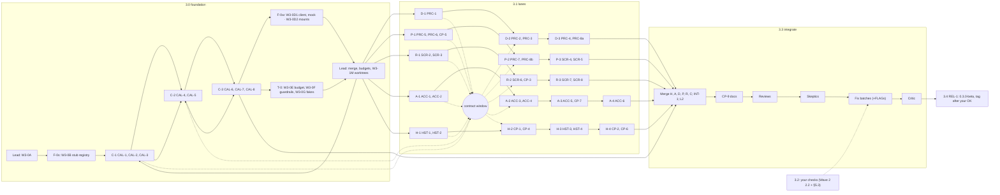

# Wave 3 — v3: win more of the bids you find

**Goal.** Wave 3 delivers the v3 release in docs/ROADMAP.md, everything Wave 2 moved to v3 (docs/WAVE-2.md §11 and the lean cuts in §8.9), and the v2.1 carry-overs in docs/WAVE-2-STATUS.md. It has four parts:
- **Price and qualify.** Lgbids reads site lists and schedules out of bid PDFs, including PDFs the user downloads from a portal. It turns them into a scope and an estimate the user edits. A bid/no-bid scorecard and a Results tab show where the company wins. A contract value can be stored and filtered on.
- **A team.** Owner and estimator accounts, each with their own sign-in and their own phone alerts (UX-14, UX-15).
- **Keep dates.** Closings and site meetings for the bids you pursue go into your own calendar by CalDAV, and Lgbids shows any change you make there.
- **Run anywhere.** A hosted option (Docker compose with Caddy, or Fly.io) with HTTPS, backups that work in a container, an upgrade command, and the last v2 security and ops gaps closed.

Every binding Decision in CLAUDE.md still holds: no AI/LLM, no portal logins, robots.txt and bot checks respected, generated bids state only profile facts, the auto-send guardrails are unchanged (only checklist key `documents` is waived), and the default host is 127.0.0.1. All of this is built and tested against local fakes, because the sandbox cannot reach bid sites, calendars or hosting providers. Task ids come from the six scout reports: `PRC` (pricing and documents), `SCR` (scorecard, value, results), `ACC` and `HST` (accounts, hosted), `CAL` (calendar), `CP` (carry-overs) and `W3-0` (infrastructure). Merged, split and deferred items are listed in §6.0 and §11.

---

## 1. Contents
1. Contents · 2. Exit criteria · 3. Starting point · 4. Coverage matrix · 5. Decisions and user inputs · 6. Workstreams and tasks · 7. Sub-waves and dependency graph · 8. Workflow design · 9. Verification pyramid · 10. Risks · 11. Deferred to v4 / later · 12. Tracking checklist

---

## 2. Exit criteria (all must hold to tag `v0.3.0-beta`)

| # | Criterion | How it is checked |
|---|---|---|
| E1 | Every row of the coverage matrix (§4) is built with its named tests, or listed in §11 with a reason. | The completeness critic compares §4 and §12 with `git log wave3/base..HEAD` and the test file names. |
| E2 | No route answers 501: the runtime stub registry `NOT_BUILT` and the mock's `NOT_BUILT_MOCK` are both empty. Every route in the `src/shared/api.ts` doc block has a server handler and a mock handler. | `tests/stubs.test.ts` (with `STUBS_EMPTY=1`, set by the integrator in 3.3) and `tests/web/mock-parity.test.ts`. |
| E3 | Guardrails hold. No code path fills `priceTotal` or ticks `pricing` by itself. Auto mode waives only `documents`. A calendar read-back never changes a closing, reminder, checklist or mute. Scope text never becomes a company fact in a generated bid. | `tests/guardrails-v3.test.ts` is green and unchanged since 3.0 (`git diff <3.0 merge>..HEAD -- tests/guardrails-v3.test.ts` is empty). The existing auto-send tests in `tests/pipeline.test.ts` are unchanged. |
| E4 | Corpus gate (D32): all pinned rows pass, no metric drops, suitable recall ≥ 0.95 and precision ≥ 0.70. | `npm run eval -- --check` and `tests/eval.test.ts`. |
| E5 | Document reading works on table PDFs. The pdfkit fixtures give the expected ` \| ` rows and `analysis.scope`. An uploaded bid document is read with zero outbound requests and never appears in a submission. | `tests/pdfLayout.test.ts`, `tests/scope.test.ts`, `tests/bidDocuments.test.ts`. |
| E6 | Tests: `npm test` count above 613, and every test file named in §6 exists. Shuffled runs pass for seeds 1, 42, 1337, 9001 and 777. The coverage ratchet holds. `npm run test:e2e` passes 3 times in a row. axe finds 0 serious or critical issues on every route, new ones included, in light and dark, at 1280 and 390 px, in demo and prototype. Typecheck shows 0 errors. | `npm run verify:full`, plus the seed loop and e2e loop in §9. |
| E7 | Security review done on accounts, roles, hosted mode, calendar and the HTTP client. Each high or medium finding is fixed with a test or listed in `docs/SECURITY.md`. Probes: an estimator gets 403 on every owner route; a route missing from `ROUTE_ROLES` fails a test; a DNS rebind to 127.0.0.1 reaches 0 requests; `/api/health` answers before the Host check; behind a trusted proxy the cookie is Secure and HSTS is sent; the calendar password is never returned or logged; Authorization goes only to the configured calendar origin or the iCloud partition pattern, never after an https → http redirect; a calendar URL never reaches a link-local or metadata address (nor a private one in hosted mode); a forged Host header never changes a reset link; a demoted or disabled user loses rights on the next request. `npm audit --omit=dev --audit-level=high` is clean. | `tests/roles.test.ts`, `tests/users.test.ts`, `tests/http.test.ts`, `tests/hosted.test.ts`, `tests/caldav.test.ts`, `tests/calendar-settings.test.ts`, and the CI audit job. |
| E8 | Upgrade safety: a schema-3 database with data upgrades to schema 4, keeps every row and writes the pre-migration snapshot. A schema-5 database is refused with the restore sentence. Schema-3 sessions stay signed in as the owner. v1 push settings become recipient 1 (a company recipient, `user_id` NULL) exactly once, with the reminders and change alerts already sent backfilled into `alert_deliveries`, so the first tick after the upgrade sends 0 pushes. A v0.2.0 prototype snapshot restores with no page error. | `tests/migration-v3.test.ts`, `tests/accounts.test.ts`, `tests/recipients.test.ts`, `tests/web/mock-parity.test.ts`. |
| E9 | Bundle budget: the entry and `schemas` budgets are the gzip sizes measured in 3.0c after W3-0D2 merges, plus 3 KB headroom each, rounded up and dated (v0.2: entry 85.7 KB of 92, `schemas` 28.0 KB of 32). Every other chunk is at most 40 KB. No prototype code is in `dist/web`. | `npm run check:bundles` (W3-0E; budgets re-set in 3.0c). |
| E10 | Lane hygiene: `npm run check:lane -- <lane>` passes on every lane branch, and no commit in `wave3/base..HEAD` touches `node_modules`, `dist` or `.e2e`. | `check:lane`, plus `git log --name-only wave3/base..HEAD \| grep -E '^(node_modules\|dist\|\.e2e)'` returns nothing. |
| E11 | CI is green on GitHub on the release commit: `check`, `e2e`, `node-floor`, `prod-smoke` (now also running `npm run backup`), `docker`, `audit` and the new `compose-https` job. | GitHub Actions run (needs your push, §5.3). |
| E12 | Docs: README, `docs/DEPLOY.md`, `docs/SECURITY.md`, the Help glossary (estimate, scope, estimated value, scorecard, straight-line distance, "Who you hear from", calendar), CHANGELOG 0.3.0-beta with upgrade notes (one-way schema 4, sessions, recipients), CLAUDE.md Decisions (every §5 answer) and "Done", and ROADMAP (moved items). | Docs agent; checked by the critic. |
| E13 | Release: version `0.3.0-beta` in package.json and package-lock.json. Tag `v0.3.0-beta` is pushed only after your OK. | `git tag`, GitHub tag list. |
| E14 | Budget: each sub-wave stays inside its directive (§8.8). Any overrun is logged in docs/WAVE-3-STATUS.md. | `budget.spent()` in each run's result. |

---

## 3. Starting point

### 3.1 v0.2.0-beta state (2026-11-22, branch `ccr-707adaf0-joblwh`, commit `644df96`)
- 613 vitest tests pass, also shuffled. `npm run verify:full` is green with 46 Playwright tests (14 skipped by project). axe shows 0 violations. CI is written but has **never run on GitHub**.
- The version is `0.2.0-beta`. The tag `v0.2.0-beta` and the PR wait for your OK (D27, D29).
- Schema version 3. `/api/coverage`, `/api/recipients*` and `/api/status` answer 501. The `recipients` table, store methods, schemas and web client exist but are unused. `/api/health` does not check the database.
- One shared `APP_PASSWORD`. No user identity in `sessions` or `events`.
- Document reading merges PDF text (`documents.ts:43`), so table structure is lost. Rates are free-text units. No estimate, no value field, no coordinates, and an empty Results tab (`insights.ts:5-11`). The ICS export is one-way and holds closings only.
- Prototype: `STORAGE_KEY` is still `lgbids-prototype-v1`, and restore replaces the profile wholesale (`mock.ts:1059`).

### 3.2 Open items carried over

| Open item | Source | Task |
|---|---|---|
| 2.2 user checks: live check, real alert samples, D4 CRD URL, CI on GitHub, phone checks, Netlify forms | WAVE-2-STATUS "2.2" | **Stay with you** (§7.1, 3.2). They decide whether Wave 3 branches from v0.2.0-beta or v0.2.1-beta (D85). No Wave 3 lane edits the files the 2.2 branch owns. |
| Tag `v0.2.0-beta` and open the PR | WAVE-2-STATUS "2.4" | Your OK (before 3.0a) |
| COV-14 "Who you hear from" UI and `/api/coverage` | lean cut, D7 | CP-2 |
| OPS-10 `/api/status` and the health database check | WAVE-2-STATUS | CP-1 (health), HST-2 (health before the Host check) |
| F5: a draft stays expired after an extension | CHANGELOG known gaps | CP-3 |
| DNS rebinding: the connection is not pinned to the checked address | CHANGELOG, WAVE-2-STATUS | CP-4 (needs D73) |
| A change push that fails after the summary listed it is never resent | CHANGELOG known gaps | ACC-5 (per-recipient `alert_deliveries` retry; never e-mailed twice) |
| Contract requests not applied: `linkDuplicate` changes, explicit `runId`, `reissueOf`, R25 | WAVE-2-STATUS | CP-8 (optional); `reissueOf` and R25 dropped (D78) |
| UX-14 recipients, UX-12 Results tab, value filter (D23), accounts (D15) | WAVE-2 §8.9, §11 | ACC-5, SCR-6, SCR-4/5, ACC-1..6 |
| Weekly tuning line; PWA hint; money and date sweep | WAVE-2 §11 | CP-7, CP-6, CP-5 |
| OPS-15 `docs/DEPLOY.md` and `docs/SECURITY.md` never written; README Docker advice is wrong for containers | hosted scout | HST-3 |
| ROADMAP does not record the lean moves | WAVE-2.md:1557 | CP-9 |

### 3.3 Scout findings → task (nothing dropped silently)

| Scout | Finding → task |
|---|---|
| PRC | Merged text loses columns and reorders wrapped cells (pdfkit probe); pages past 40 unread → **PRC-1** (tables up to 120 pages, D47). No structured scope → **PRC-2**. Insurance kinds, bond amounts, `bondingLimit`, only the first site meeting, library expiry → **PRC-3**. |
| PRC | Portal and alert bids never have their documents read; `application_files` would e-mail an upload back to the buyer → **PRC-4** (separate `opportunity_documents`). Free-text rate units, no internal flag → **PRC-5**. No estimate model, storage, API, UI or stale check → **PRC-6, PRC-7, PRC-8b**. |
| PRC | No re-read after `documents_added` → **FLAG-2** (reopens D14). Excel/CSV schedules, scanned PDFs, AcroForms → **§11**. Duplicate React keys on requirement rows → **W3-0D2**. |
| SCR | No coordinates → **SCR-2**. Nowhere to keep yard, crews, radius and margin without re-scoring → **SCR-3** (D50). No contract value → **SCR-4**. No `minValue` filter or value CSV → **W3-0C3** (plumbing), **SCR-5**. Results tab, "Did you win?" and results CSV → **SCR-6**. No contract months, crews or private cost → **SCR-7**. No scorecard → **SCR-8**. |
| ACC | No users, identity, roles or actor → **W3-0C1** (migration), **ACC-1 … ACC-3**. Recipients answer 501 → **ACC-5**. Multi-user lost updates → **W3-0C3** (`expectedUpdatedAt`, 409). |
| HST | Backups need tsx, which the image prunes; no retention or second destination; the lock is not container-aware (pid 1) → **HST-1**. `TRUST_PROXY=1` trusts loopback only; the Host check runs before `/api/health` → **HST-2, HST-3**. No compose, Caddyfile, fly.toml, HTTPS test or upgrade command → **HST-3, HST-4**. |
| CAL | Mock ICS differs from the server's → **CAL-1**. Site-meeting date lost after `extractFacts` → **PRC-3** (`Requirement.at`), **CAL-2**. No CalDAV client, DAV XML or ICS reader → **CAL-3**. No settings or sync state → **W3-0C1**, **CAL-4, CAL-5**. No read-back → **CAL-6**. No live check → **CAL-8** (you run it). |
| CP | `/api/status`, coverage, F5, rebinding, tz bypass in `ChangesSection.tsx:23`, PWA hint, tuning line → **CP-1 … CP-7**. |
| W3-0 | Hard-coded 501 lists (`a8da39d`); committed node_modules link (`7f497a2`); uncommitted P-3 work; reduced-motion flake; reused e2e servers; no bundle budget or mock-parity check; stale coverage thresholds → **W3-0A, W3-0B, W3-0D1, W3-0E**. `store.ts` is one 2239-line closure → **W3-0C1** (per-area store factories, D81). |

---

## 4. Coverage matrix

| Roadmap or carried item | Tasks | Not built (→ §11) |
|---|---|---|
| v3 **Pricing helper** (rates sheet → editable estimate, never auto-filled) | PRC-5, PRC-6, PRC-7, PRC-8b, W3-0F | Auto-filled price (not planned) |
| v3 **Document reading upgrade** (site lists, frequencies, areas, site meetings; insurance, WorkSafeBC and bond against the profile) | PRC-1, PRC-2, PRC-3, PRC-4, PRC-8a | OCR, Excel schedules, AcroForms; addendum re-read, and an uploaded addendum changing required items (FLAG-2) |
| v3 **Bid/no-bid scorecard** (distance, crew capacity, win rate with the buyer, margin) | SCR-2, SCR-3, SCR-7, SCR-8 | Road distance or drive time; distance filter |
| v3 **Calendar sync** (two-way) | CAL-1 … CAL-8 | Google Calendar (CAL-9, D65); token feed URL (D72) |
| v3 **Hosted option** (Docker on a VPS or Fly.io, HTTPS, backups, upgrade command) | HST-1, HST-2, HST-3, HST-4, CP-1 | Encrypted secrets (FLAG-5); moving your live install (FLAG-7) |
| WAVE-2 §11 accounts and roles (owner, estimator), per-user sessions | ACC-1, ACC-2, ACC-3, ACC-4, ACC-6 | Viewer role, multi-tenant (v4) |
| UX-14 per-person recipients | ACC-5 | Per-recipient digest (D60) |
| UX-12 Results tab | SCR-6 | — |
| Contract-value field and "value at least" filter (D23) | W3-0C, SCR-4, SCR-5 | — |
| Weekly tuning line / Monday digest | CP-7 | Standalone Monday e-mail (D77) |
| PWA install hint | CP-6 | Service worker (Decision) |
| Money and date sweep | CP-5 | — |
| COV-14 UI and `/api/coverage` | CP-2 | — |
| OPS-10 `/api/status` and health DB check | CP-1, HST-2 | Log file and rotation (FLAG-8) |
| F5 | CP-3 | — |
| DNS rebinding | CP-4 | v3.1 if you decline D73 (§11) |
| Optional contract requests | CP-8 | v3.1 if the budget guard skips it (§11); `reissueOf`, R25 (D78) |
| ROADMAP v2 award tracking as the base for price benchmarking | SCR-6 (`differencePct`), SCR-8 (median winning price) | Past winning prices on the estimate card (v3.1, §11) |
| WAVE-2 §11 MERX and Biddingo parsers tuned on samples | — | When you subscribe and send samples (D5, §11) |
| Release 3.4 `0.3.0-beta` | REL-1 | Tag waits for your OK |
| Wave 2 user checks (2.2) | — (yours) | — |

---

## 5. Decisions and user inputs

### 5.1 Decisions needed
**Rule.** If you have not answered by the start of 3.1, the recommended default is used, and the docs agent records it in CLAUDE.md "Decisions" in 3.3. Every default respects the existing Decisions; anything that would not is in §5.2.

| ID | Question | Recommended default | Blocks |
|---|---|---|---|
| D40 | How does table structure survive from PDF to analysis? | Rows are stored in `document_text` as cells joined by ` \| `. The text can be re-parsed, and pasted text can use the same form. | PRC-1, PRC-2 |
| D41 | Where is the scope stored? | `analysis.scope?` (optional, like `trace?`), left out of list responses. | PRC-2 |
| D42 | One rates list or two? | Extend `Profile.rates` with an optional `measure` (inferred for old rows) and `internal` (not printed in the package). | PRC-5 |
| D43 | What does "Use this total" do, and how is the estimate saved? | It fills the Total price field only, through the normal autosave PATCH. You still tick "Price entered and checked". `POST …/estimate` builds or rebuilds. | PRC-7, PRC-8b |
| D44 | Can the breakdown reach the buyer? | Never automatically. A "Copy breakdown to price notes" button you press. A line priced with an internal rate goes across with its description and quantity only; cost, margin and scorecard data are never copied. | PRC-8b |
| D45 | Where do uploaded bid documents live? | A new `opportunity_documents` table, read only and never attached. PDF only (`%PDF-` check), server-generated file names, at most 10 files and 40 MB per bid. An upload rebuilds required items only on the bid's first document read (FLAG-1/D14). | PRC-4 |
| D46 | Frequency "weekly" with no season dates? | Visits stay blank with a warning; you enter them. | PRC-2, PRC-6 |
| D47 | Read tables past page 40? | Scan up to 120 pages for table rows only, within `MAX_CHARS`. | PRC-1 |
| D48 | Insurance shortfall, bond above `bondingLimit`, missing or expired WorkSafeBC letter? | Advisory rows (`required:false`). `met:false` lowers the decision to review, as today; there are no new checklist holds. | PRC-3 |
| D49 | Does the scorecard change the score, decision or auto-send? | No: it is advisory. Four factor rows with tone and a sentence, plus "N of 4 look good". No combined number. | SCR-8 |
| D50 | Where do the yard, crews, comfort radius and target margin live? | A separate `scorecard` settings key, not Profile. Saving does not re-score, and nothing reaches generated bids. | SCR-3 |
| D51 | How is the yard located, and which distance is shown? | A place picked from a bundled gazetteer (optional lat/lon under Advanced). Straight-line km, labelled "in a straight line". | SCR-2, SCR-8 |
| D52 | How is the contract value stored, and which value wins? | Columns with an origin (`notice` or `manual`). A hand entry wins. The award amount is a labelled fallback. The stated amount is compared with its basis (per year or per contract); totals are never annualised. | SCR-4 |
| D53 | What does "Value at least $X" do with bids that state no value? | Keeps them by default, with an opt-in "Hide bids with no stated value". Steps: Any, $10k, $25k, $50k, $100k, $250k. | SCR-5 |
| D54 | Where do contract months and cost come from? | Months are read from the notice only, otherwise unknown until you enter them. The cost is entered by hand per application and is private. | SCR-7 |
| D55 | How does the owner sign in once accounts exist? | `APP_PASSWORD` alone with the e-mail left blank signs in the bootstrap owner, as today. Estimators use their e-mail and their own password. Without `APP_PASSWORD`, there are no users and v2 behaviour stays. Recipients with no user (`user_id` NULL) are company recipients. Accounts matter only once a second person can reach Lgbids (a LAN `HOST` or hosted mode). | ACC-1, ACC-2, ACC-5 |
| D56 | May an estimator press Send? | No, the owner only. Estimators prepare, tick the checklist and mark portal or hard-copy bids submitted. Auto-send is unchanged and does not depend on who ticked the items; owner approval before an auto-send would be FLAG-9. | ACC-3 |
| D57 | Who edits the profile and the documents library? | Profile: the owner only. Documents: both. | ACC-3 |
| D58 | How does a new estimator get a password? | A one-time set-password link (72 h) that the owner copies, or e-mails through the company SMTP. | ACC-4 |
| D59 | Where is "last visit" kept? | On the server (`users.last_visit_at`). The browser key stays as the fallback when no password is set. | ACC-2 |
| D60 | Does the summary digest become per recipient? | No. It stays company-wide on `notifyEmail`. Recipients get push alerts plus per-bid reminder and change e-mails. | ACC-5 |
| D61 | Who gets closing reminders? | Every recipient with the `reminders` kind (D17 is per bid). | ACC-5 |
| D62 | Which hosted target comes first? | Docker compose with Caddy on a small VPS. Fly.io is a documented recipe. | HST-3 |
| D63 | Where do off-box backups go? | `BACKUP_DIR` (a second disk or volume) plus a host timer running `npm run backup -- --keep N`. | HST-1, HST-3 |
| D64 | Strict hosted checks: opt-in or automatic? | Opt-in with `LGBIDS_HOSTED=1` (compose and fly.toml set it). | HST-2 |
| D65 | Which calendar providers? | CalDAV only (iCloud, Fastmail, Nextcloud, with an app password). Google needs an OAuth client you create, so it is deferred (CAL-9, §11). | CAL-3 … CAL-7 |
| D66 | What does "two-way" mean? | Lgbids pushes events and reads them back only to show what changed. An event you edited is never overwritten (If-Match). You choose "Put the notice time back" or "Keep my calendar's time". Notice data never changes. | CAL-5, CAL-6 |
| D67 | Which bids are synced? | Watched bids (D12) plus failed applications that are open and canonical. | CAL-5 |
| D68 | Should synced events carry alarms (VALARM)? | No: D16/D17 reminders already cover it. | CAL-5 |
| D69 | Does sync run in every automation mode? | Yes, once it is set up (like D16 reminders). It reads no bid site. | CAL-5 |
| D70 | UIDs, and what happens when a bid ends? | Keep `opportunity-<id>@lgbids` for the closing. Site meetings are `site-meeting-<id>@lgbids` for `site_meeting` and `site-meeting-<id>-<n>@lgbids` for `site_meeting_<n>`; `calendar_events.kind` is `closing` or the requirement key. Adopt an existing event on a UID conflict. A dismissed bid or withdrawn application deletes the event. A buyer cancellation marks it `STATUS:CANCELLED`. | CAL-5 |
| D71 | Which calendar addresses are allowed? | https, or http for local and LAN hosts. LAN addresses are allowed, because this is your own server and not a bid site. Link-local and metadata addresses and the app's own port are always refused; with `LGBIDS_HOSTED=1`, loopback and private ranges are refused too unless `CALDAV_ALLOW_PRIVATE=1`. | CAL-3, CAL-4 |
| D72 | Offer a subscribable feed URL with a token? | No: it would bypass the login, and hosted calendars cannot reach 127.0.0.1 anyway. | — |
| D73 | How are bid-site connections pinned to the checked address? | Add `undici` as a direct dependency. It is already in the lockfile through cheerio (7.30.x), so nothing new is downloaded. Use undici's own fetch with a guarded Agent, never Node's global fetch. | CP-4 |
| D74 | Coverage rules? | `reading` needs an enabled source that is not in error or blocked. `alerts_seen` means an alert in the last 90 days. Priority: reading > alerts_seen > alerts_expected > not_covered. | CP-2 |
| D75 | May an F5-revived draft be sent automatically? | Yes, under the unchanged guardrails (which include `sendCutoffHours`). | CP-3 |
| D76 | Where does `/api/status` show, and is there a log file? | A collapsed "About this install" on Settings. Logging stays stdout only. | CP-1 |
| D77 | Weekly tuning line or a Monday e-mail? | The line only, in the first summary of each ISO week. | CP-7 |
| D78 | What happens to the remaining contract requests? | CP-8 is optional (in 3.3). `reissueOf` and R25 are dropped. | CP-8 |
| D79 | Where does the install hint show? | A one-time, dismissible card on Today, on phones only. | CP-6 |
| D80 | How many lanes? | 6 lanes with 20 work packages (§8.1). The lean option uses 4 lanes (§8.9). | 3.1 |
| D81 | How do lanes add persistence without colliding in `store.ts`? | 3.0 creates `src/server/db/stores/<area>.ts` factories, spread into `createStore`. Each lane owns its own factory. | W3-0C |
| D82 | Push lane branches after each green work package? | Yes, if you approve once: the container is disposable. Otherwise commits stay local until 3.3. | 3.1 |
| D83 | Prototype storage: bump the key or merge in place? | Keep the key. Parse the saved profile with `profileSchema` (defaults fill new fields) and deep-merge the v3 state. | W3-0D1 |
| D84 | Blocking aria snapshots for new screens (D30 allows them)? | No: axe, keyboard and route-list checks only. | — |
| D85 | Which base, and do the carry-overs join Wave 3? | Branch from `v0.2.1-beta` if 2.2 has landed, otherwise from `v0.2.0-beta`. The carry-overs go in lane H. | W3-0A |

### 5.2 Flagged: these would change a CLAUDE.md Decision, so they are not planned until you say yes

| Flag | What | Why flagged | Ready spec if approved |
|---|---|---|---|
| FLAG-2 (reopens FLAG-1 / D14) | Re-read documents and uploaded addenda after a `documents_added` change, so that a new site meeting, bond or forms clause adds required checklist items | Required items would hold auto-send. FLAG-1 was not approved. | Files: `pipeline/documents.ts`, `applications/draft.ts`, `tests/addenda-v3.test.ts` (new). A `documents_added` change clears `documents_read_at` for watched bids. The next run re-reads them and rebuilds an untouched draft, and only reassesses an edited draft. The test shows a new mandatory meeting appears as an item. It also lets an upload on a bid already read rebuild its required items (PRC-4 otherwise changes only the scope and the advisory rows). 3.3 fix pass. |
| FLAG-3 | Make the PRC-3 rows (insurance shortfall, bond above `bondingLimit`, missing or expired WorkSafeBC letter) **required** items | Adds holds beyond forms, site meeting, bond and price. | `draft.ts` sets `required:true` for these keys when `met:false`; a test asserts auto mode refuses. 3.3 fix pass. |
| FLAG-4 | Push or e-mail reminders before a mandatory site meeting | Extends D16/D17, which count only from `closingDeadline`. | `pipeline/reminders.ts`: thresholds 72 h and 24 h before `Requirement.at`, deduped per meeting instant in `alert_deliveries`; `tests/meeting-reminders.test.ts`. |
| FLAG-5 | Encrypt stored secrets, or encrypt off-box backups | Changes D24 (plain text, 0600, env overlays). | `src/server/util/secretBox.ts` (node:crypto AES-256-GCM, key from `LGBIDS_SECRET_KEY`); settings read and write through it; one-time migration with a fallback when the key is missing; backup docs. A separate task in 3.3, or v4. |
| FLAG-6 | Add a `CALDAV_PASS` env overlay | Extends the D24 overlay list. | `settings.ts` overlay with the same rule as `ALERT_IMAP_PASS`; a test in `tests/calendar-settings.test.ts`. Without it, CAL-4 uses the stored password only. |
| FLAG-7 | Move the beta company's live install to a VPS or Fly.io | Changes D25 (the beta runs on the owner's computer). | HST-3 builds the kit either way; the move is yours (§5.3). |
| FLAG-9 | Owner approval before an auto-send of a bid an estimator prepared | Adds a condition to the auto-send rule list. | `pipeline/run.ts`: auto mode refuses when the last tick or price edit came from an estimator (`applications.updated_by`); `tests/roles-autosend.test.ts`. 3.3 fix pass. |
| FLAG-8 | `LOG_FILE` with rotation | Revisits the lean cut "dropped: OPS-10 log rotation". | `logging.ts` size-based rotation (5 × 5 MB); `tests/logging.test.ts`. |
| — Not planned | Scorecard tones as an auto-send condition, or folded into `analyse()` | Changes the auto-send rule list and the D32 baseline. | None. |
| — Not planned | An estimate fills the price, or ticks `pricing`, by itself | Contradicts the roadmap ("never auto-filled") and the waiver of `documents` only. | None; W3-0F guards against it. |
| — Not planned | Calendar edits flowing into notice data (closings, ticks, mutes) | Breaks the closing and `closingDeadline` Decisions and the guardrails. | None; W3-0F guards against it. |
| — Not planned | A service worker for the install prompt; SMS channels; a hold on F5-revived drafts; in-app daily snapshots | Each conflicts with a Decision or a lean cut. | None. |
| — Planned, wording only | CLAUDE.md gains: owner and estimator accounts (`APP_PASSWORD` still enables login and signs in the owner), the route-role rules and the Send rule (D55-D57); D7's parenthetical and the COV-14 lean-cut line once CP-2 lands; D15 and D23 marked done | They add to Decisions; none reverses one. UX-15 asked for this. | Docs agent in 3.3, using the answers you gave. |

### 5.3 What you must do or provide
- [ ] **Answer §5.1 in one message**, or say "use the defaults". At minimum: D55-D57 (roles), D65 (calendar), D73 (`undici`) and D82 (pushing).
- [ ] **Say yes or no to each FLAG** (§5.2). Silence means no.
- [ ] **Before 3.0:** say OK to tag `v0.2.0-beta` (or tell us that 2.2 has landed, so we branch from `v0.2.1-beta`).
- [ ] **Business inputs** (tests use invented values; real values are never invented): your rates and units (crew hour with truck, mowing per acre per cut, mulch per cubic yard, hedge per linear metre), and which are internal; your yard place (or rough coordinates), number of crews, comfort radius (30 km is proposed) and target margin %.
- [ ] **2-3 real bid PDFs** (anonymised if needed) with site lists or schedules of quantities. Put them in `~/lgbids-bid-pdfs/` and run `npm run pdf-text -- ~/lgbids-bid-pdfs` (PRC-1). It writes scrubbed, text-only `.txt` files. Read them, then send those, not the PDFs. This needs the lane D build; until then, keep the files.
- [ ] **Calendar check** (after 3.3, on your computer): make a throwaway calendar "Lgbids test" and an app password (Apple app-specific, Fastmail with CalDAV, or Nextcloud). Then run `CALDAV_URL=… CALDAV_USER=… npm run calendar-check` (it asks for the password) and send the pass/fail lines.
- [ ] **Per-person alerts check:** add two recipients with two Telegram chats or ntfy topics, break one on purpose, and confirm the other still gets a reminder and a change alert.
- [ ] **Hosted (optional, FLAG-7 not needed to test it):** a VPS or Fly.io account, a domain and DNS. Then `cd deploy && cp .env.example .env && docker compose up -d`, and open `https://<your domain>`. Run `npm run upgrade -- --dry-run` once on your git install.
- [ ] **Push** the integration branch so the new `compose-https` and prod-smoke backup steps run on GitHub.
- [ ] **Release:** say OK to tag `v0.3.0-beta` (3.4).

---

## 6. Workstreams and tasks

### 6.0 How to read this, and where each scout task went
Each block gives the size (S, M or L), the lane and work package (§8.1), dependencies, and whether you are needed. **Files** lists only the files that task may edit; "(stub)" means 3.0 created it. 3.0 publishes every schema, DTO, migration column, route stub, settings key, mount line and hook line (§8.3), so lane tasks fill in their own files only. Prototype parity is part of every UI or API task: the matching `src/web/mock/<area>.ts` is updated in the same commit. Help-glossary text goes in `docNotes`, and the docs agent adds it in 3.3.

| Scout task | Outcome |
|---|---|
| SCR-1 (foundation), migration parts of ACC-1, PRC-4, PRC-7, CAL-4 | Merged into **W3-0C1**: one migration 4 ("W3-0C" below means C1-C3 together) |
| PRC-8 | Split: **PRC-8a** scope and upload UI (lane D), **PRC-8b** estimate card (lane P) |
| PRC-9 (site meetings in .ics), CAL-2 | Merged: the date part goes to **PRC-3**, the ICS part to **CAL-2** |
| SCR-9 | Mock data goes into each SCR task; Help and docs to **CP-9**; e2e to **INT-1** |
| SCR-5 SQL, filter schema, mock filter | Plumbing in **W3-0C3** / **W3-0D1**; UI, `ValueChip` and CSV in SCR-5 |
| ACC-3 `expectedUpdatedAt` (409) | **W3-0C3** (it lives in the frozen `routes/applications.ts`) |
| ACC-3 `ROUTE_ROLES` table; ACC-3 event actor listing | Published by **W3-0C2** (every route exists by then) and **W3-0C1** (`listEvents` returns `actor`); enforcement in ACC-3 |
| CP-5 format guard and formatter helpers | **W3-0D1** (so every lane sees the guard); lane P keeps the ChangesSection fix and the money move |
| ACC-1 bootstrap | Runs in the auth plugin (`routes/auth.ts`), not `bootstrap.ts` |
| CAL-8 `live-check --calendar` | New script `npm run calendar-check`, so `cli/liveCheck.ts` stays untouched |
| HST-2 health | `/api/health` moves into `routes/status.ts` in 3.0 (lane H owns it) |
| CP-3 F5 | Lane R (applications lifecycle), in the new `pipeline/revive.ts` |
| CP-8 | 3.3, by the integrator (it needs `store.ts` core) |

### 6.1 Foundation and process (3.0, lead)

**W3-0A — Lead prep: base branch, CI triggers, e2e isolation, reduced motion, coverage ratchet** · S · Lead 3.0a · Depends: your OK on the v0.2 tag · User: D73, D82, D85
- Why: CI ignores `wave3/**` (ci.yml:5); Playwright reuses servers outside CI (playwright.config.ts:44, :55); the reduced-motion flake (`f450a30`); stale thresholds (vitest.config.ts:18-25).
- Files: `.github/workflows/ci.yml`, `playwright.config.ts`, `src/web/styles.css`, `vitest.config.ts`, `package.json`, `package-lock.json`.
- Acceptance: `wave3/base` is cut per D85 and checked out only in `/home/user/lgbids-wt/base`; the worktrees `F0` and `T0` are made (§8.4). The main checkout stays on its own branch for all of Wave 3. CI push branches include `wave3/**`. `reuseExistingServer` is on only when `E2E_REUSE=1`, and `use.contextOptions.reducedMotion` is `'reduce'`. There is one global `prefers-reduced-motion` block (animation and transition durations of .01ms). Thresholds are re-measured, set 1 point lower, and dated. The §8.3 package scripts point at stub files that print "Not built yet." and exit 2. `undici` becomes a direct dependency only if D73 is yes (`npm ls undici` shows one copy). `npm run verify:full` is green.
- Tests: `verify:full`; `for i in 1 2 3 4 5; do npx playwright test e2e/a11y.spec.ts || exit 1; done`.

**W3-0B — Stub registry and lane hygiene check (fixes the frozen 501-list blocker)** · M · F-0s · Depends: W3-0A
- Why: building a stub broke a frozen test in Wave 2 (`a8da39d`). The committed node_modules link and P-3's uncommitted work were found only at merge.
- Files: `src/server/routes/{util,coverage,recipients,status}.ts`, `src/web/mock/context.ts`, `src/web/mock.ts`, `tests/migration.test.ts`, `tests/stubs.test.ts` (new), `scripts/check-lane.mjs` (new), `scripts/lanes-v3.json` (new), `tests/check-lane.test.ts` (new).
- Acceptance: **Stub registry.** `stub(app, method, url)` registers a 501 "Not built yet." handler and adds the route to an exported runtime `NOT_BUILT` set; every stub uses it. **Stub test.** `tests/stubs.test.ts` iterates `NOT_BUILT` at runtime, with no hard-coded list. It requires every `METHOD /path` line of `src/shared/api.ts` to be registered. With `STUBS_EMPTY=1` it requires the set to be empty. The list at migration.test.ts:389-405 is deleted. **Mock registry.** Each `src/web/mock/<area>.ts` calls `mockStub(method, path)` or `mockRoute(method, path, handler)` and exports its routes; mock.ts builds its dispatch table from the exported area modules, and `NOT_BUILT_MOCK` is derived from the `mockStub` calls, so no central list exists. **Lane check.** `npm run check:lane -- <lane>` exits 1 when: a changed file is outside the lane's globs (`git diff --name-only wave3/base...HEAD`); a path is under `node_modules`, `dist` or `.e2e`; `git status --porcelain` is not empty; the manifest gives one file to two lanes. Replacing a stub needs no edit to a test the lane does not own.
- Tests: the four failure cases plus a pass case, each on a temp git repo in `os.tmpdir()`. A fixture app with one stub removed stays green. Replacing a mock stub changes only `mock/<area>.ts` (a `check-lane` case).

**W3-0C1 — Migration 4, v3 schemas and contracts, store factories** · L · F-0s · Depends: W3-0B
- Why: the contract-first foundation with one migration is what made Wave 2's parallel lanes work (R2). W3-0C is three committed tasks (C1-C3), each its own agent and gate, so no foundation agent runs long (R3).
- Files: `src/server/db/database.ts`, `src/shared/{schemas,api}.ts`, `src/server/schemas-v3.ts` (new: server-only validators such as `UserInput`, the calendar settings write and the password rules), `src/server/contracts.ts`, `src/server/db/store.ts` (spread line, `addEvent` actor, `listEvents` join), `src/server/db/stores/{documents,estimates,planning,accounts,calendar,ops}.ts` (new), `src/shared/results.ts` (new; the real `isAwaitingResult()` moves here), `src/server/dashboard.ts` (uses it), `tests/migration.test.ts`, `tests/migration-v3.test.ts` (new).
- Acceptance: (1) `MIGRATIONS[3]` adds everything in §8.3, with migrations 1-3 untouched. `SCHEMA_VERSION` is 4, and migration.test.ts:72 is updated. (2) `// v3:` schema sections hold every §8.3 DTO, each field optional or defaulted. DTOs the web never parses are type-only `interface`s (no zod bytes in the web bundle); server-only validators live in `src/server/schemas-v3.ts`. (3) `store.addEvent` stores `currentActor()`, and `store.listEvents` joins users and returns `actor {id,name}|null`. (4) `ResultsInsights.awaitingList: {applicationId, opportunityId, title, closesAt}[]` (at most 5) comes from the shared pure `isAwaitingResult()`, which dashboard.ts also uses, so `counts.awaitingResult` is unchanged. (5) All 613 existing tests pass.
- Tests: `migration-v3`: upTo 3 with data, then a full open, keeps rows, starts the new tables empty and writes `backups/lgbids-schema3-*.sqlite` (0600); schema 5 is refused with the restore sentence; a CRUD round trip per store factory; `listEvents` gives `actor` null for a scheduler event and `{id,name}` for a user's.

**W3-0C2 — v3 routes, stubs and `ROUTE_ROLES`** · M · F-0s · Depends: W3-0C1
- Files: `src/server/routes/{bidDocuments,estimates,value,scorecards,users,calendarSync}.ts` (new), `routes/status.ts`, `routes/auth.ts` (only to move `/api/health` to status.ts), `src/server/app.ts`, `src/shared/roles.ts` (new), `src/server/http/pinned.ts` (new stub), `tests/foundation-v3.test.ts` (new).
- Acceptance: (1) Every v3 route is in api.ts and registered, as a `stub()` unless C3 makes it plumbing. (2) `ROUTE_ROLES` classifies every route by the rule in §6.5. (3) `pinnedDispatcher({allowPrivate})` in `http/pinned.ts` returns undefined (the default transport) until CP-4 fills it; the CalDAV client passes whatever it returns.
- Tests: `foundation-v3`: every route is in `ROUTE_ROLES`; a fixture route left out fails; every non-GET route under `/api/profile`, `/api/settings/**`, `/api/sources/**` and `/api/users/**`, plus Send and `.eml` import, is owner.

**W3-0C3 — Plumbing and hook lines** · L · F-0s · Depends: W3-0C2
- Files: `routes/{opportunities,applications,settings}.ts`, `src/server/{settings,config}.ts`, `src/server/util/actor.ts` (new), `pipeline/{run,scheduler}.ts`, `pipeline/{valueStep,workPeriodStep,revive,calendarSync}.ts` (new stubs), `src/shared/{estimate,scorecard,gazetteer,ics,calendarUrl}.ts` (new stubs, `breakdownText` included), `tests/foundation-v3.test.ts`.
- Acceptance: (1) Plumbing: GET/PUT `/api/settings/scorecard` and `/api/settings/calendar`, with a write-only calendar `pass` that is kept only when the server and user are unchanged; the calendar PUT clears `verifiedAt` when the server, user, password or calendar changes. `minValue` and `hideNoValue` on the list, the CSV and saved searches, using `COALESCE(o.value_amount, award.amount) >= :minValue`. PATCH `/api/applications/:id` accepts `estimate`, `costEstimate`, `crewsNeeded` and `expectedUpdatedAt`, and answers 409 "Someone else changed this application. Reload to see their changes." when stale. The opportunity detail gets `scorecard` and `calendar` from providers in `routes/scorecards.ts` and `routes/calendarSync.ts` (stubs return null). `opportunityDto` leaves `analysis.scope` out of lists. `config.hosted` and `config.caldavAllowPrivate` are parsed (HST-2 adds the start-up checks). (2) Hook lines in `run.ts` (`recordNoticeValue`, `recordWorkPeriod`, `reviveExpired` before step 6, `runCalendarSync` at run end) and on the reminder tick (`runCalendarSync`). Each hook is wrapped so it never throws, and each stub is a no-op. (3) The stubs of `scorecardSettingsProblem` and `calendarServerProblem` return null. (4) All 613 existing tests pass.
- Tests: `foundation-v3`: `pass` is never returned; `verifiedAt` is cleared by each of the four changes and kept by an unrelated one; a stale write gives 409; `minValue` filters the list, the CSV and a saved search; a v0.2 saved search parses; bids with no value are kept unless `hideNoValue`; `awaitingList` holds at most 5 and matches `counts.awaitingResult`.

**W3-0D1 — Web client, mock modules, safe restore, formatters and the format guard (no page edits)** · M · F-0w · Depends: W3-0C3
- Why: the prototype must keep in step, and every lane must see the format guard from the start.
- Files: `src/web/{api,roles}.ts` (`roles.ts` new, with `useIsOwner()` returning true), `src/web/format.ts`, `src/web/mock.ts`, `src/web/mock/context.ts`, `src/web/mock/{scope,pricing,package,scorecard,users,calendar,status,coverage}.ts` (new; session handling moves to users.ts, the package PDF to package.ts, the ICS to calendar.ts), `tests/web/{mock-parity,format-guard}.test.ts` (new).
- Acceptance: (1) Typed client functions for every v3 route. `ROUTE_ROLES` is imported only by lazy chunks and the mock, never by the entry. (2) `MockV3State` is saved. (3) `restore()` parses the profile with `profileSchema` and deep-merges the v3 state (D83). (4) Sample scope is seeded on mock bids 101 and 102. (5) The mock filter honours `minValue` and `hideNoValue`. (6) Mock area modules use `mockStub`/`mockRoute` (W3-0B). (7) `format.ts` gains `formatKm`, `formatPercent`, `formatBytes` and `formatDuration`, and `formatTimeOfDay` uses `effectiveZone`. The guard fails on `new Intl.`, `toLocale*String` or `toFixed(` in `src/web` outside `format.ts`, `mock.ts`, `mock/*.ts` and `prototypePdf.ts`; `ChangesSection.tsx` is allowlisted until CP-5 removes it.
- Tests: `mock-parity`: every api.ts route gets an answer other than 404 "The mock has no answer"; a v0.2.0 snapshot restores with the v3 defaults. The guard scan is green.

**W3-0D2 — Page mount lines, section stubs, a11y routes, bundle check** · M · F-0w · Depends: W3-0D1
- Why: the big pages (Settings 927 lines, ApplicationDetail 827) are touched once, here.
- Files: `src/web/App.tsx`, `src/web/pages/{OpportunityDetail,ApplicationDetail,Profile,Settings,Sources,Opportunities,Dashboard}.tsx`, `src/web/styles.css` (imports only), `src/web/styles/v3-{d,p,r,a,c,h}.css` (new), section stubs (every component named in §6.2-6.7, plus `opportunity/ValueChip.tsx`), `e2e/{a11y,prototype}.spec.ts`.
- Acceptance: (1) Lazy section components get one mount line per page; `<ValueChip opportunity>` is mounted in the Opportunities list item (owned by lane P), and `AwaitingResult` gets `awaitingList` (Dashboard.tsx:399). (2) The Rates fieldset moves unchanged into `RatesSection`. (3) ApplicationDetail's `Draft` gains `estimate` and `costEstimate`; the autosave sends `expectedUpdatedAt`; `EstimatePanel` and `CostField` get `draft` and `update` props. (4) Settings and Sources wrap their forms in `<fieldset disabled={!useIsOwner()}>`. (5) Requirement rows use unique keys (OpportunityDetail.tsx:148). (6) The a11y and prototype route lists gain `/insights?tab=results` and `/set-password#token=demo` (demo project), and the login page with its E-mail field (login project). (7) `npm run build && npm run check:bundles` is green against the W3-0E budgets; the lead then re-measures in 3.0c (E9).
- Tests: the prototype project of `e2e/prototype.spec.ts`; `e2e/a11y.spec.ts` with the new routes.

**W3-0E — Bundle-size budget** · S · T-0 · Depends: W3-0A
- Files: `scripts/check-bundles.mjs`, `tests/check-bundles.test.ts`.
- Acceptance: it reads the `.gz` files that compress.mjs writes. It fails with a sentence naming the chunk and both sizes when the entry is over 92 KB, the schemas chunk is over 32 KB, or any other chunk is over 40 KB. The budgets sit in one dated constant, and `dist/prototype` is exempt. In 3.0c, after W3-0D2 merges, the lead re-measures and sets the entry and `schemas` budgets to the measured size plus 3 KB, rounded up, with the date (E9).
- Tests: an oversized temp entry fails and a within-budget one passes; the existing four cases stay green.

**W3-0F — v3 guardrail invariants (frozen until release)** · S · T-0 · Depends: W3-0C
- Files: `tests/guardrails-v3.test.ts` (new).
- Acceptance: these hold on the stubs and after every merge: (1) an `auto` run with an estimate leaves `price_total` null and a needs-price application at needs_input; (2) a scan of `src/server/pipeline/` finds no SQL write of the price (`price_total\s*=`, or `price_total` in an INSERT or UPDATE column list) and no `updateApplication(` call whose patch holds `priceTotal`; the reads at run.ts:362 and run.ts:406 are on an explicit allowlist, and (1) and (3) stay the primary guard; (3) auto waives only `documents`, even with a scope or scorecard present; (4) a calendar read-back through the `runCalendarSync` contract leaves `closes_at`, `closes_at_precision`, `status`, `user_decision`, `alerts_muted`, `reminders_sent` and the checklist unchanged; (5) without a user action, none of the cover note, package, sent e-mail, ICS, CalDAV PUT body (from the `fakeCaldav` request log) or push text (from the push fake) holds scope text, `costEstimate`, the yard, scorecard data or an internal rate; after the user's "Copy breakdown" (`breakdownText`), the price notes still hold no internal rate or cost; (6) fixture e-mails end in `.example` and dates fall in June or July.
- Tests: `npx vitest run tests/guardrails-v3.test.ts` with `makeEnv({automation:{mode:'auto'}})`.

**W3-0G — Local fakes and demo data** · M · T-0 · Depends: W3-0C
- Files: `src/server/demo/caldav.ts` (new: the one implementation, exported as `createFakeCaldav()`, demo-only; lane C owns it in 3.1), `tests/helpers/fakeCaldav.ts` (new; re-exports it), `tests/helpers/pdfFixtures.ts` (new), `src/server/demo/{fixtures,server}.ts` (frozen in 3.1, §8.2), `tests/demo-v3.test.ts` (new).
- Acceptance: `fakeCaldav` is a node:http server on `127.0.0.1:0` with a request log, Basic auth, ETags, If-Match and If-None-Match, UID uniqueness, and three dialects (prefixed, default namespace, no ETag on PUT). It has a cross-host redirect and the hooks `userMoves(uid, start)` and `userDeletes(uid)`. `pdfFixtures` builds pdfkit PDFs: a site table, a quantities table, a July site meeting, insurance, bond and WorkSafeBC lines, two-column prose, and a 45-page file with the table on page 45. The demo serves one invented bid with these and a stated value and contract months, and mounts the fake CalDAV at `/caldav` in demo mode only. Every address ends in `.example`.
- Tests: the demo PDF text holds the table cells; a fake CalDAV PUT, then REPORT returns the ETag.

**W3-1M — Lane manifest, worktrees and ports** · S · Lead 3.0c · Depends: W3-0B … W3-0G merged · User: D82
- Files: `scripts/lanes-v3.json` (and `scripts/lanes-v3-lean.json` only if you choose §8.9).
- Acceptance: the manifest holds the six lanes of §8.1 with their globs, `gate`, `e2eGate` and port triples. `npm run check:lane -- --manifest` reports no overlap. Worktrees are made as in §8.4.
- Tests: in every worktree, `git status --porcelain` is empty and `git check-ignore -q node_modules` succeeds; `git -C /home/user/lgbids-wt/base rev-parse --abbrev-ref HEAD` prints `wave3/base`.

**W3-3R — Resumable workflow runs (§8.7)** · S · Lead · Depends: W3-1M
- Acceptance: A dry run of the 3.1 script with one package already committed logs `skipped` and continues. A dirty worktree makes its lane report `blocked` with no new commits. The lead writes `docs/WAVE-3-STATUS.md` at every sub-wave boundary.

### 6.2 Workstream D — Documents and scope (lane D)

**PRC-1 — PDF layout reader: rebuild table rows from text positions** · M · D-1 · Depends: 3.0
- Why: merged text loses columns (`Cedar Hill Park 12,400 Weekly $____`) and reorders wrapped cells. unpdf 1.9.1 `extractTextItems` gives x, y, width and height.
- Files: `src/server/util/pdfLayout.ts` (new, pure), `src/server/pipeline/documents.ts`, `src/server/cli/pdfText.ts` (stub), `tests/helpers/pdfFixtures.ts`, `tests/pdfLayout.test.ts` (new).
- Acceptance: `layoutLines(items)` sorts by page, −y and x. It drops whitespace items, splits cells on x-gaps, and merges a wrapped line into the cell above when the other columns are empty within 1.5 line heights. `pdfText` joins table cells with ` | ` and leaves prose unchanged. It scans table rows up to 120 pages (prose stays at 40) within `MAX_CHARS`, and yields to the event loop between pages so the lock heartbeat (HST-1) and requests keep running. The fixtures give `Cedar Hill Park | 12,400 | Weekly | $____` and `Gorge Waterway Strip | 0.8 ha | 20 cuts per season`. Two-column prose gives no ` | ` rows. A text-free PDF still says "has no readable text", and pipeline.test.ts:79-82 stays green. `npm run pdf-text -- <folder>` writes a scrubbed (`util/scrub.ts` rules, read-only import), text-only `.txt` next to each PDF, with no network call. This is how you send real samples (§5.3).
- Tests: synthetic item arrays (gap split, wrapped cell, superscript ² within the y tolerance, right-aligned numbers, a header repeated on page 2); pdfkit fixtures (site table, multi-page table, two-column prose, blank page, the 45-page file); the CLI on a temp folder.

**PRC-2 — Structured scope into `analysis.scope`** · M · D-2 · Depends: PRC-1
- Files: `src/server/matching/scope.ts` (new, pure), `src/server/matching/analyse.ts`, `tests/scope.test.ts` (new).
- Acceptance: `extractScope(text)` accepts a ` | ` table only when its header matches the lexicon (site, location, park or address, plus an area or frequency column). It returns: `sites[]` as `{name, area {value, unit, m2}, frequency {text, kind, visitsPerSeason|null}, page}`; `quantities[]` in m³, yd³, lm or each; `season` from stated dates only; `termYears`. It reads the units m², m2, sq m, ha, acres, sq ft, lm, m³, cu yd and yd³. "Weekly" with no season dates gives null visits and a warning (D46). At most 200 sites. `analyse()` sets `scope` only when something is found. The demo bid shows its scope.
- Tests: each unit and frequency; a header-less table is rejected; the prose fallback ("approximately 3.5 hectares of turf"); pdfkit → `pdfText` → `extractScope`; `npm run eval -- --check`.

**PRC-3 — Requirements upgrade: insurance kinds, bond amounts, WorkSafeBC letter, every site meeting with its date** · M · D-2 · Depends: PRC-1
- Files: `src/server/matching/{requirements,analyse}.ts`, `src/server/applications/draft.ts`, `tests/requirements-v3.test.ts` (new).
- Acceptance: `NoticeFacts` gains: `insurance {cgl, automobile, umbrella}`; `bidBond {amount, percent}` and `performanceBond {percent}`; `worksafeLetter`; `siteMeetings[]`: mandatory first, a date only from the same sentence or table row, plus the location. A fixed bid bond above `bondingLimit` gives `met:false` with "$X required; your bonding limit is $Y". A percentage gives "10% of your bid price" with `met:null`. CGL is compared with `insuranceLiability`. Automobile and umbrella cover are only noted. Draft worksafe and insurance rows get a detail and `done:false` when the library document is missing or expires before the closing. They stay `required:false` (D48). Site-meeting requirements carry `at` and `precision`: "A mandatory site meeting will be held on July 8, 2027 at 10:00 a.m." gives `2027-07-08T17:00:00.000Z` with datetime precision. Extra meetings get the keys `site_meeting_2` and on. Only mandatory meetings are `required:true`; optional ones stay `required:false`. Extra dates are usually alternatives, so the past-meeting block (analyse.ts:197, now matching every `site_meeting*` key) applies only when no mandatory meeting is still ahead; a past date with a later mandatory one ahead becomes `required:false` with "This date has passed; another date is listed." `npm run eval -- --check` keeps the D32 metrics with the bond rule included (its `met:false` reaches the decision and score through analyse.ts:195).
- Tests: "$2,000,000 automobile liability" is not CGL; "bid security of 10% of the Tender Price"; "$5,000 bid deposit" against a 2,000 `bondingLimit` gives `met:false` and a warn reason; a date in the next sentence is not taken, but one in a table row is; an expired library WorkSafeBC document gives a detail and no change to `missing`; a mandatory plus an optional meeting (only the first is required); two mandatory dates with the first past (no block) and both past (block); the eval gate.

**PRC-4 — Read a bid document you upload (local file only, never attached)** · M · D-3 · Depends: PRC-1, PRC-2
- Why: most local bids arrive by alert, and Lgbids never opens those links. You download the PDF from the portal and hand it over.
- Files: `src/server/routes/bidDocuments.ts` (stub), `src/server/db/stores/documents.ts` (stub), `src/server/pipeline/documents.ts` (a buffer reader and the one text builder), `tests/bidDocuments.test.ts` (new).
- Acceptance: **Upload.** POST `/api/opportunities/:id/bid-documents` takes a PDF only (multipart, up to `MAX_UPLOAD_BYTES`): the body must start with `%PDF-`, or it gets 400 "This file is not a PDF." At most 10 files and 40 MB per bid, each refusal a full sentence. The file is stored 0600 under a server-generated name; the uploaded name is display text only, escaped, and never part of a path. Text is extracted locally with the PRC-1 reader under a 20 s limit; a timeout or a scanned PDF gives 200 with the plain "no readable text" problem. **One text builder.** The reader that run.ts calls (run.ts:705-707) appends a `[Uploaded: name]` block per `opportunity_documents` row (read through the DocumentStore) to the link text it returns, and the upload and DELETE routes use the same function, so a later link read never drops an upload. **First read only (FLAG-1/D14).** When the bid has no `documents_read_at`, the upload is its first read: `pipeline.refreshOpportunity` rebuilds an untouched draft or reassesses an edited one, as a link read does today. If the bid still has unread link documents, `documents_read_at` stays null and the next run's read is the first read, upload blocks included. When the bid was already read, an upload updates `analysis.scope` and the advisory rows only, and never adds, removes or changes a required item (that is FLAG-2). DELETE removes the file and rebuilds the text under the same rule. The upload is never in the mail attachments or the package.
- Tests: on an unread bid, a pdfkit upload fills the scope and requirements while the HttpClient fake logs 0 requests; a bid already read plus an uploaded addendum with a mandatory meeting keeps its required item set unchanged (the scope updates); upload, then a run that reads the link documents, leaves the upload block in `document_text` and `analysis.scope` unchanged; a `.pdf`-named HTML file is refused; a `../evil.pdf` name is stored under a generated name; the 11th file is refused; a parse timeout gives the problem; a send leaves the document out of the attachments; delete; a scanned file.

**PRC-8a — Scope section and upload on the bid page (+ prototype)** · M · D-3 · Depends: PRC-2, PRC-4
- Files: `src/web/components/opportunity/{ScopeSection,BidDocumentsSection}.tsx`, `src/web/mock/scope.ts`, `src/web/styles/v3-d.css`, `e2e/v3-documents.spec.ts` (new).
- Acceptance: "Scope from the bid documents" shows a sites table in `.table-scroll`, the quantities and the dated meetings, with the raw rows on demand and the note "Read from the documents; check before relying on it." "Upload the bid document" explains each problem in plain language, and says that on a bid already read the upload updates the scope only. The prototype accepts a file and returns a canned scope. Nothing renders when there is no scope. axe 0 at 390 and 1280 px, light and dark, also with the upload problem shown.
- Tests: the prototype e2e (upload → scope appears).

### 6.3 Workstream P — Pricing, value and money (lane P)

**PRC-5 — Rates sheet: a measure and an "internal" flag per rate** · S · P-1 · Depends: 3.0 · User: your rates (tests use invented ones)
- Files: `src/web/components/profile/RatesSection.tsx`, `src/shared/estimate.ts` (`rateMeasure`), `src/server/applications/templates.ts`, `src/web/mock/package.ts`, `tests/rates.test.ts` (new).
- Acceptance: An old profile parses unchanged. `rateMeasure` maps hour/hr → hour, acre → acre, m2/m²/sq m → m2, ha → hectare, cu yd/yard → yd3, m3 → m3, lm/linear metre → lm and visit/cut → visit; anything else is other. The package and mock-package rates tables leave out internal rates. The cover-note sentence "Our unit rates are set out in the attached submission package." (templates.ts:137) and the package rates intro depend on the count of public rates: with none, both are left out (server and mock), and readiness adds the note "All your rates are marked internal, so no rates are included." (a note, not a hold). Each row gets a measure select and "Only for estimates, not shown to buyers".
- Tests: back-compat; a `rateMeasure` table; internal rates are not printed; an all-internal profile with `includeRates` on: neither the cover note nor the package text mentions rates; a mock round trip.

**PRC-6 — Estimate builder (shared, pure)** · M · P-1 · Depends: PRC-5
- Files: `src/shared/estimate.ts`, `tests/estimate.test.ts` (new).
- Acceptance: `buildEstimate(scope, rates, {termYears})` makes one line per site and service. Amounts are in cents: the converted quantity × visits × rate. Conversions: m² → acre at 4046.8564224, ha → acre ×2.4710538, sq ft → acre ÷43,560, m³ ↔ yd³ at 0.764554858. Each line notes its sums ("12,400 m² = 3.06 acres × 30 cuts × $55.00"). A line with no matching rate gets amount null and "No rate for cubic yards of mulch: add one to your profile." Unknown visits give "Enter the number of visits." Null lines are listed but kept out of the total. Crew-hour lines are added by hand only. `recalc(lines, adjustmentPct)` is deterministic. It gives an annual total, plus a term total when `termYears` is known. A `scopeKey` hash detects stale estimates. At most 200 lines. It never touches `priceTotal`.
- Tests: the exact numbers per conversion and rounding; a missing rate; weekly with no season; a manual line; an adjustment; a `scopeKey` change; the cap.

**CP-5 — Money and date sweep, with a guard** · S · P-1 · Depends: 3.0
- Files: `src/shared/money.ts` (new), `src/server/util/text.ts`, `src/web/format.ts`, `src/web/components/opportunity/ChangesSection.tsx`, `src/web/mock/package.ts`, `tests/money.test.ts` (new), `tests/web/format-v3.test.ts` (new), `tests/web/{format,format-guard}.test.ts` (the guard from W3-0D1).
- Acceptance: ChangesSection uses `formatTimeOfDay` (made zone-aware in W3-0D1) and has no `Intl` of its own; CP-5 removes it from the guard's allowlist, which then has no component entries. `formatMoney(amount, {cents})` moves to `src/shared/money.ts`. `util/text.ts` re-exports it, and server output is byte-identical. The prototype PDF uses it, with rates in cents.
- Tests: 1200 → "$1,200"; 1200.5 → "$1,200.50"; 45 with cents → "$45.00"; a summer time of day in America/Vancouver; a date-only change shows only the date; the guard scan.

**PRC-7 — Store and serve the estimate; prove it never sets the price or weakens auto-send** · M · P-2 · Depends: PRC-6
- Files: `src/server/routes/estimates.ts` (stub), `src/server/db/stores/estimates.ts` (stub), `tests/estimate-api.test.ts` (new), `tests/estimate-auto.test.ts` (new).
- Acceptance: POST `/api/applications/:id/estimate {mode: build|rebuild}` builds from `analysis.scope` and the profile rates. A PATCH that carries an estimate is recalculated on the server, so client totals are never trusted. Neither call changes `priceTotal`, `priceNotes`, `editedByUser`, the ticks or the status. The estimate shows `stale:true` when the `scopeKey` changes, and is never rebuilt by itself once edited. The package and the e-mail never contain the breakdown. Tests seed `analysis.scope` (PRC-2) through the published schema and store factory, and never import lane D's modules.
- Tests: build, patch and stale; after a Copy (`breakdownText` into `priceNotes`), no internal rate appears in the package or e-mail text. On a summer clock in auto mode, a lump-sum e-mail bid with an estimate: (1) is refused; (2) with the price entered, is still refused; (3) with `pricing` ticked, is allowed (subject to the other guardrails).

**PRC-8b — Estimate card on the application (+ prototype)** · L · P-2 · Depends: PRC-7
- Files: `src/web/components/application/EstimatePanel.tsx`, `src/web/mock/pricing.ts`, `src/web/styles/v3-p.css`, `tests/web/mock-estimate.test.ts` (new), `e2e/v3-pricing.spec.ts` (new).
- Acceptance: Editable lines (description, quantity, unit, visits, rate picker, amount), with warnings, an adjustment %, annual and term totals, and a stale banner with Rebuild. "Use this total" fills Total price only. A toast with Undo says "Check the price against the bid documents, then tick “Price entered and checked”." `pricing` stays unticked. "Copy breakdown to price notes" appends `breakdownText(estimate, rates)` (`src/shared/estimate.ts`) only when you press it (D44). A line priced with an internal rate goes across with its description and quantity only, never its rate or amount, and a confirm dialog says how many lines were shortened and why. `costEstimate`, margin and scorecard data are never copied. With no scope and no rates, a hint links to Profile → Rates. The prototype uses `src/shared/estimate.ts`, so the numbers match. axe 0 at 390 px, light and dark, also with the confirm dialog open.
- Tests: mock build → edit → use total sets `priceTotal` and leaves `pricing` not done; `breakdownText` never holds an internal rate or the cost (`tests/estimate.test.ts`); after Copy, an internal rate is absent from `priceNotes` and the mock package and e-mail text (`tests/web/mock-estimate.test.ts`); the prototype e2e does the same.

**SCR-4 — Contract value: read from the notice, entered by hand, award as fallback** · M · P-3 · Depends: 3.0
- Files: `src/server/matching/value.ts` (new, pure), `src/server/pipeline/valueStep.ts` (stub), `src/server/routes/{value,manual}.ts`, `src/server/db/stores/estimates.ts`, `src/web/components/{opportunity/ValueLine,ManualAddDialog}.tsx`, `src/web/mock/{manual,pricing}.ts`, `tests/value.test.ts` (new).
- Acceptance: `findContractValue(text)` takes an amount only next to a cue: estimated, approximate, anticipated or annual contract value; budget of or budget is; upset limit; not to exceed; maximum contract value; valued at. It refuses windows about insurance, bonds or security, deposits, document fees, holdbacks, hourly or unit rates, and award notices. The basis is `year` for annual, per year or per season, and `contract` otherwise. The excerpt is kept. `recordNoticeValue` never overwrites a `manual` value. PUT `/api/opportunities/:id/value` sets `manual`; DELETE clears it and re-reads the notice value. The manual add dialog gets "Estimated value". The detail shows "Estimated value: $X (read from the notice: “…”)", "(entered by you)" or "(from the award, suggested)". The score and decision are unchanged, and the value never reaches a generated bid.
- Tests: a sentence table (these are not values: "$5,000,000 liability", "bid security of $5,000", "$50 non-refundable deposit", "$65 per hour"); re-analysis keeps a manual value; DELETE restores the notice value; a manual add stores it; eval metrics are identical.

**SCR-5 — "Value at least" filter UI and value CSV columns** · M · P-3 · Depends: SCR-4 · User: D53
- Files: `src/web/components/{OpportunityToolbar,opportunity/ValueChip}.tsx`, `src/shared/csv.ts`, `tests/value-filter.test.ts` (new), `tests/web/filter-params.test.ts` (new).
- Acceptance: MoreFilters gets "Value at least" and "Hide bids with no stated value", both kept in the URL. The filter help says "Compares the amount as stated, per year or per contract." (D52: never annualised). "Save this search" is enabled when either differs from the default. `ValueChip` (mounted by W3-0D2) shows the value with its basis ("$48,000 a year", "$120,000 for the contract"). The CSV adds "Estimated value" and "Value basis" after the award columns. A bad value gives 400 "The lowest value must be a whole number of dollars." The server and the mock return the same rows.
- Tests: every combination (value, award fallback, no value with and without hiding), with one fixture bid of each basis; the CSV headers come last; the URL round trip; server and mock equal.

### 6.4 Workstream R — Results, scorecard and lifecycle (lane R)

**SCR-2 — Bundled gazetteer and straight-line distance** · M · R-1 · Depends: 3.0 · User: optional spot-check
- Files: `src/shared/gazetteer.ts`, `tests/gazetteer.test.ts` (new). `geo.ts` and `buyers.ts` are read-only imports (`buyers.ts` is frozen while 2.2 is open).
- Acceptance: It holds `{name, lat, lon, municipality}` for every `CORE_PLACES` and `LOCAL_PLACES` entry, plus a centroid for every `DEFAULT_ORGANIZATIONS` entry and BUYERS id (mapped inside gazetteer.ts), plus Willis Point, Otter Point and East Sooke. `resolveSite({areaMatch, organization, location})` tries the place, then the buyer's municipality, then gives null. Boat islands give null with reason `boat`. Jordan River, Shirley and Port Renfrew are absent. `distanceKm` is haversine, rounded to whole km. No network.
- Tests: everything resolves; every point lies in lat 48.30-48.75, lon −124.10 to −123.20; Sidney↔Sooke is 33-45 km; Victoria↔Oak Bay is under 6 km; James Island gives null/boat; "District of Saanich" gives the Saanich centroid.

**SCR-3 — Scorecard settings: yard, crews, comfort radius, target margin** · S · R-1 · Depends: SCR-2 · User: your values
- Files: `src/shared/scorecard.ts` (`scorecardSettingsProblem`), `src/web/components/profile/ScorecardSettingsSection.tsx`, `src/web/mock/scorecard.ts`, `tests/scorecard-settings.test.ts` (new).
- Acceptance: The settings are `yardPlace` (a gazetteer name or empty), `yardLat`/`yardLon` (both or neither, inside the bbox), `crews` (0-50 or null), `comfortKm` (default 30) and `targetMarginPct` (0-90 or null). Invalid input gives 400 with a full sentence. A save never calls `markAllForAnalysis`. "Your yard and crews" sits on Profile, with the coordinates under Advanced. The mock uses the same validator.
- Tests: defaults; the error sentences; no re-marking; the yard never appears in the cover note, package or ICS.

**SCR-6 — UX-12 Results tab, "Did you win?" on Today, results CSV** · M · R-2 · Depends: 3.0
- Files: `src/shared/results.ts`, `src/server/insights.ts`, `src/server/routes/insights.ts`, `src/web/pages/insights/Results.tsx`, `src/web/components/dashboard/AwaitingResult.tsx`, `src/web/mock/awards.ts`, `tests/results.test.ts`.
- Acceptance: `resultsFrom(applications, awards, now)` fills the frozen `ResultsInsights` shape (schemas.ts:1153-1187): submitted counts submitted, won and lost; awaiting uses the shared `isAwaitingResult()` (W3-0C1); `winRate` is null below 3 decided; `valueWon` is your price on won bids; `byBuyer` groups by `organizationKey` and `byType` by notice type; `recent` holds the last 20 decided, with `differencePct` only when both prices are known. The tab shows "Based on N decided bids", tables with `th scope` in `.table-scroll`, and "Download results (CSV)" (`GET /api/insights/results.csv`, with a BOM and the formula guard). `AwaitingResult` lists `awaitingList` (up to 5 bids, W3-0C1) with Won and Not awarded buttons, which open `ResultDialog`. The mock computes the same results.
- Tests: the zero state; 2 decided gives null; 3 decided gives 0.67; the two Saanich names merge; the sign of `differencePct`; awaiting equals `counts.awaitingResult`; the CSV guard.

**CP-3 — F5: revive a draft that expired when an extension reopens its bid** · S · R-2 · Depends: 3.0
- Files: `src/server/pipeline/revive.ts` (stub), `tests/revive.test.ts` (new).
- Acceptance: In every mode, before step 6, an `expired` application is revived when its bid is canonical, open and not dismissed and its `closingDeadline` is after now. Revival uses `transitionApplication(['expired'],'needs_input')`, then reassess, and writes one `application_reopened` event naming the new closing. It is idempotent. It never touches withdrawn, submitted, won or lost applications, or awarded or cancelled bids. The revived draft gets the 72 h and 24 h reminders. Auto mode sends it only under the unchanged guardrails (D75).
- Tests (July 2026, `.example`): expire → extend → revive; a dismissed bid stays expired; a withdrawn application is untouched; a second run adds no event; the reminder fires at 72 h; inside the cutoff, auto mode does not send.

**SCR-7 — Contract months, crews per contract, private cost** · M · R-3 · Depends: 3.0
- Files: `src/server/matching/workPeriod.ts` (new, pure), `src/server/pipeline/workPeriodStep.ts` (stub), `src/server/routes/scorecards.ts`, `src/server/db/stores/planning.ts`, `src/web/components/{ResultDialog,application/CostField}.tsx`, `src/web/mock/scorecard.ts`, `tests/workperiod.test.ts` (new).
- Acceptance: `findWorkPeriod(text, {now, zone})` reads "commencing <date>", "<Month> to <Month> <year>", "for the <year> season" and the term phrase. Otherwise it gives null; there is no default season. PUT `/api/opportunities/:id/work-period` sets `manual` (end ≥ start, at most 10 years), and a manual period survives re-analysis. `ResultDialog` on Won shows "Contract months" and "Crews it needs" (default 1). The price step shows "Your estimated cost (only you see this)". The cost is never in the cover note, package, e-mail or ICS.
- Tests: "commencing June 1, 2027 for a two (2) year term" gives 2027-06 to 2029-05; the error sentences; the cost round trip and its absence from the draft and the PDF text.

**SCR-8 — Bid/no-bid scorecard (advisory)** · M · R-3 · Depends: SCR-2, SCR-3, SCR-6, SCR-7
- Files: `src/shared/scorecard.ts`, `src/server/routes/scorecards.ts` (detail provider), `src/web/components/opportunity/ScorecardSection.tsx`, `src/web/mock/scorecard.ts`, `src/web/styles/v3-r.css`, `tests/scorecard.test.ts` (new), `e2e/v3-scorecard.spec.ts` (new).
- Acceptance: four factors in a fixed order, each with a tone (`good`, `warn`, `bad` or `unknown`) and a sentence: **Distance:** "About 12 km in a straight line from your yard". Within `comfortKm` is good, up to 2× is warn, further is bad. No yard or site is unknown, with a link. **Capacity:** free crews in each month of this bid's period, after overlapping won contracts. 0 is bad, 1 is warn, and missing data is unknown. **Buyer:** your won and lost with this `organizationKey`. A rate shows only at 3 or more decided, and the median winning price only at 3 or more amounts. **Margin:** (price − cost) / price, where price is your price or the value. Below target is warn, below 0 is bad, and no cost is unknown. The summary reads "N of 4 checks look good; M need a look; K unknown". Duplicates count once. The scorecard is in the detail response only. Scores, decisions, alerts and auto-send are unchanged (D49). Tests seed `opportunity.value` (SCR-4), awards and winning prices through the published schema and store factories, and never import lane P's modules.
- Tests: every branch; the R21 thresholds; an overlapping won contract uses a crew; corpus `analyse()` output is identical; the prototype e2e.

### 6.5 Workstream A — Accounts, roles and alerts (lane A)

`ROUTE_ROLES` (published by W3-0C2; the role is read from the user row on every request, ACC-2):
- **owner**: every non-GET method on `/api/profile`, `/api/settings/**` (automation mode, the excluded words that Insights writes through `PUT /api/settings/automation`, region reset, every Test), `/api/sources/**` (create, PATCH on/off, delete, Test) and `/api/users/**`; plus, by name, `POST /api/applications/:id/send` (D56) and `POST /api/alerts/import` (`.eml` import). Hiding a button is never the enforcement.
- **public**: `/api/session`, `/api/login`, `/api/health`, `/api/set-password`.
- **any signed-in user**: everything else, with per-row checks on `/api/recipients/**` (ACC-5). A test classifies every non-GET route under the owner prefixes as owner, and the unclassified-route test fails on any new route.

**ACC-1 — Owner bootstrap and accounts store** · M · A-1 · Depends: 3.0
- Files: `src/server/routes/auth.ts`, `src/server/db/stores/accounts.ts`, `tests/accounts.test.ts` (new).
- Acceptance: With `APP_PASSWORD` set and no users, exactly one owner ("Owner", no e-mail) is created, idempotently. Schema-3 sessions get that owner's id, so nobody is signed out. Without `APP_PASSWORD` there are 0 users and the v2 behaviour stays. Hashes use async scrypt (`scrypt:salt:hash`) and never appear in a DTO. The bootstrap never creates, duplicates or reassigns a recipient: recipient 1 stays a company recipient (ACC-5).
- Tests: two starts are idempotent; no password gives 0 users; no DTO contains `scrypt:`; setting `APP_PASSWORD` later keeps exactly one recipient, and the owner sees it.

**ACC-2 — Per-user sign-in, session identity, `/api/me`, server-side last visit** · M · A-1 · Depends: ACC-1
- Files: `src/server/routes/auth.ts`, `src/web/pages/Login.tsx`, `src/web/hooks.ts`, `src/web/mock/users.ts`, `tests/accounts.test.ts`.
- Acceptance: A blank e-mail plus `APP_PASSWORD` signs in the bootstrap owner. A disabled user gets the wrong-password sentence. The limits of 5 per address and 30 overall stay; the new limit of 5 per account is keyed on (account, client address), so failures from one address never lock the owner out from another. The session row stores only `user_id`: the auth hook loads the user (role, `disabled_at`) on every request, and `/api/session` returns `user {id,name,email,role}|null` from that load. PATCH `/api/me` takes a strict schema of `name`, `email` and `password` (a `role` or `disabled` field gives 400) and requires `currentPassword`; a new password needs 12+ characters and signs out the user's other sessions. The bootstrap owner's password is `APP_PASSWORD`, so a password change for them gets 400 "Change APP_PASSWORD to change the owner password." An `APP_PASSWORD` change signs everyone out. `last_visit_at` drives the "New" chips, with the browser key as the fallback. The login page gets an optional E-mail field: "Leave empty to sign in with the owner password." docNote: accounts matter only once a second person can reach Lgbids (a LAN `HOST` or hosted mode); on the default 127.0.0.1 install nobody else can sign in.
- Tests: owner and estimator sign-in; disabled user; 5 failures for the owner from address A, then the owner signs in from address B; PATCH `/api/me` without `currentPassword`, or with `role`, gives 400; the bootstrap owner's password change is refused with the sentence; password change; rotation; `/%61pi/me` gives 401.

**ACC-3 — Role enforcement and event actor** · M · A-2 · Depends: ACC-2 · User: D56, D57
- Files: `src/server/routes/auth.ts`, `src/server/util/actor.ts`, `src/web/roles.ts`, `src/web/components/settings/OwnerOnlyNotice.tsx`, `src/web/pages/{insights/Scoring,Activity}.tsx`, `tests/roles.test.ts` (new).
- Acceptance: A matched-route hook (the auth.ts:99-101 pattern) answers 403 "Only the owner can change this.", using the role loaded on this request, so a demotion takes effect on the next request. AsyncLocalStorage carries the request user, so events store `actor_user_id`; Activity shows "by {name}" from the `actor` that W3-0C1's `listEvents` returns. Scheduler events show no actor. For estimators, `useIsOwner()` makes Settings and Sources read-only with a callout, and hides "Add to excluded words" (the server refuses it anyway). Auto-send is unchanged and does not depend on who ticked the items (D56).
- Tests: an estimator gets 403 on every owner route and never on an "any" route; a demoted owner gets 403 on the next request; a disabled user's live session gets 401; the actor is stored and listed; an estimator who ticks every item on an e-mail bid in auto mode gets the same auto-send outcome as the owner would.

**ACC-4 — People and sign-in: users API and owner section** · M · A-2 · Depends: ACC-3
- Files: `src/server/routes/users.ts` (stub), `src/web/components/settings/TeamSection.tsx`, `src/web/pages/SetPassword.tsx` (new; route added by 3.0), `src/web/mock/users.ts`, `tests/users.test.ts` (new).
- Acceptance: Users CRUD. Disabling, demoting or deleting a user deletes that user's sessions (delete through the FK CASCADE). Reset returns a one-time link (stored as SHA-256, 72 h, single use). The link is built only from the configured app address (`automation.appUrl`, or the first `ALLOWED_HOSTS` entry over https in hosted mode), never from the request's Host or X-Forwarded-Host, and the token sits in the fragment (`/set-password#token=…`), which the page sends in the POST body, so it never reaches a log. With no app address, "E-mail it" is disabled with a sentence and Copy gives the path only; "E-mail it" also needs SMTP. POST `/api/set-password` is public and throttled, needs 12+ characters, and signs out the user's other sessions. The last active owner cannot be removed or demoted: 409 "Lgbids needs at least one owner." E-mails are unique ignoring case. At most 20 users. Disable asks for confirmation and offers Undo.
- Tests: CRUD; the last-owner guard; a token works once and expires under a fake clock; tokens are never stored in plain text; a forged Host or X-Forwarded-Host leaves the link unchanged; no app address gives a path and a disabled "E-mail it"; an 11-character password gives 400; set-password and disabling each delete the user's other sessions. axe runs with the reset dialog open.

**ACC-5 — Per-person alert recipients (UX-14), owned by users** · L · A-3 · Depends: ACC-3 · User: phone check
- Files: `src/server/routes/recipients.ts`, `src/server/pipeline/{notify,reminders,watch,push}.ts`, `src/server/db/stores/accounts.ts`, `src/web/components/settings/RecipientsSection.tsx`, `src/web/mock/alerts.ts`, `tests/{recipients,alerts-fanout}.test.ts` (new), `tests/{push,reminders,watch,notify}.test.ts`.
- Acceptance: UX-14 as designed: one company bot token or ntfy server. Each recipient has a name, an optional e-mail, a chat id or topic, kinds, an optional saved search as the new-bid filter (`minValue` included) and its own Test. Recipients with `user_id` NULL are company recipients: owners see and edit them, and so does everyone when there are no users. Estimators see and edit only their own recipients, never a company one. The v1 push settings become recipient 1, a company recipient (`user_id` NULL), exactly once, whether or not users exist. In the same idempotent step, `alert_deliveries` is backfilled for recipients 0 and 1 from `reminders_sent` and from the changes with `notified_at` set, so nothing already sent goes out again. `recipient_id` 0 is the company channel (`notifyEmail`); deleting a recipient deletes its rows (stores/accounts.ts). A recipient gets reminder e-mails only while the company reminder e-mail switch is on (D17), and change e-mails only while "Changes to bids you pursue" is on (D12); push follows the recipient's kinds. One failure never blocks the others or fails a run. `alert_deliveries` dedupes reminders once per closing instant per recipient (D17), with a retry for the failed recipient only. It dedupes changes once per change per recipient (D12); a failed push is retried, which closes the CHANGELOG gap. `closing_refined` is never sent, and a change already in the summary is never e-mailed again. Tokens stay write-only. The digest stays company-wide (D60). Tests seed `minValue` saved searches (SCR-4/5) through the published schema and store factory, and never import lane P's modules.
- Tests: per-recipient filters; one fails and the others go; a retry reaches only the failed recipient; the v1 → recipient migration is idempotent; a schema-3 database with a sent 72 h reminder and a notified change upgrades, and the next tick sends 0 pushes; no `APP_PASSWORD` gives recipient 1 with `user_id` NULL; an estimator cannot edit a company recipient and gets 403 on another person's; with the company e-mail switches off, no per-recipient reminder or change e-mail goes while push still does (`alerts-fanout`); an address equal to `notifyEmail` is not e-mailed twice. axe runs with the recipient Test result shown.

**CP-7 — Weekly tuning line** · S · A-3 · Depends: 3.0
- Files: `src/server/matching/tuning.ts`, `src/server/pipeline/notify.ts`, `tests/tuning-line.test.ts` (new).
- Acceptance: `weeklyTuningLine(insights)` returns one sentence, or null when there is nothing to say. `sendSummary` adds it once per ISO week (luxon, `config.timeZone`, starting Monday), using meta `tuning_line_week`, recorded only after a successful send. It links `/insights` when the app address is set. It never creates a summary by itself and never goes to push.
- Tests: Monday 2026-07-06 has the line; a second summary that week has none; 2026-07-13 has it again; no feedback gives no line; a failed SMTP send records nothing.

**ACC-6 — Prototype parity: users, roles, recipients, role switcher** · M · A-4 · Depends: ACC-3, ACC-4, ACC-5
- Files: `src/web/mock/{users,alerts}.ts`, `src/web/components/PrototypeBar.tsx`, `src/web/styles/v3-a.css`, `tests/web/mock-roles.test.ts` (new), `e2e/v3-accounts.spec.ts` (new).
- Acceptance: The mock session returns a user. "View as: Owner / Estimator" sits behind an inline `import.meta.env.VITE_PROTOTYPE` check. The mock gives the same 403 sentences from `ROUTE_ROLES`, and supports users (with a reset link) and recipients (with Test). `?mockAuth=1` with "demo" still works. New tester task: "Switch to Estimator and try to change Settings". The check-bundles marker comes in by contract request.
- Tests: every mock route's role equals `ROUTE_ROLES`; the e2e role switch.

### 6.6 Workstream C — Calendar (lane C)

**CAL-1 — One shared ICS writer** · S · C-1 · Depends: 3.0
- Files: `src/shared/ics.ts`, `src/server/routes/calendar.ts`, `src/web/mock/calendar.ts`, `tests/ics.test.ts` (new).
- Acceptance: Pure, using `TextEncoder`: `icsEscape`, `icsFold` (75 octets, safe for multi-byte characters), `buildEvent` and `buildCalendar`. Server and prototype output match byte for byte apart from DTSTAMP. Date-only closings are `VALUE=DATE` in both, on the local date in `config.timeZone` (luxon), with DTEND the next local date; never the UTC date of the stored end-of-day instant. api.test.ts:568-616, clock-matrix.test.ts:91-94 and e2e/prototype.spec.ts:81-100 pass unchanged.
- Tests: escaping; a fold with a 3-byte character at the boundary; all-day and timed; a closing stored as 2027-07-15T23:59:59 local (06:59:59Z on the 16th) gives `DTSTART;VALUE=DATE:20270715` and `DTEND;VALUE=DATE:20270716`; parity on a 2027-07-15 fixture.

**CAL-2 — Site meetings in calendar files** · S · C-1 · Depends: CAL-1 (reads `Requirement.at` from PRC-3; tests seed it)
- Files: `src/shared/ics.ts`, `src/server/routes/{calendar,runs}.ts`, `src/web/mock/calendar.ts`, `tests/calendar-ics.test.ts` (new).
- Acceptance: `?id=` adds one event per dated meeting, `site-meeting-<id>@lgbids` for `site_meeting` and `site-meeting-<id>-<n>@lgbids` for `site_meeting_<n>` (D70): "Site meeting (mandatory): <title>", with LOCATION when known. Date-only meetings are all-day events on their local date. Past or undated meetings are left out quietly. The description says the time was read from the notice.
- Tests: timed and date-only July meetings; two dated July meetings give two events with distinct UIDs; a past meeting left out; escaping and folding.

**CAL-3 — CalDAV client and DAV XML and ICS readers (no new packages)** · M · C-1 · Depends: 3.0
- Files: `src/server/calendar/{caldav,davXml}.ts` (new), `src/server/util/icsRead.ts` (new), `tests/helpers/fakeCaldav.ts`, `tests/{caldav,icsRead}.test.ts` (new).
- Acceptance: `discover()` follows well-known, then principal, then home-set, then Depth 1, and lists calendars that support VEVENT. `putEvent` creates with `If-None-Match:*` and updates with If-Match, falling back to a PROPFIND for `getetag` when the server returns no ETag. `deleteEvent` uses If-Match. `multiget` returns each event or "missing". Typed full-sentence errors: 401 gives "The calendar refused the user name or app password."; 412 is a conflict; 403 `no-uid-conflict` adopts the existing href. **Redirects:** at most 3. Authorization is re-sent only to (a) the exact configured origin (scheme, host and port) or (b) the bundled iCloud partition pattern (`caldav.icloud.com` → `^p\d+-caldav\.icloud\.com$`, https only); never to a sibling subdomain, a shared suffix such as duckdns.org, or any other IP literal. An https → http redirect is refused; an http redirect is followed only to the same LAN host and port. Every hop goes through `calendarServerProblem` (CAL-4) with its resolved address, and connections use `pinnedDispatcher` (`http/pinned.ts`, filled by CP-4). Errors carry the status code and a sentence, never the response body. Namespace prefixes are handled generically. `icsRead` handles Z, TZID (luxon) and VALUE=DATE; an unknown zone gives `start:null` and `unknownZone:true`. The password never appears in logs or errors. package.json is unchanged.
- Tests: each case on the three fake dialects; no Authorization to an unrelated host, a duckdns-style sibling (`a.duckdns.example` → `b.duckdns.example`) or a redirect to an IP literal; an https → http redirect is refused; a redirect to 169.254.169.254 is refused; an error from a server that echoes its body holds no body text; folded lines; a summer TZID=America/Vancouver time.

**CAL-4 — Calendar settings validation and Test** · S · C-2 · Depends: CAL-3
- Files: `src/shared/calendarUrl.ts`, `src/server/routes/calendarSync.ts` (Test route), `tests/calendar-settings.test.ts` (new).
- Acceptance: `calendarServerProblem(url, {hosted, allowPrivate, appPort})` accepts https, or http for local or LAN hosts (D71). It always refuses link-local and metadata addresses (169.254.0.0/16, fe80::/10, fd00:ec2::254, `metadata.google.internal`) and the app's own address and port. With `config.hosted` it also refuses loopback and private ranges unless `config.caldavAllowPrivate`. It checks the name and every resolved address. It refuses a user or password in the URL, and `?` or `#`. POST `/api/settings/calendar/test` runs `discover()`, returns `{ok, message, calendars}` and sets `verifiedAt`; the W3-0C3 PUT clears it when the server, user, password or calendar changes. Files stay 0600, and the routes need sign-in when `APP_PASSWORD` is set.
- Tests: the error sentences; metadata and link-local refused (IPv4 and IPv6); hosted mode refuses 10.0.0.5 unless `CALDAV_ALLOW_PRIVATE=1`; the app's own port refused; Test against the fake; `verifiedAt` cleared by a server change; `pass` is never returned; the overlay only if FLAG-6 is approved.

**CAL-5 — Push sync: Lgbids → calendar** · L · C-2 · Depends: CAL-1, CAL-3, CAL-4
- Files: `src/server/pipeline/calendarSync.ts` (stub), `src/server/db/stores/calendar.ts`, `src/server/routes/calendarSync.ts` (`POST /api/calendar/sync`), `tests/calendar-sync.test.ts` (new).
- Acceptance: `runCalendarSync` never throws. It runs on the reminder tick, after each run, and from "Sync now", in every mode once set up (D69). It syncs canonical, open, watched bids with a known closing, plus failed applications (D67). On a summer clock against the fake: (1) pursuing creates a closing event, plus one per future dated meeting (`calendar_events.kind` is the requirement key); (2) a repeat sync sends 0 PUTs (`pushed_hash`); (3) `closing_moved` and `closing_refined` send one If-Match PUT and no alert; (4) a dismissed, withdrawn or no-longer-watched bid gets an If-Match DELETE; (5) a buyer cancellation gives `STATUS:CANCELLED` with "Cancelled by the buyer:"; (6) closed and awarded bids are left alone; (7) times are in UTC; date-only closings are all-day on their local date in `config.timeZone`; (8) at most 25 writes per tick, honouring Retry-After; (9) a failure adds one warn event and the run still succeeds; (10) no VALARM is written; (11) removing the second meeting DELETEs only its event. Tests seed `Requirement.at` (PRC-3) through the published schema and store factory, and never import lane D's modules.
- Tests: cases 1-11 (two dated July meetings give two events); a shuffled run.

**CAL-6 — Read-back: calendar → Lgbids (shows changes, never changes notice data)** · M · C-3 · Depends: CAL-5
- Files: `src/server/pipeline/calendarSync.ts`, `src/server/routes/calendarSync.ts` (restore, keep, detail provider), `tests/calendar-readback.test.ts` (new).
- Acceptance: A 404 sets `removed`, and the event is not recreated until "Put it back". A changed ETag sets `moved` (with `remote_start`) when the start differs, otherwise `edited`; a `VALUE=DATE` start is compared as a local date in `config.timeZone`, so the same date read back is not `moved`. Neither is ever overwritten; a 412 shows the conflict. POST `/api/calendar/events/:id/restore` and `…/keep`. A DB snapshot of the W3-0F columns is identical before and after any read-back.
- Tests: `userMoves` and `userDeletes`; restore and keep; the 412 path; a 2027-07-15 date-only closing read back as `VALUE=DATE:20270715` stays `synced`; an unknown zone shows "changed in your calendar" without a time.

**CAL-7 — Calendar UI (+ prototype)** · M · C-3 · Depends: CAL-4, CAL-6
- Files: `src/web/components/{settings/CalendarSection,CalendarBanner}.tsx`, `src/web/mock/calendar.ts`, `src/web/styles/v3-c.css`, `e2e/v3-calendar.spec.ts` (new).
- Acceptance: Settings has presets (iCloud, Fastmail, Nextcloud), app-password help, Test followed by a calendar picker, "Include site meetings", "Sync now", a last-sync line and "N need your attention". The bid shows "In your calendar"; or "Your calendar shows <time>; the notice says <time>" with "Put the notice time back" and "Keep my calendar's time"; or "Removed from your calendar" with "Put it back". Prototype Test returns sample calendars and says no calendar was contacted. One sample bid is moved. axe 0 at 1280 and 390 px, light and dark, also with the calendar picker open.
- Tests: the prototype e2e (set up → sync → resolve moved).

**CAL-8 — `npm run calendar-check` (you run it)** · S · C-3 · Depends: CAL-3, CAL-4 · User: the run
- Files: `src/server/cli/calendarCheck.ts` (stub), `tests/calendarCheck.test.ts` (new).
- Acceptance: It uses the saved settings or `CALDAV_*` env values, and prompts for the password. It creates "Lgbids test event" (a summer date), reads it back, updates it with If-Match and deletes it. It prints pass or fail per step and the dialect seen, never the password, and cleans up after a failure.
- Tests: against the fake (all pass; the 401 sentence; cleanup).

### 6.7 Workstream H — Hosted option and ops carry-overs (lane H)

**HST-1 — Container-safe backup, restore and lock** · M · H-1 · Depends: 3.0
- Files: `scripts/run-cli.mjs` (new), `src/server/db/backup.ts`, `src/server/cli/{backup,restore}.ts`, `src/server/util/lock.ts`, `src/server/bootstrap.ts`, `tests/{backup,lock}.test.ts`, `tests/send-race.test.ts` (new).
- Acceptance: The runner uses `dist/server/cli/*.js` when built, otherwise tsx. The script switch comes by contract request. `--keep N` prunes only `<stamp>` folders, never `before-restore-*` or `lgbids-schema*`. `BACKUP_DIR` or `--to` writes elsewhere (0700/0600). The lock records the hostname, pid and a heartbeat every 60 s (unref'd). It is stale only when the hostname differs and the heartbeat is older than 3 minutes, or the hostname matches and the pid is dead, so a heartbeat starved by a long task never lets a second server start beside a live one. A fresh lock from another host blocks a second server even when both are pid 1. The move to `sending` stays the conditional `transitionApplication` UPDATE (store.ts:1652, `WHERE status IN (…)`), now proved under a race. A restore clears the `sessions` table, so it signs everyone out. A restore after a crash in a fresh container works.
- Tests: pruning, `BACKUP_DIR` and modes; a fake clock with injected hostname and pid: a same-host lock with a live pid and a 10-minute-old heartbeat is not stale, another host's 4-minute-old heartbeat is; two pipelines sending the same ready application give one SMTP send (`send-race`); a restore leaves 0 sessions (`backup`).

**HST-2 — Opt-in hosted mode, proxy trust, health before the Host check** · M · H-1 · Depends: 3.0
- Files: `src/server/{config,index,app}.ts`, `src/server/routes/status.ts` (health), `src/server/db/stores/ops.ts` (`ping`), `tests/hosted.test.ts` (new), `tests/startup.test.ts`.
- Acceptance: With `LGBIDS_HOSTED=1`, start-up exits 1 with a sentence unless `APP_PASSWORD` has 12+ characters, `ALLOWED_HOSTS` is set, and `TRUST_PROXY` goes beyond loopback when HOST is not loopback. It logs the proxy trust in effect. Without hosted mode nothing changes: HOST is 127.0.0.1, and start-up still refuses without a password. `/api/health` is answered before the Host check, returns only `{ok}`, and gives 503 when `SELECT 1` fails. With `TRUST_PROXY=hops=1`, a request from 172.17.0.1 with `x-forwarded-proto: https` gets a Secure cookie and HSTS, and the lockout keys on the forwarded address.
- Tests: the exit sentences; health with `Host: 10.0.0.5` gives 200 while another route gives 403; a closed database gives 503; the proxy cases.

**CP-1 — `/api/status` and "About this install"** · M · H-2 · Depends: HST-2
- Files: `src/server/routes/status.ts`, `src/server/dashboard.ts` (shared `sourcesFailing` helper), `src/server/db/stores/ops.ts`, `src/web/components/settings/AboutSection.tsx`, `src/web/mock/status.ts`, `tests/status.test.ts` (new).
- Acceptance: Every `StatusInfo` field (schemas.ts:1193-1208): version, schema, node and tz versions, and the tz warning; uptime, last run, next run and failing sources; latest backup: the newest stamp folder or schema snapshot; data folder size: null for `:memory:`; symlinks are not followed and the file count is capped. 401 when signed out under `APP_PASSWORD`. The collapsed Settings section shows the version, the last backup (or a sentence naming `npm run backup`) and the tz warning. Logging stays stdout only.
- Tests: the shape; 401; the newest of two backups; the tz warning through an injected offset (no winter dates); `:memory:`.

**CP-4 — Pin outgoing connections to the checked address** · M · H-2 · Depends: W3-0A (`undici`) · User: D73
- Files: `src/server/http/{client,pinned}.ts`, `src/server/sources/liveCheck.ts`, `tests/http.test.ts`.
- Acceptance: The default transport is undici's fetch with one Agent whose `connect.lookup` uses `this.lookup`. `pinnedDispatcher({allowPrivate})` in `http/pinned.ts` returns the same guarded Agent for the CalDAV client (CAL-3); it refuses link-local and metadata answers whatever `allowPrivate` says. If you decline D73, the CalDAV client keeps the per-hop pre-check only, and the gap stays in the CHANGELOG. A private answer fails the connection unless `allowPrivate` is set, and the connection uses only the checked address. `guardAddress` stays as the pre-check. A refusal at connect time maps to the same blocked `HttpError`, and the TLS servername stays the hostname. An injected `fetchImpl` is honoured, and the Agent never reaches the global fetch. `createLiveCheckHttp` is pinned too. The known-gap comment (client.ts:189-193) is removed, and no undici code is in the web bundles.
- Tests: real sockets on 127.0.0.1. Rebind: a lookup that answers 203.0.113.10, then 127.0.0.1, rejects with 0 server hits. Today's code gets a hit. Pin: `allowPrivate` with `bids.example` → 127.0.0.1 arrives with `Host: bids.example:<port>`. The fake-fetch tests stay green.

**HST-3 — Deploy kit: compose with Caddy, Fly.io recipe, DEPLOY and SECURITY docs** · M · H-3 · Depends: HST-1, HST-2 · User: domain, VPS or Fly (optional)
- Files: `deploy/{docker-compose.yml,Caddyfile,fly.toml,.env.example}` (new), `docs/{DEPLOY,SECURITY}.md` (new), `tests/deploy-files.test.ts` (new). The README fix goes in docNotes; the CI `compose-https` job comes by contract request.
- Acceptance: Compose: the app has `expose: 3000` and no `ports:`, a `/data` volume, `restart: unless-stopped`, `stop_grace_period: 30s`, `LGBIDS_HOSTED=1`, `TRUST_PROXY=hops=1` and `ALLOWED_HOSTS` from `.env`. Caddy serves 80 and 443 with HSTS and `reverse_proxy app:3000`. fly.toml: `internal_port 3000`, a `/data` mount, auto-stop off with min 1 machine (the scheduler and reminder tick must run), and an `/api/health` check. Secrets come only through the existing overlays. DEPLOY covers compose, Fly, systemd, a backup timer with `--keep`, restore and the env table. SECURITY covers the threat model and lists every secret a backup holds in plain text (D24): the SMTP and IMAP passwords, the Telegram and ntfy tokens, the CalDAV app password, user password hashes and reset-token hashes. It says a restore brings back the accounts and signs everyone out (HST-1). The CI job runs compose with `tls internal`, and curl checks for a Secure cookie and HSTS.
- Tests: text checks (no `ports:` under app; the `/data` mount; Fly auto-stop off; no secret values).

**HST-4 — Upgrade command** · M · H-3 · Depends: HST-1 · User: one dry run
- Files: `scripts/upgrade.mjs` (stub), `deploy/upgrade.sh` (new), `tests/upgrade.test.ts` (new).
- Acceptance: `npm run upgrade`: (1) refuses when there are uncommitted changes or the pull would not fast-forward; (2) takes a backup first and prints its folder; (3) stops the locked instance with SIGTERM only (never SIGKILL) and waits for the lock to go, so a `sending` row is never cut; (4) runs `git pull --ff-only`, `npm ci` and `npm run build`, then restarts what it stopped, or says how to start it; (5) on any failure prints the exact `npm run restore -- <folder>` line; (6) with `--dry-run`, lists the steps. `deploy/upgrade.sh` takes a backup through `docker compose exec app node dist/server/cli/backup.js`, then runs `pull` and `up -d`.
- Tests: an injected command runner and a temp local bare remote: fast-forward; diverged; backup before pull; failure prints restore; dry-run runs nothing.

**CP-2 — COV-14: `/api/coverage` and "Who you hear from"** · L · H-4 · Depends: 3.0 · User: D74
- Files: `src/server/sources/coverage.ts` (new, pure), `src/server/routes/coverage.ts`, `src/server/db/stores/ops.ts`, `src/server/dashboard.ts`, `src/web/components/sources/CoverageSection.tsx`, `src/web/mock/coverage.ts`, `tests/coverage.test.ts` (new), `tests/web/mock-coverage.test.ts` (new). `buyers.ts` and `mock/sources.ts` are not edited.
- Acceptance: Each `BUYERS` entry gets one status by D74. The hint is `setupHint`. `hintHref` is `/settings#alert-inbox` when the inbox is not set up, otherwise `/sources`. Rows sort gaps first. The section is a collapsed, read-only `<details>` with a `.table-scroll` table and empty, loading and error states. There is no Add or Edit. Mock rows cover every BUYERS id.
- Tests: one fixture per status; aliases (CRD and Capital Regional District); a 91-day-old alert does not count; a source in error is not "reading"; API inject.

**CP-6 — One-time install hint on phones (no service worker)** · S · H-4 · Depends: 3.0
- Files: `src/web/install.ts` (new), `src/web/components/InstallHint.tsx`, `src/web/styles/v3-h.css`, `tests/web/install.test.ts` (new), `e2e/v3-ops.spec.ts` (new).
- Acceptance: `installHintKind` returns `ios`, `android-prompt`, `android-menu` or null. It is null when standalone, dismissed, on a fine pointer, or at 768 px and wider. iOS: "Tap Share, then Add to Home Screen." Android: Install, which calls the saved `beforeinstallprompt`, or the menu steps. Dismissal is saved to localStorage in try/catch, and the card still works when storage throws. The manifest is unchanged. axe 0 at 390 px.
- Tests: each branch; the prototype e2e at 390 px with an iPhone user agent (shows → dismiss → reload → gone); none at 1280 px.

### 6.8 Integration and release (3.3, 3.4)

**CP-8 — Optional contract tidy** · S · 3.3 integrator, only if `budget.remaining() > 60000`
- Files: `src/server/{contracts.ts,db/store.ts,pipeline/run.ts,routes/manual.ts}`, `tests/{store,changes}.test.ts`.
- Acceptance: `linkDuplicate(id, runId?)` returns `{canonicalId, changes}`. A bid pasted by hand during a run stores `run_id` NULL and is left out of that run's summary, but is still alerted once.

**INT-1 — Golden path v3 and demo** · M · 3.3 integrator · Depends: all lanes merged
- Files: `e2e/golden-path.spec.ts`, `e2e/golden-v3.spec.ts` (new), `src/web/components/PrototypeBar.tsx` (tester tasks), `package.json` (`STUBS_EMPTY=1` in `verify`).
- Acceptance: Demo: upload the bid PDF → scope → build the estimate → use the total → the price check is still required → tick it → send. The scorecard shows the demo yard. Pursue puts the event into the fake CalDAV. Won appears in Results. The cross-lane chains that lane tests only seeded are asserted end to end: upload → scope → estimate (PRC-7); stated value → scorecard margin (SCR-8); dated meeting → calendar event (CAL-5); a `minValue` saved search → recipient filter (ACC-5). Prototype tester tasks cover the scorecard, the value filter, recording a result, the role switch and the calendar. `NOT_BUILT` is empty.

**CP-9 — Docs, Help and status sync** · S · 3.3 docs agent · Depends: lanes merged
- Files: `README.md`, `CHANGELOG.md`, `CLAUDE.md`, `docs/{ROADMAP,WAVE-2-STATUS,WAVE-3-STATUS}.md`, `docs/WAVE-2.md` (the §11 `tuning-report` line only), `src/web/pages/Help.tsx`.
- Acceptance: ROADMAP shows the moved and delivered items. CHANGELOG has a 0.3.0-beta entry with upgrade notes (schema 4 is one way; the snapshot is the way back), and its Known gaps lose the closed lines. CLAUDE.md records every §5 answer, the §5.2 wording rows, the test count, Done, and `undici` in Stack. The Help glossary has the E12 entries. README uses `-p 127.0.0.1:3000:3000 --restart unless-stopped --stop-timeout 30` with `ALLOWED_HOSTS`.

**REL-1 — Release 0.3.0-beta** · S · 3.4 lead · Depends: 3.3 exit · User: OK to tag
- Acceptance: The version is `0.3.0-beta` in both package files, and the CHANGELOG is dated. CI is green on the release commit. Tag `v0.3.0-beta` is pushed only after your OK. The prototype is redeployed from `main`, and the live smoke passes (`PROTOTYPE_URL=… npx playwright test e2e/prototype.spec.ts`).

---

## 7. Sub-waves and dependency graph

### 7.1 Sub-waves
| Sub-wave | Entry | Work | Exit |
|---|---|---|---|
| **3.0 Foundation** | §5.1 asked; v0.2 tag OK | **3.0a (lead, inline):** W3-0A. **3.0b (workflow, §8.7):** F-0s runs W3-0B, W3-0C1, W3-0C2 and W3-0C3 as four committed agents; then F-0w (W3-0D1, W3-0D2) in parallel with T-0 (W3-0E, W3-0F, W3-0G; merges `wave3/F0` first). **3.0c (lead, inline, in `/home/user/lgbids-wt/base`):** merge into `wave3/base`, re-measure and set the bundle budgets (E9), W3-1M, coverage thresholds. | `npm run verify` green on `wave3/base`; every contract in §8.3 present; `guardrails-v3` green |
| **3.1 Build** | 3.0 exit | Six lanes in parallel, each a serial chain of 3-4 work packages (§8.1). One **contract window** after the first package of every lane: the keeper applies the queued requests to `wave3/base`, and each lane merges base before its next package. No other cross-lane waits. | Each lane's last package ran `npm run verify` and `check:lane`, or reported `blocked` |
| **3.2 User checks** | Integration branch pushed | **Yours:** the open Wave 2 checks (WAVE-2-STATUS "2.2") plus the Wave 3 L4 items in §5.3 (bid PDFs, `calendar-check`, two-recipient phone check, optional hosted deploy, CI on GitHub). Real samples become fixtures in the 3.3 fix pass. | Your results back, or D29-style honest statuses |
| **3.3 Integrate, review, fix, docs** | 3.1 exit | Integrator merges in the order H, A, D, P, R, C, applies contract requests, does INT-1 (and CP-8 if time allows), and finishes with L2. Then the docs agent (CP-9), then reviewers (security, correctness, UI), skeptics, a batched fix pass (FLAGs if approved), and the critic. | `npm run verify:full` green; E1-E10, E12 met |
| **3.4 Release** | 3.3 exit (+3.2 or honest statuses) | REL-1 | E11, E13, E14 met; tag only with your OK |

### 7.2 Dependency graph


### 7.3 Critical path
In the sandbox: W3-0A → W3-0B → W3-0C1 → W3-0C2 → W3-0C3 → W3-0D1 → W3-0D2 → merge and budgets → **lane A (4 packages: ACC-5 is L) or lane C (CAL-5 is L)** → integrate → reviews → fix → critic → 3.4. Lane H has 4 packages, but they are smaller. If lane A runs late, ACC-6 (prototype parity for roles) can move to 3.3, because the mock still answers through the stubs. With you: bid PDFs and `calendar-check` feed the fix pass, and the tag can go ahead with honest statuses if they are not back.

---

## 8. Workflow design

### 8.1 Lanes, work packages and file ownership (3.1)
One agent per work package, run in order within a lane; lanes run in parallel. Every lane may also edit the lane-owned tests named in its tasks and its `src/web/styles/v3-<lane>.css`. Anything else goes to `contractRequests`. The manifest `scripts/lanes-v3.json` holds these globs, and `check:lane` enforces them.

| Lane | WPs (tasks) | Owns in 3.1 (only these) | Lane gate (after L0) | E2E ports (demo/proto/login) |
|---|---|---|---|---|
| **D** documents | D-1 (PRC-1) · D-2 (PRC-2, PRC-3) · D-3 (PRC-4, PRC-8a) | `server/util/pdfLayout.ts`, `cli/pdfText.ts`, `pipeline/documents.ts`, `matching/{scope,requirements,analyse}.ts`, `applications/draft.ts`, `routes/bidDocuments.ts`, `db/stores/documents.ts`, `web/components/opportunity/{ScopeSection,BidDocumentsSection}.tsx`, `web/mock/scope.ts`, `tests/helpers/pdfFixtures.ts`, `tests/{pdfLayout,scope,requirements-v3,bidDocuments,matching,applications}.test.ts`, `e2e/v3-documents.spec.ts` | `npx vitest run tests/pdfLayout.test.ts tests/scope.test.ts tests/requirements-v3.test.ts tests/bidDocuments.test.ts tests/matching.test.ts tests/eval.test.ts && npm run eval -- --check` | 4511/4512/4513 |
| **P** pricing & value | P-1 (PRC-5, PRC-6, CP-5) · P-2 (PRC-7, PRC-8b) · P-3 (SCR-4, SCR-5) | `shared/{estimate,money,csv}.ts`, `server/util/text.ts`, `applications/templates.ts`, `routes/{estimates,value,manual}.ts`, `db/stores/estimates.ts`, `matching/value.ts`, `pipeline/valueStep.ts`, `web/format.ts`, `web/components/{application/EstimatePanel,profile/RatesSection,opportunity/ValueLine,opportunity/ValueChip,opportunity/ChangesSection,OpportunityToolbar,ManualAddDialog}.tsx`, `web/mock/{pricing,package,manual}.ts`, `tests/{rates,estimate,estimate-api,estimate-auto,money,value,value-filter,csv,manual}.test.ts`, `tests/web/{format,format-guard,format-v3,mock-estimate,filter-params}.test.ts`, `e2e/v3-pricing.spec.ts` | `npx vitest run tests/estimate.test.ts tests/estimate-api.test.ts tests/estimate-auto.test.ts tests/value.test.ts tests/value-filter.test.ts tests/money.test.ts tests/web && npm run eval -- --check` | 4521/4522/4523 |
| **R** results & scorecard | R-1 (SCR-2, SCR-3) · R-2 (SCR-6, CP-3) · R-3 (SCR-7, SCR-8) | `shared/{gazetteer,scorecard,results}.ts`, `matching/workPeriod.ts`, `pipeline/{workPeriodStep,revive}.ts`, `routes/{scorecards,insights}.ts`, `server/insights.ts`, `db/stores/planning.ts`, `web/pages/insights/Results.tsx`, `web/components/{dashboard/AwaitingResult,ResultDialog,opportunity/ScorecardSection,profile/ScorecardSettingsSection,application/CostField}.tsx`, `web/mock/{scorecard,awards}.ts`, `tests/{gazetteer,scorecard,scorecard-settings,results,workperiod,revive,awards-api}.test.ts`, `e2e/v3-scorecard.spec.ts` | `npx vitest run tests/gazetteer.test.ts tests/scorecard.test.ts tests/scorecard-settings.test.ts tests/results.test.ts tests/workperiod.test.ts tests/revive.test.ts && npm run eval -- --check` | 4531/4532/4533 |
| **A** accounts & alerts | A-1 (ACC-1, ACC-2) · A-2 (ACC-3, ACC-4) · A-3 (ACC-5, CP-7) · A-4 (ACC-6) | `routes/{auth,users,recipients}.ts`, `server/util/actor.ts`, `db/stores/accounts.ts`, `pipeline/{notify,reminders,watch,push}.ts`, `matching/tuning.ts`, `web/pages/{Login,SetPassword,Activity}.tsx`, `web/pages/insights/Scoring.tsx`, `web/hooks.ts`, `web/roles.ts`, `web/components/settings/{TeamSection,RecipientsSection,OwnerOnlyNotice}.tsx`, `web/components/PrototypeBar.tsx`, `web/mock/{users,alerts}.ts`, `tests/{accounts,roles,users,recipients,alerts-fanout,tuning-line,push,reminders,watch,notify,tuning}.test.ts`, `tests/web/mock-roles.test.ts`, `e2e/{v3-accounts,login}.spec.ts` | `npx vitest run tests/accounts.test.ts tests/roles.test.ts tests/users.test.ts tests/recipients.test.ts tests/alerts-fanout.test.ts tests/security.test.ts tests/push.test.ts tests/reminders.test.ts tests/watch.test.ts tests/notify.test.ts` | 4541/4542/4543 |
| **C** calendar | C-1 (CAL-1, CAL-2, CAL-3) · C-2 (CAL-4, CAL-5) · C-3 (CAL-6, CAL-7, CAL-8) | `shared/{ics,calendarUrl}.ts`, `routes/{calendar,runs,calendarSync}.ts`, `server/calendar/*`, `server/demo/caldav.ts`, `server/util/icsRead.ts`, `pipeline/calendarSync.ts`, `db/stores/calendar.ts`, `cli/calendarCheck.ts`, `web/components/{settings/CalendarSection,CalendarBanner}.tsx`, `web/mock/calendar.ts`, `tests/helpers/fakeCaldav.ts`, `tests/{ics,calendar-ics,caldav,icsRead,calendar-settings,calendar-sync,calendar-readback,calendarCheck}.test.ts`, `e2e/v3-calendar.spec.ts` | `npx vitest run tests/ics.test.ts tests/calendar-ics.test.ts tests/caldav.test.ts tests/icsRead.test.ts tests/calendar-settings.test.ts tests/calendar-sync.test.ts tests/calendar-readback.test.ts` | 4551/4552/4553 |
| **H** hosted & ops | H-1 (HST-1, HST-2) · H-2 (CP-1, CP-4) · H-3 (HST-3, HST-4) · H-4 (CP-2, CP-6) | `server/{config,index,app,bootstrap,dashboard}.ts`, `routes/{status,coverage}.ts`, `util/lock.ts`, `db/backup.ts`, `cli/{backup,restore}.ts`, `db/stores/ops.ts`, `http/{client,pinned}.ts`, `sources/{liveCheck,coverage}.ts`, `scripts/{run-cli,upgrade}.mjs`, `deploy/**`, `docs/{DEPLOY,SECURITY}.md`, `web/install.ts`, `web/components/{InstallHint,sources/CoverageSection,settings/AboutSection}.tsx`, `web/mock/{status,coverage}.ts`, `tests/{hosted,startup,backup,lock,send-race,status,http,upgrade,deploy-files,coverage,dashboard,liveCheck}.test.ts`, `tests/web/{install,mock-coverage}.test.ts`, `e2e/v3-ops.spec.ts` | `npx vitest run tests/hosted.test.ts tests/startup.test.ts tests/backup.test.ts tests/lock.test.ts tests/status.test.ts tests/http.test.ts tests/upgrade.test.ts tests/deploy-files.test.ts tests/coverage.test.ts` | 4561/4562/4563 |

Integration uses 4571/4572/4573; the main checkout keeps 4317-4319. `check:lane -- --manifest` proves no file is owned by two lanes. Lane A's gate runs the frozen `tests/security.test.ts` read-only.

**UI e2e gate** (`e2eGate` in lanes-v3.json; every lane has UI): in L1, and in L0 of PRC-8a, PRC-8b, SCR-8, CAL-7, ACC-6 and CP-6, run `npm run build && npm run build:prototype && E2E_DEMO_PORT=<1> E2E_PROTO_PORT=<2> E2E_LOGIN_PORT=<3> npx playwright test e2e/<the lane's v3 spec> e2e/a11y.spec.ts` with the lane's port triple (lane A adds `e2e/login.spec.ts`). Each v3 spec runs axe after opening every new dialog (upload problem, Copy confirm, Team reset, recipient Test, calendar picker).

### 8.2 Shared hotspot files: one owner per sub-wave

| Hotspot | 3.0 | 3.1 | 3.3 |
|---|---|---|---|
| `src/shared/schemas.ts`, `src/shared/api.ts`, `src/shared/roles.ts`, `src/server/contracts.ts` | F-0s | **Frozen**; contract requests (applied in the contract window) | Integrator |
| `src/server/db/database.ts` | F-0s writes **migration 4** (all v3 tables) | **No migrations** | Integrator; migration 5 only for an approved FLAG |
| `src/server/db/store.ts` (core) | F-0s (spread line, `addEvent` actor, filter SQL) | **Frozen**; lanes use `db/stores/<area>.ts` | Integrator (CP-8) |
| `pipeline/run.ts`, `pipeline/scheduler.ts` | F-0s (hook lines) | **Frozen** | Fix pass |
| `routes/opportunities.ts`, `routes/applications.ts`, `routes/settings.ts`, `server/settings.ts` | F-0s (plumbing) | **Frozen** | Fix pass |
| `src/web/api.ts`, `App.tsx`, `mock.ts` (core), `mock/context.ts`, big pages (Settings, ApplicationDetail, OpportunityDetail, Profile, Sources, Opportunities, Dashboard) | F-0w (mount lines, Draft, fieldsets) | **Frozen**; lanes own their section components and `mock/<area>.ts` | Fix pass |
| `src/web/styles.css` | F-0w (imports) and W3-0A (reduced motion) | **Frozen**; lanes own `styles/v3-<lane>.css` | Fix pass |
| `src/web/pages/Help.tsx`, README, CLAUDE.md, CHANGELOG, `docs/*` (except H's two new docs) | — | **None**; text goes in `docNotes` | Docs agent |
| `tests/api.test.ts`, `pipeline.test.ts`, `migration*.test.ts`, `guardrails-v3.test.ts`, `stubs.test.ts`, `tests/web/mock-parity.test.ts`, `tests/helpers/{apiHarness,pipelineEnv}.ts` | F-0s / T-0 | **Frozen**; new tests go in new files | Integrator (guardrails: only with your OK) |
| `tests/security.test.ts`, and every other existing test file not named in a §8.1 lane row (`scheduler`, `lifecycle`, `settings-secrets`, `changes` and the rest) | — | **Frozen**; new cases go in new lane-owned files (lane H `hosted.test.ts`, lane A `accounts`/`roles.test.ts`); a needed change is a contract request | Integrator |
| `src/server/demo/{fixtures,server}.ts` | T-0 (W3-0G) | **Frozen**; demo fixture changes go in `corpusRows` or `contractRequests` (lane C owns only `demo/caldav.ts`) | Integrator |
| `e2e/golden-path.spec.ts`, `a11y.spec.ts`, `prototype.spec.ts`, `playwright.config.ts` | F-0w / lead | **Frozen**; lanes own `e2e/v3-<lane>.spec.ts` | Integrator (INT-1) |
| `package.json`, lockfile, `tsconfig*`, `vitest.config.ts`, `.github/workflows/*`, `scripts/check-bundles.mjs`, `scripts/lanes-v3.json` | Lead / T-0 | **Lead only** | Lead |
| 2.2 files: `registry.ts`, `buyers.ts`, `parse.ts`, `award.ts`, `mock/sources.ts`, `tests/fixtures/live\|alerts` | — | **Untouched** while a `wave2/live` branch is open | Only after it merges |

**Contract-request rule** (as in Wave 2). A lane never edits a frozen file. It uses a local named type (never `any`) and reports the change. The contract window applies the first batch; the rest wait for the integrator. **Corpus rule:** only lane D runs eval-moving changes. Rows that others propose go in `corpusRows`, and a lower `baseline.json` is never committed.

### 8.3 Contract list the 3.0 foundation must publish
- **Migration 4 (one step; the scope lives in the analysis JSON per D41, and the scorecard is computed per request):**

  | Table or column | Used by |
  |---|---|
  | `users(id, name, email UNIQUE COLLATE NOCASE NULL, role CHECK IN ('owner','estimator'), password_hash, disabled_at, last_visit_at, created_at)`; `password_tokens(token_hash PK, user_id FK CASCADE, expires_at, used_at)` | ACC-1, ACC-2, ACC-4 |
  | `sessions.user_id` FK CASCADE; `events.actor_user_id`; `recipients.user_id` FK SET NULL | ACC-1, ACC-3, ACC-5 |
  | `alert_deliveries(kind, opportunity_id, dedupe_key, recipient_id INTEGER NOT NULL DEFAULT 0, sent_at, channels, PK(kind, opportunity_id, dedupe_key, recipient_id))`: 0 is the company channel; no FK (stores/accounts.ts deletes a removed recipient's rows), because a nullable key column would not dedupe in SQLite | ACC-5 |
  | `opportunity_documents(id, opportunity_id FK CASCADE, name (display only), path (server-generated), bytes, pages, text, problem, created_at)` | PRC-4 |
  | `calendar_events(opportunity_id FK CASCADE, kind, uid UNIQUE, href, etag, pushed_start, pushed_precision, pushed_hash, remote_start, state, error, synced_at, UNIQUE(opportunity_id, kind))`, where `kind` is `closing` or the requirement key (`site_meeting`, `site_meeting_2`, …) | CAL-2, CAL-5, CAL-6 |
  | `opportunities.{value_amount, value_text, value_basis, value_origin, value_excerpt, work_start, work_end, work_origin}` | SCR-4, SCR-5, SCR-7 |
  | `applications.{estimate (JSON text), cost_estimate, crews_needed DEFAULT 1, updated_by}` | PRC-7, SCR-7, W3-0C (409) |

- **Schemas and DTOs** (`// v3:` sections): `Scope`, `ScopeSite`, `Estimate`, `EstimateLine`, `BidDocument`; `Rate.measure?` and `Rate.internal`; `Requirement.at?` and `Requirement.precision?`; `Analysis.scope?`; `OpportunityValue`, `WorkPeriod`; `Opportunity.value`, `.workPeriod`, `.scorecard?` and `.calendar?` (the last two in the detail only); `Scorecard`, `ScorecardFactor`, `ScorecardSettings`; `Application.estimate`, `.costEstimate`, `.crewsNeeded` and `.updatedAt`, plus `applicationUpdateSchema.expectedUpdatedAt`; `OpportunityFilter.minValue` and `.hideNoValue`; `User`, `UserInput`, `SessionInfo.user`, `Recipient.userId`; `CalendarSettings` (with a write-only `pass`), `CalendarEventState`; `Event.actor?` (filled by `listEvents`); `ResultsInsights.awaitingList`; `manualOpportunitySchema.value?`. Web-unparsed DTOs are type-only interfaces; server-only validators sit in `src/server/schemas-v3.ts` (E9).
- **Routes** (documented in api.ts; stubs unless implemented as plumbing): bid documents: `GET|POST /api/opportunities/:id/bid-documents`, `DELETE …/bid-documents/:docId`; estimate: `POST /api/applications/:id/estimate`; value and work period: `PUT|DELETE /api/opportunities/:id/value`, `PUT /api/opportunities/:id/work-period`; settings: `GET|PUT /api/settings/scorecard` and `GET|PUT /api/settings/calendar` (both plumbing); results: `GET /api/insights/results.csv`; accounts: `GET|POST /api/users`, `PATCH /api/users/:id`, `POST /api/users/:id/reset`, `POST /api/set-password`, `PATCH /api/me`; calendar: `POST /api/settings/calendar/test`, `POST /api/calendar/sync`, `POST /api/calendar/events/:id/restore|keep`; existing stubs stay: `/api/coverage`, `/api/recipients*`, `/api/status`; changed: `/api/login` (email), `/api/session` (user), `/api/health` (503; moved to status.ts), PATCH `/api/applications/:id` (new fields, 409), list and CSV (`minValue`, `hideNoValue`).
- **Contracts:** Store sub-interfaces `DocumentStore`, `EstimateStore`, `PlanningStore`, `AccountStore`, `CalendarStore` and `OpsStore`; `Pipeline.refreshOpportunity`; `AppDeps.calendarFetch?`; `isAwaitingResult()` (real, shared by dashboard and Results); `pinnedDispatcher()` (`http/pinned.ts`); `config.hosted` and `config.caldavAllowPrivate`; the calendar PUT clearing `verifiedAt`.
- **Stubs:** the hook functions and pure validators listed in W3-0C; `breakdownText`; `ROUTE_ROLES`; mock area modules with `mockStub`/`mockRoute`; React section components, `ValueChip` included; `src/web/roles.ts`; the format guard and formatter helpers (W3-0D1).
- **Package scripts** (lead, 3.0a): `check:lane`, `upgrade`, `calendar-check` and `pdf-text`, each pointing at a stub until its lane fills it. `backup` and `restore` switch to `node scripts/run-cli.mjs` through H's contract request.

### 8.4 Worktrees
```bash
cd /home/user/Lgbids                        # stays on its own branch (the release branch) for all of Wave 3
wt() {
  ln -s /home/user/Lgbids/node_modules /home/user/lgbids-wt/$1/node_modules
  git -C /home/user/lgbids-wt/$1 check-ignore -q node_modules || { echo "node_modules not ignored in $1"; exit 1; }
}
# 3.0a: wave3/base is checked out only here; the lead merges here in 3.0c and the keeper commits here in 3.1
git worktree add /home/user/lgbids-wt/base wave3/base && wt base
for l in F0 T0; do git worktree add -b wave3/$l /home/user/lgbids-wt/$l wave3/base && wt $l; done
# 3.0c (W3-1M), after the foundation is merged into wave3/base:
for l in D P R A C H integration; do git worktree add -b wave3/$l /home/user/lgbids-wt/$l wave3/base && wt $l; done
```
- Agents stage only the paths they own (`git add -- <paths>`), **never `git add -A` or `git add .`**. `check:lane` fails on any `node_modules` path, so a committed link cannot reach the merge.
- Each lane builds its own `dist/` and exports its three ports for every Playwright command, together with `E2E_REUSE` unset.
- After the contract window, each lane's next package first runs `git -C <wt> merge --no-edit wave3/base`.
- Nobody runs `git checkout` of `wave3/base` anywhere else; the keeper works only in `/home/user/lgbids-wt/base`, and the integrator merges lanes in `/home/user/lgbids-wt/integration` on `wave3/integration`.
- Read-only agents (reviewers, skeptics, critic) get no worktree and probe only in the scratchpad.

### 8.5 Gates
- **L0** (each task, before its commit): `npm run typecheck && npx vitest run`, plus the lane `gate`, plus the `e2eGate` for the UI tasks named in §8.1. Then **commit at once**: `wave3(<task id>): <summary>` plus the attribution lines.
- **L1** (the last package of a lane): `npm run verify && npm run check:lane -- <lane>` and the lane's `e2eGate` (`verify` has no Playwright step), then `git status --porcelain` must be empty.
- **L2** (integration and each fix batch): `npm run verify:full`, `STUBS_EMPTY=1 npx vitest run tests/stubs.test.ts` (at the end of 3.3), and the seed loop (§9).
- **L3** (review): the `security-review` skill; the `code-review` skill at level high on `matching/`, `pipeline/`, `calendar/`, `http/` and `routes/auth.ts`; the `ui-quality-pass` skill.
- **L4** (yours): §5.3. No lane marks an L4 item done.

Commits are local unless you approved D82; then `git push -u origin wave3/<lane>` follows each green package.

### 8.6 Integration, review, fix and critic (3.3)
1. **Integrator** (effort high, in `/home/user/lgbids-wt/integration`). Merges in the order H, A, D, P, R, C with `--no-ff`. H and A go first because app.ts and auth change every request. C goes last because its sync touches the pipeline end. L0 runs after each merge; a red merge is fixed at the seam or reverted. Then it applies the remaining contract requests and corpus rows, does INT-1, does CP-8 only if `budget.remaining() > 60000`, and finishes with L2.
2. **Docs agent** (effort low): CP-9 plus every lane's `docNotes`. It runs no builds.
3. **Reviews** (read-only, in parallel; at most 15 findings each): security (effort high: accounts, roles, hosted mode, CalDAV credentials, the HTTP client, uploads); correctness (code-review high); UI (`ui-quality-pass` on every new section, light and dark, 390 and 1280 px).
4. **Skeptics**: 2 for a security finding, 1 otherwise, for high and medium findings only, at most 20 findings. They default to "refuted" when they cannot reproduce.
5. **Fix pass in batches**: at most 5 findings per agent, one commit per finding (`wave3(fix-F<n>)`). Each batch skips findings already in `git log`, and the budget is checked before each batch, so a stopped run resumes at the next finding. Approved FLAGs and the real 3.2 samples (PDF text fixtures, calendar dialect notes) go in their own batch.
6. **Critic** (effort low): compares §2 and §12 with the evidence and returns only what is missing.

### 8.7 Workflow scripts (ready to adapt)
These use only `agent`, `parallel`, `pipeline`, `phase`, `log` and `budget`. The metas are pure literals, with no `Date.now`, `Math.random` or argless `new Date`. One run per sub-wave.

**Shared RESULT schema** (adds `head` and `clean` to the Wave 2 schema):
```js
const S = { type: 'string' }, LIST = { type: 'array', items: S }
const RESULT = { type: 'object', required: ['wp', 'status', 'gate', 'clean'], properties: {
  wp: S, status: { type: 'string', enum: ['done', 'partial', 'blocked', 'skipped'] }, commits: LIST, gate: S, testsAdded: { type: 'number' },
  head: S,                        // git rev-parse HEAD after the last commit
  clean: { type: 'boolean' },     // git status --porcelain was empty before returning
  contractRequests: LIST, docNotes: LIST, corpusRows: LIST, userNeeds: LIST,
} }
```

**3.0b — foundation** (one committed agent per task, with the same skip-by-`git log` and clean/head rules as 3.1)
```js
export const meta = { name: 'lgbids-wave-3-0b', description: 'Wave 3.0b of docs/WAVE-3.md: foundation tasks as short committed agents',
  whenToUse: 'After W3-0A is committed on wave3/base and the base, F0 and T0 worktrees exist', phases: [{ title: 'Server' }, { title: 'Web and tests' }] }
const WT = '/home/user/lgbids-wt', RESERVE = 20000, L0 = 'npm run typecheck && npx vitest run'   // RESULT schema as above
const F0S = ['W3-0B', 'W3-0C1', 'W3-0C2', 'W3-0C3'], F0W = ['W3-0D1', 'W3-0D2']   // both on wave3/F0, F0W after F0S
const T0 = ['W3-0E', 'W3-0F', 'W3-0G']                                             // wave3/T0
const step = (dir, task, first) => [
  `Foundation task ${task} for Lgbids Wave 3. Work ONLY in ${dir} (absolute paths; cwd resets between Bash calls).`,
  `If git -C ${dir} log --oneline --grep "wave3(${task})" shows it, return status "skipped".`,
  `If git -C ${dir} status --porcelain is not empty, return "blocked" with clean=false.`,
  first || '',
  `Do ${task} exactly as docs/WAVE-3.md section 6.1 says; read only that block and section 8.3. CLAUDE.md is in your context.`,
  `Gate: ${L0}${task === 'W3-0D2' ? ' && npm run build && npm run check:bundles' : ''}. Stage only your paths (git add -- <paths>); commit "wave3(${task}): ..." plus the attribution lines.`,
  'Return clean=true and head=git rev-parse HEAD. If the gate stays red after two attempts, commit nothing more and return "blocked".',
].filter(Boolean).join('\n')
async function chain(dir, tasks, ph, effort, first) {
  const out = []
  for (const t of tasks) {
    if (budget.total && budget.remaining() < RESERVE) { out.push({ wp: t, status: 'skipped', clean: true, gate: 'budget reserve reached' }); break }
    let r = null
    try { r = await agent(step(dir, t, first), { label: t, phase: ph, schema: RESULT, effort }) } catch (e) { r = null; log(`${t}: ${String(e)}`) }
    out.push(r || { wp: t, status: 'blocked', clean: false, gate: 'agent error or no result' })
    if (!r || !['done', 'skipped'].includes(r.status) || !r.clean) break
  }
  return out
}
const ok = (rs, n) => rs.length === n && rs.every((r) => ['done', 'skipped'].includes(r.status) && r.clean)
phase('Server')
const server = await chain(`${WT}/F0`, F0S, 'Server', 'high')
if (!ok(server, F0S.length)) { log('F-0s did not finish; F-0w and T-0 wait for a rerun.'); return { server } }
phase('Web and tests')
const [web, tests] = await parallel([
  () => chain(`${WT}/F0`, F0W, 'Web and tests', 'high'),
  () => chain(`${WT}/T0`, T0, 'Web and tests', 'low', `First: git -C ${WT}/T0 merge --no-edit wave3/F0.`),
])
return { server, web, tests }
```
A rerun skips every task already in `git log`. T-0 only needs the C3 contracts, so it merges `wave3/F0` while F-0w keeps committing there.

**3.1 — builder lanes with a contract window**
```js
export const meta = {
  name: 'lgbids-wave-3-1',
  description: 'Wave 3.1 of docs/WAVE-3.md: six builder lanes in named worktrees, one contract window, per-task commits',
  whenToUse: 'After 3.0 is merged into wave3/base and the lane worktrees exist',
  phases: [{ title: 'Build' }, { title: 'Contracts', detail: 'one window after the first package of every lane' }, { title: 'Report' }],
}
const WT = '/home/user/lgbids-wt', RESERVE = 25000, MAX_WP = 22, L0 = 'npm run typecheck && npx vitest run'
const FROZEN = 'see docs/WAVE-3.md section 8.2 (Frozen rows) and the 2.2 files row'
// RESULT schema as above
const LANES = [
  { id: 'D', ports: [4511, 4512, 4513], wps: [{ id: 'D-1', tasks: ['PRC-1'], effort: 'high' }, { id: 'D-2', tasks: ['PRC-2', 'PRC-3'] }, { id: 'D-3', tasks: ['PRC-4', 'PRC-8a'] }] },
  { id: 'P', ports: [4521, 4522, 4523], wps: [{ id: 'P-1', tasks: ['PRC-5', 'PRC-6', 'CP-5'] }, { id: 'P-2', tasks: ['PRC-7', 'PRC-8b'] }, { id: 'P-3', tasks: ['SCR-4', 'SCR-5'] }] },
  { id: 'R', ports: [4531, 4532, 4533], wps: [{ id: 'R-1', tasks: ['SCR-2', 'SCR-3'] }, { id: 'R-2', tasks: ['SCR-6', 'CP-3'] }, { id: 'R-3', tasks: ['SCR-7', 'SCR-8'] }] },
  { id: 'A', ports: [4541, 4542, 4543], wps: [{ id: 'A-1', tasks: ['ACC-1', 'ACC-2'], effort: 'high' }, { id: 'A-2', tasks: ['ACC-3', 'ACC-4'], effort: 'high' }, { id: 'A-3', tasks: ['ACC-5', 'CP-7'] }, { id: 'A-4', tasks: ['ACC-6'] }] },
  { id: 'C', ports: [4551, 4552, 4553], wps: [{ id: 'C-1', tasks: ['CAL-1', 'CAL-2', 'CAL-3'], effort: 'high' }, { id: 'C-2', tasks: ['CAL-4', 'CAL-5'] }, { id: 'C-3', tasks: ['CAL-6', 'CAL-7', 'CAL-8'] }] },
  { id: 'H', ports: [4561, 4562, 4563], wps: [{ id: 'H-1', tasks: ['HST-1', 'HST-2'], effort: 'high' }, { id: 'H-2', tasks: ['CP-1', 'CP-4'], effort: 'high' }, { id: 'H-3', tasks: ['HST-3', 'HST-4'] }, { id: 'H-4', tasks: ['CP-2', 'CP-6'] }] },
]
let started = 0
const overBudget = () => (budget.total ? budget.remaining() < RESERVE : started >= MAX_WP)

// Contract window: opens once every lane has finished (or skipped) its first package.
const firstResults = []
let waiting = LANES.length, openWindow = null, releaseLanes = null
const windowOpen = new Promise((r) => { openWindow = r }), released = new Promise((r) => { releaseLanes = r })
function reachWindow(r) { firstResults.push(r); waiting -= 1; if (waiting === 0) openWindow() }

function prompt(lane, wp, isLast, afterWindow) {
  const dir = `${WT}/${lane.id}`
  return [
    `You are builder ${wp.id} (lane ${lane.id}) for Lgbids Wave 3.1. Work ONLY in ${dir} (absolute paths; cwd resets between Bash calls).`,
    `Step 1: run git -C ${dir} log --oneline --grep "wave3(" and skip every task id already committed; if all are, return status "skipped".`,
    `Step 2: if git -C ${dir} status --porcelain is not empty, stop with status "blocked" and clean=false; do not commit someone else's work.`,
    afterWindow ? `Step 3: git -C ${dir} merge --no-edit wave3/base (contract window results).` : '',
    `Do ${wp.tasks.join(', ')} exactly as written in docs/WAVE-3.md section 6; read only those task blocks and the lane ${lane.id} row of section 8.1. CLAUDE.md is already in your context.`,
    `Edit only lane ${lane.id} files. Frozen: ${FROZEN}. For a frozen change, use a local named type (never any) and add a contractRequest.`,
    `Export E2E_DEMO_PORT=${lane.ports[0]} E2E_PROTO_PORT=${lane.ports[1]} E2E_LOGIN_PORT=${lane.ports[2]} for every Playwright command; never set E2E_REUSE.`,
    `After EACH task: ${L0} && the lane's "gate" from scripts/lanes-v3.json (plus its "e2eGate" for the UI tasks named in section 8.1). When green, stage only your own paths (git add -- <paths>; never -A or .) and commit at once: "wave3(<task id>): <summary>" plus the attribution lines. Never commit node_modules, dist or .e2e.`,
    isLast ? `Last package: finish with npm run verify && npm run check:lane -- ${lane.id} && the lane's e2eGate; put the last line in gate.` : '',
    'Before returning, git status --porcelain must be empty (clean=true) and head must be git rev-parse HEAD. Keep the run short: if a gate stays red after two attempts, commit nothing more and return "blocked".',
    'Never mark live sites, real mail, calendars, phones, Docker or hosting as verified. Help text goes in docNotes.',
  ].filter(Boolean).join('\n')
}

async function runLane(lane) {
  const results = []
  let stopped = false, signalled = false
  for (let i = 0; i < lane.wps.length; i++) {
    const wp = lane.wps[i]
    if (i === 1) { if (!signalled) { reachWindow(results[0]); signalled = true } await released }
    let r = null
    if (stopped || overBudget()) {
      r = { wp: wp.id, status: 'skipped', clean: true, gate: stopped ? 'an earlier package stopped' : 'budget reserve reached' }
    } else {
      started += 1
      try {
        r = await agent(prompt(lane, wp, i === lane.wps.length - 1, i > 0), { label: wp.id, phase: 'Build', schema: RESULT, effort: wp.effort })
      } catch (e) { r = { wp: wp.id, status: 'blocked', clean: false, gate: `agent error: ${String(e)}` } }
      if (!r) r = { wp: wp.id, status: 'blocked', clean: false, gate: 'agent returned nothing' }
    }
    results.push(r)
    if (r.status !== 'done' || !r.clean) { stopped = true; log(`${wp.id} ${r.status} (clean=${r.clean}); lane ${lane.id} stops`) }
  }
  if (!signalled) reachWindow(results[0])
  return { lane: lane.id, results }
}

async function contractWindow() {
  await windowOpen
  const reqs = firstResults.flatMap((r) => (r && r.contractRequests) || [])
  let keeper = null
  if (reqs.length && !(budget.total && budget.remaining() < RESERVE + 15000)) {
    keeper = await agent([
      `Contract keeper for Lgbids Wave 3.1. Work ONLY in ${WT}/base, where wave3/base is already checked out; never run git checkout or switch.`,
      `Apply only these requests to frozen files, keeping every existing test green (${L0}): ${JSON.stringify(reqs)}`,
      'Reject anything that changes a CLAUDE.md Decision or tests/guardrails-v3.test.ts; list it in contractRequests with the reason. Commit "wave3(contracts-1): ..." and return clean=true.',
    ].join('\n'), { label: 'contracts', phase: 'Contracts', schema: RESULT, effort: 'high' })
  } else log(reqs.length ? 'Budget too low for the contract window; requests wait for 3.3.' : 'No contract requests after the first packages.')
  releaseLanes()
  return keeper
}

phase('Build')
const out = await parallel([...LANES.map((lane) => () => runLane(lane)), () => contractWindow()])
phase('Report')
const lanes = out.slice(0, LANES.length).filter(Boolean)
const all = lanes.flatMap((l) => l.results)
const notDone = all.filter((r) => r.status !== 'done').map((r) => `${r.wp} (${r.status})`)
if (notDone.length) log(`Not finished: ${notDone.join(', ')}`)
return { lanes, keeper: out[LANES.length], contractRequests: all.flatMap((r) => r.contractRequests || []),
  docNotes: all.flatMap((r) => r.docNotes || []), corpusRows: all.flatMap((r) => r.corpusRows || []), userNeeds: all.flatMap((r) => r.userNeeds || []) }
```
The lead saves the result as `<scratchpad>/wave3-1-report.json` and updates docs/WAVE-3-STATUS.md. In lean mode the script uses `LANES = LANES_LEAN` (§8.9), and the prompt reads the lane's row from `scripts/lanes-v3-lean.json` instead of §8.1.

**3.3 — the batched fix pass** (the rest follows WAVE-2 §8.7 2.3, with the order `H, A, D, P, R, C` and L2 as in §8.5):
```js
const confirmed = judged.filter((j) => j && j.keep).map((j, i) => ({ id: `F${i + 1}`, ...j.f }))
const fixes = []
for (let i = 0; i < confirmed.length; i += 5) {
  if (budget.total && budget.remaining() < 40000) { log(`Fix pass stopped before ${confirmed[i].id}: budget. Rerun resumes there.`); break }
  const batch = confirmed.slice(i, i + 5)
  fixes.push(await agent([
    `Fix batch in ${INT}. Findings: ${JSON.stringify(batch)}.`,
    'First run git log --oneline --grep "wave3(fix-" and skip any finding id already committed.',
    `Per finding: a regression test that fails first, the fix, ${L0}, then one commit "wave3(fix-<id>): ..." (stage only the files you changed).`,
    `End with ${L2}; return clean=true only if git status --porcelain is empty.`,
  ].join('\n'), { phase: 'Fix', schema: RESULT, effort: 'high' }))
}
```

### 8.8 Token and time estimates (output tokens)
Scale: S ≈ 3k, M ≈ 7k, L ≈ 15k per task, plus about 20 % for gate fix-ups.

| Sub-wave | Agents | Output | Wall clock | Directive |
|---|---|---|---|---|
| 3.0 | 9 short agents (F-0s: W3-0B, C1, C2, C3; F-0w: D1, D2; T-0: E, F, G) + lead | ≈ 100-110k (C1-C3 ≈ 45-60k, D1-D2 ≈ 20-30k) | 1.5-2.5 h | `+120k` |
| 3.1 | 20 packages + 1 keeper | ≈ 250k, ≈ 300k with fix-ups | 3-4 h (longest: A, H, C) | `+300k` |
| 3.3 | integrator, docs, 3 reviewers, ≤ 28 skeptic calls, ≤ 4 fix batches, critic | ≈ 90-110k | 2-3 h | `+110k` |
| 3.4 | lead inline | ≈ 8k | 0.5 h + your OK | `+10k` |
| **Total** | ≈ 36 agents + skeptics | **≈ 510-530k** | ≈ 7.5-10 h | — |

### 8.9 Lean option (≈ 380k output)
- **3.0:** the same 3.0b script with T-0 folded into the F-0w chain (W3-0E, W3-0F, W3-0G after W3-0D2) ≈ 95k.
- **3.1:** 4 lanes, 15 packages of at most 3 tasks (§8.10 rule 3) ≈ 210k:

  | Lane | Work packages | Ports |
  |---|---|---|
  | DP | (PRC-1) · (PRC-2, PRC-3) · (PRC-5, PRC-6, CP-5) · (PRC-4, PRC-8a) · (PRC-7, PRC-8b) · (SCR-4, SCR-5) | 4511-4513 |
  | R | (SCR-2, SCR-3, SCR-6) · (SCR-7, SCR-8, CP-3) | 4531-4533 |
  | A | (ACC-1, ACC-2, ACC-3) · (ACC-4, ACC-5, ACC-6) | 4541-4543 |
  | CH | (CAL-1, CAL-2, CAL-3) · (CAL-4, CAL-5) · (HST-1, HST-2, CP-1) · (CP-4, HST-3) · (HST-4, CP-2) | 4551-4553 |

- **Lean manifest:** W3-1M also writes `scripts/lanes-v3-lean.json`: DP is the union of the D and P globs, gates and e2e specs; CH the union of C and H; R and A as in §8.1. `check:lane -- --manifest` runs on it too. The 3.1 script swaps in:
  ```js
  const L = (id, ports, wps) => ({ id, ports, wps: wps.map((tasks, i) => ({ id: `${id}-${i + 1}`, tasks })) })
  const LANES_LEAN = [
    L('DP', [4511, 4512, 4513], [['PRC-1'], ['PRC-2', 'PRC-3'], ['PRC-5', 'PRC-6', 'CP-5'], ['PRC-4', 'PRC-8a'], ['PRC-7', 'PRC-8b'], ['SCR-4', 'SCR-5']]),
    L('R', [4531, 4532, 4533], [['SCR-2', 'SCR-3', 'SCR-6'], ['SCR-7', 'SCR-8', 'CP-3']]),
    L('A', [4541, 4542, 4543], [['ACC-1', 'ACC-2', 'ACC-3'], ['ACC-4', 'ACC-5', 'ACC-6']]),
    L('CH', [4551, 4552, 4553], [['CAL-1', 'CAL-2', 'CAL-3'], ['CAL-4', 'CAL-5'], ['HST-1', 'HST-2', 'CP-1'], ['CP-4', 'HST-3'], ['HST-4', 'CP-2']]),
  ]
  ```
  DP becomes the longest lane (6 packages); set `MAX_WP = 17`.

- **Moved out in lean mode (→ v3.1, §11):** CAL-6 read-back and the CAL-7 conflict banner (sync pushes only, and the Settings section stays); CAL-8 (you test with Test connection instead); CP-6 install hint; CP-7 tuning line; CP-8; `deploy/upgrade.sh` (`npm run upgrade` stays).
- **3.3:** integrator plus one combined reviewer, 1 skeptic per high finding (at most 8) and one fix agent that also does the docs. No critic; the lead ticks §12. ≈ 70k.

### 8.10 Budget controls (always on)
1. One workflow per sub-wave, each with its own directive (§8.8). An overrun stops at a sub-wave boundary.
2. In-script guards: no new package below `RESERVE`, `MAX_WP` without a directive, no contract window below `RESERVE + 15k`, no fix batch below 40k remaining. Every skip is logged.
3. **Short agents:** one package is at most 3 tasks, and every green task is committed at once. A killed agent loses at most one task, and the rerun skips what `git log` shows.
4. No retry loops. A `blocked` or unclean package stops its lane.
5. Effort: `high` for W3-0C1 to W3-0C3, W3-0D1 and W3-0D2, PRC-1, ACC-1 to ACC-4, CAL-1 to CAL-3, HST-1/2 with CP-1/4, the keeper, the integrator, the security reviewer and the fix batches. `low` for T-0, docs and the critic. The model is never overridden.
6. Tight prompts: each agent reads only its task blocks and lane row and returns `RESULT`.
7. The lead does the trivial work inline: package.json, merges, worktrees, the version bump and the tag.

---

## 9. Verification pyramid

| Level | What it proves | Command | Where | When |
|---|---|---|---|---|
| L0 unit + types | Logic and contracts | `npm run typecheck && npx vitest run` | Every task; CI `check` | Every commit |
| Lane hygiene | Owned files only; no `node_modules`; clean tree | `npm run check:lane -- <lane>` | L1 | Lane end |
| Stub registry | No silent 501s; api.ts routes registered | `npx vitest run tests/stubs.test.ts` (`STUBS_EMPTY=1` at 3.3) | vitest | Every commit; 3.3 exit |
| Guardrails | Price, waiver, calendar and fact invariants | `npx vitest run tests/guardrails-v3.test.ts` | vitest | Every commit |
| Corpus gate | Scores do not regress (D32) | `npm run eval -- --check`; `tests/eval.test.ts` | Lanes D, P, R; CI | Every commit |
| Area suites | PDF rows and scope; exact estimate math; CalDAV dialects, ETags, redirects, credentials and read-back; roles (every owner route refuses an estimator, nothing unclassified); hosted mode (proxy trust, Secure cookie, HSTS, health before Host); rebinding with real sockets; migration 4 (rows kept, snapshot, refusal, sessions mapped) | `npx vitest run tests/{pdfLayout,scope,bidDocuments,estimate,caldav,calendar-sync,calendar-readback,roles,hosted,startup,http,migration-v3,accounts}.test.ts` | vitest | Every commit |
| Order independence | No hidden coupling | `for s in 1 42 1337 9001 777; do npx vitest run --sequence.shuffle --sequence.seed=$s; done` | L2 | 3.3 |
| Time zones | Pacific, Eastern, UTC; old tz data | `npx vitest run tests/clock-matrix.test.ts tests/startup.test.ts` | vitest; CI `node-floor` | Every commit; CI |
| Coverage ratchet | Coverage does not fall | `npm run test:coverage` | CI `check`; L2 | CI |
| Bundles | Size budget; no prototype code in `dist/web`; CSP parity | `npm run build && npm run build:prototype && npm run check:bundles` | L1; CI | Lane end; CI |
| Mock parity | Every route answered by the mock; old snapshots restore | `npx vitest run tests/web` | vitest | Every commit |
| Golden path | Upload → scope → estimate → price check → send; pursue → calendar; won → Results | `npm run test:e2e:demo` | L2; CI `e2e` | 3.3; CI |
| Prototype | Same flows on the mock | `npm run test:e2e:prototype` | L2; CI; live on demand | 3.3; after deploy |
| Accessibility | axe 0 serious or critical; keyboard; 390/1280; light/dark | `npx playwright test e2e/a11y.spec.ts` | L2; CI | 3.3; CI |
| E2E stability | No flake | `for i in 1 2 3; do npm run test:e2e \|\| exit 1; done` | L2 | 3.3 exit |
| Prod-only install | No dev-only imports; backup runs without tsx | CI `prod-smoke` (`npm ci --omit=dev`, start, health, `npm run backup`) | CI | CI |
| Docker and compose | Healthy, non-root, refusal; Caddy HTTPS with Secure cookie and HSTS | CI `docker`, `compose-https` | CI | CI, tag |
| Security | Known classes closed; no vulnerable dependencies | `security-review` skill; `npm audit --omit=dev --audit-level=high` | 3.3; CI `audit` | 3.3; CI |
| L4 yours | Real PDFs, real CalDAV, two phones, hosted deploy, GitHub CI | §5.3 | Your computer, server, GitHub | 3.2, 3.4 |

Playwright stays at 1.63.0 with `PLAYWRIGHT_BROWSERS_PATH=/opt/pw-browsers`. Never run `playwright install` in the sandbox. Reduced motion is the default context (W3-0A).

---

## 10. Risks and mitigations

| # | Risk | Likelihood / impact | Mitigation |
|---|---|---|---|
| R1 | Table rules tuned on invented pdfkit PDFs miss real layouts (ruled tables, merged cells, rotated text) | High / medium | Accept a table only with a lexicon header; show the raw rows; the "check before relying on it" label; your 2-3 real PDFs become text fixtures in 3.3 |
| R2 | Lanes collide on hotspots or migrations | High / high | 3.0 contract-first, one migration 4, per-area store factories, mount and hook lines, `check:lane`, frozen files, one contract window, a fixed merge order |
| R3 | A usage limit kills a long agent; uncommitted work is lost | Medium / high | At most 3 tasks per package, a commit per green task, `git log` skip on rerun, `clean` in RESULT, fix batches of 5 or fewer |
| R4 | The frozen stub test blocks lanes again | Medium / medium | The runtime `NOT_BUILT` registry (W3-0B); `STUBS_EMPTY=1` only at 3.3 |
| R5 | An estimate is trusted as a quote | Medium / high | `pricing` stays required; "Use this total" never ticks it; W3-0F; the card says it is not a quote |
| R6 | Internal costs, the cost estimate or the yard leak into what the buyer receives | Low / high | Negative tests in PRC-7, SCR-3, SCR-7 and W3-0F; "Copy breakdown" only when you press it |
| R7 | A wrongly read meeting date marks a meeting "already held" and blocks a bid (hurts recall) | Medium / medium | Same-sentence or same-row dates only; the eval gate; tests |
| R8 | The value extractor takes an insurance limit, bond or fee as the value | Medium / medium | Cue and exclusion windows, a negative sentence table, the excerpt and origin shown, a hand override; never written into bids |
| R9-R10 | Gazetteer coordinates are off by a few km; sparse win/loss data looks like a trend | Medium-high / low | Bbox and known-pair tests, whole km, the "straight line" label, your spot-check; at least 3 decided (R21 rule) and "Based on N" |
| R11 | Role drift: a new route defaults open | Medium / high | `ROUTE_ROLES` published in 3.0, the unclassified-route test, the mock imports the same table |
| R12 | Accounts upgrade signs everyone out or doubles alerts | Medium / medium | Schema-3 sessions mapped to the owner; an idempotent recipient migration with tests |
| R13 | Two people overwrite each other | Medium / medium | `expectedUpdatedAt` 409 on applications; whole-object settings PUTs are owner-only |
| R14 | Per-recipient fan-out breaks D12/D17 dedupe | Medium / high | `alert_deliveries` keyed per recipient; the summary guard keyed to the summary address; tests |
| R15 | iCloud partition redirects: too strict breaks iCloud, too loose leaks the password | Medium / high | Exact origin plus one bundled iCloud pattern (no parent-domain rule), at most 3 hops, no https → http downgrade, tests for siblings, IP literals and downgrades; `calendar-check` on your account |
| R16 | CalDAV dialects differ beyond the fake | High / medium | Three fake dialects; `calendar-check` on your account before the tag; stays unverified until you run it |
| R17 | Calendar edits leak into notice data | Low / high | CAL-6 invariant snapshot; W3-0F |
| R18, R20 | Docker proxy trust leaves cookies non-Secure and shares one lockout address; Fly auto-stop silences reminders | High / high | HST-2 hop trust; hosted-mode checks; README fix; the CI compose job; fly.toml with auto-stop off and min 1 machine, plus a text test |
| R19 | Two containers on one volume both run the scheduler, or a starved heartbeat lets a second server start beside a live one | Medium / high | Host, pid and heartbeat lock with the same-host pid rule (HST-1); PDF reading yields between pages (PRC-1); the conditional move to `sending` with a race test |
| R21 | undici 7 Agent mixed with Node 22's bundled undici 6 | Medium / medium | Use undici's own fetch only; real-socket tests; bundle check |
| R22 | Bundle growth from v3 schemas and sections | High / medium | Type-only interfaces for web-unparsed DTOs, server-only validators in `src/server/schemas-v3.ts`, `ROUTE_ROLES` out of the entry, lazy sections; budgets measured in 3.0c and checked in W3-0D2 |
| R23 | Prototype drift: old snapshots lose new fields | Medium / medium | profileSchema restore, deep merge, mock-parity test, shared pure modules (estimate, results, scorecard, ics) |
| R24 | Flaky e2e under reduced motion or reused servers | Medium / medium | The global reduced-motion rule, reducedMotion default, `E2E_REUSE` off, distinct port triples |
| R25 | Schema 4 is one way: a v0.2 install cannot open it | Certain / medium | The pre-migration snapshot; upgrade notes; HST-4 prints the restore line |
| R26-R27 | The 2.2 live branch collides with Wave 3; nothing hosted or calendar-related can be verified here | Low-certain / medium | The 2.2 files are untouched in 3.1 and buyers.ts is read-only; L4 in §5.3, CI jobs, and no lane marks them verified |
| R28 | Token overrun | Medium / medium | Per-sub-wave directives, guards and the lean option (§8.9) |
| R29 | The calendar client becomes an SSRF tool in hosted mode (metadata service, private network, the app's own port) | Medium / high | `calendarServerProblem` on every hop with resolved addresses, link-local and metadata always refused, private ranges refused in hosted mode unless `CALDAV_ALLOW_PRIVATE=1`, `pinnedDispatcher`, status-only errors |
| R30 | Accounts weaken sign-in (stale roles in sessions, owner lockout, reset-link poisoning, session takeover) | Medium / high | Role loaded per request; sessions deleted on disable or demote; lockout keyed on (account, address); links only from the configured app address with the token in the fragment; `currentPassword` on PATCH `/api/me` |
| R31 | An uploaded addendum adds holds by the back door (FLAG-1/D14) | Medium / high | PRC-4 rebuilds required items only on a bid's first document read; a test pins the item set on an already-read bid; the rest is FLAG-2 |

**Review notes (where this plan differs from a finding):**
- HST-1 "make the move to `sending` a conditional UPDATE": already true (`transitionApplication`, store.ts:1652, `WHERE status IN (…)`), so no change is planned; `tests/send-race.test.ts` proves it instead.
- CAL-3 "never forward to IP literals": Authorization still goes to the exact configured origin when that origin is an IP literal (a LAN Nextcloud at 192.168.x.x needs it); it never goes to any other IP literal.
- ACC-2 lockout: (account, client address) keying was chosen over a progressive delay, because it keeps today's lockout model and its tests.

---

## 11. Deferred to v4 / later (nothing dropped silently)

| Item | Goes to | Reason |
|---|---|---|
| Google Calendar (CAL-9: OAuth with a loopback redirect) | v3.x, if you create an OAuth Desktop client; otherwise v4 | It needs a Google Cloud project; refresh tokens expire after 7 days in Testing mode (D65) |
| Subscribable calendar feed with a token | Not planned (revisit with hosted v4) | It bypasses the login; hosted calendars cannot reach 127.0.0.1 (D72) |
| OCR of scanned PDFs; AcroForm price fields; Excel/CSV schedules; drawings | v4 (with the optional assistant) or later | Text-only reading, no AI; the sandbox cannot test real files |
| Addendum re-read and uploads changing required items; required insurance, bond and WorkSafeBC items; site-meeting reminders; encrypted secrets or backups; owner approval before an estimator's auto-send | FLAG-2, FLAG-3, FLAG-4, FLAG-5 (or v4), FLAG-9 | Each changes a Decision (D14, holds, D16/D17, D24, the auto-send rule) |
| Viewer role, multi-tenant, Postgres | v4 (ROADMAP) | Two roles on SQLite in v3 |
| An "Estimators may send" switch; a per-bid assignee | v3.x | Not needed for the beta (D56, D61) |
| Per-recipient digest | v3.x | D60 keeps the summary simple |
| Road distance or drive time; a distance filter in saved searches | Later | No road data; D23 did not foresee it |
| Annualising contract values; an auto-filled price; the scorecard in auto-send or `analyse()`; a standalone Monday Insights e-mail | Not planned | D52 (would invent figures), Decisions, D77 |
| `LOG_FILE` and rotation; in-app daily snapshots | FLAG-8; not planned | Lean cuts (host timer instead) |
| S3/B2 backup upload; blocking aria snapshots (TST-6); `reissueOf` and the R25 stored-text rewrite | Not planned or dropped | Third-party service (`BACKUP_DIR` instead, D63); D84; D78 |
| `auto` mode visible in the UI | After the beta | Beta-scope Decision |
| PWA install over plain-http LAN addresses | Not possible | Chrome needs https; hosted mode covers it |
| Lean mode only: CAL-6/7 read-back, CAL-8, CP-6, CP-7, CP-8, `deploy/upgrade.sh` | v3.1 | §8.9 |
| CP-8 contract tidy, if the 3.3 budget guard skips it | v3.1 | Optional (D78); the CHANGELOG known gap stays |
| CP-4 connection pinning, if you decline D73 | v3.1 | No direct `undici`; the CHANGELOG rebinding gap stays, and CalDAV keeps the per-hop pre-check |
| MERX and Biddingo parsers tuned on real samples (WAVE-2 §11) | When you subscribe and send samples | D5: sender recognition and generic parsing until then |
| Past winning prices next to the estimate total | v3.1 | SCR-6 and SCR-8 give the data first; the card stays estimate-only in v3 |
| v4 unchanged | v4 | Multi-tenant, region packs, native app, optional AI assistant (off by default), subcontracting marketplace |

ROADMAP.md is updated in CP-9: the v3 section lists accounts, UX-14, UX-12 and the value filter as delivered, and Google Calendar as v3.x.

---

## 12. Tracking checklist

**Before 3.0**
- [ ] §5.1 answered or defaults accepted; each FLAG answered (silence means no)
- [ ] OK to tag `v0.2.0-beta`, or 2.2 landed (D85); D73 `undici` and D82 pushing decided

**3.0 Foundation**
- [ ] W3-0A: `wave3/base`; CI `wave3/**`; e2e isolation; reduced motion; thresholds; package scripts (+`undici`)
- [ ] W3-0B: stub registry, `check:lane`, `lanes-v3.json`
- [ ] W3-0C1: migration 4, schemas and contracts, store factories, `listEvents` actor, `isAwaitingResult`
- [ ] W3-0C2: routes and stubs, `ROUTE_ROLES`, `pinned.ts` · W3-0C3: plumbing (filter SQL, 409, providers, `verifiedAt`), hook lines
- [ ] W3-0D1: web client, mock modules, safe restore, format guard · W3-0D2: mount lines, `ValueChip`, a11y routes, `check:bundles`
- [ ] W3-0E bundle budget · W3-0F guardrails · W3-0G fakes and demo
- [ ] 3.0c: merged in the base worktree; budgets re-measured; `npm run verify` green; W3-1M worktrees made and checked

**3.1 Build** (each lane: last package ran `verify` and `check:lane`; clean tree)
- [ ] D: PRC-1 · PRC-2 · PRC-3 · PRC-4 · PRC-8a
- [ ] P: PRC-5 · PRC-6 · CP-5 · PRC-7 · PRC-8b · SCR-4 · SCR-5
- [ ] R: SCR-2 · SCR-3 · SCR-6 · CP-3 · SCR-7 · SCR-8
- [ ] A: ACC-1 · ACC-2 · ACC-3 · ACC-4 · ACC-5 · CP-7 · ACC-6
- [ ] C: CAL-1 · CAL-2 · CAL-3 · CAL-4 · CAL-5 · CAL-6 · CAL-7 · CAL-8
- [ ] H: HST-1 · HST-2 · CP-1 · CP-4 · HST-3 · HST-4 · CP-2 · CP-6
- [ ] Contract window applied; `wave3-1-report.json` saved; docs/WAVE-3-STATUS.md updated

**3.2 Your checks**
- [ ] Open Wave 2 checks (WAVE-2-STATUS "2.2")
- [ ] Bid PDF text fixtures · `npm run calendar-check` results · two-recipient phone check
- [ ] Optional hosted deploy · CI on GitHub (incl. `compose-https`)

**3.3 Integrate, review, fix, docs**
- [ ] Merged H, A, D, P, R, C; remaining contract requests and corpus rows; INT-1; CP-8 (optional)
- [ ] CP-9 docs, Help glossary, CLAUDE.md Decisions, ROADMAP
- [ ] Reviews: security · correctness · UI; skeptics; fix batches (+ approved FLAGs, + real samples)
- [ ] `npm run verify:full`; `STUBS_EMPTY=1`; seed loop; e2e 3× green
- [ ] Critic: nothing missing · E1-E10, E12 met

**3.4 Release**
- [ ] REL-1: version `0.3.0-beta`, CHANGELOG dated, CI green
- [ ] Your OK → tag `v0.3.0-beta` pushed · prototype redeployed and live smoke passed
